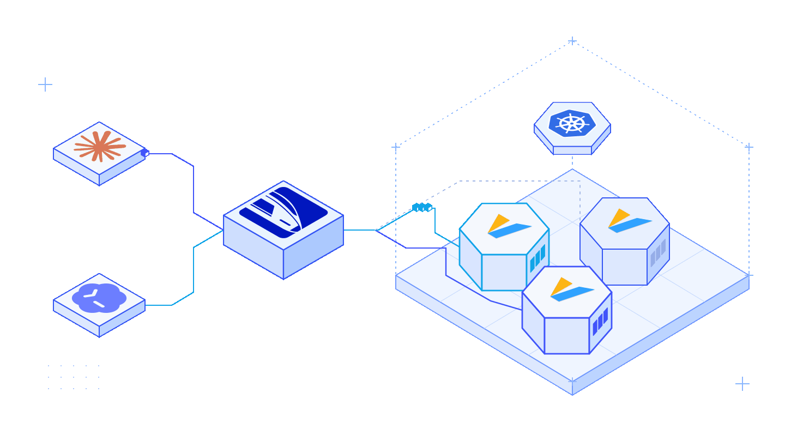

LiteLLM 現在支援 **Kubernetes 上自架推論的快取感知路由**。在同一個部署內，來自同一個工作階段的請求會送往同一個 GPU pod。這讓 vLLM 能跨回合重複使用快取的提示前綴。

代理程式請求通常共享系統指令、工具定義與對話歷史。當請求抵達不同的 pod 時，每個 pod 可能都要重新處理相同的前綴。工作階段親和性有助於重複使用這些已完成的工作。

{/* truncate */}

## 讓工作階段固定在同一個 GPU pod {#keep-a-session-on-one-gpu-pod}

LiteLLM 透過 Kubernetes headless Service 探索 pod IP。它使用工作階段 ID 透過 rendezvous hashing 選擇 pod，然後將請求直接送往該 pod。

## 開始使用 {#get-started}

[閱讀快取感知路由設定指南](https://docs.litellm.ai/docs/proxy/cache_aware_routing)。
