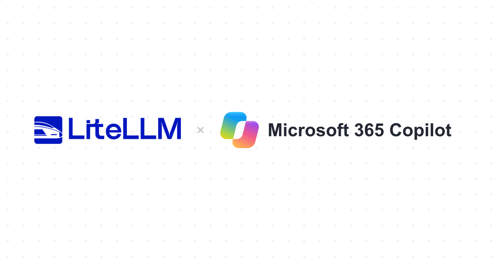

import CopilotHero from './CopilotHero';

export const Hero = CopilotHero;

**Microsoft 365 Copilot 現已成為 LiteLLM 的提供者。** 從您的應用程式使用它，就您的 Microsoft 365 工作資料提問。

使用者以其 Microsoft 工作帳戶登入，並提出像是「總結我最近一次會議。」這樣的問題。Copilot 會使用他們已有權限存取的資料來回答。

{/* truncate */}

連接支援 Microsoft Entra SSO 的應用程式，並轉送每位使用者的 access token。每位使用者都需要 Microsoft 365 Copilot 授權，且 LiteLLM 要求企業版 JWT 驗證。

管理員可以設定[自訂定價](https://docs.litellm.ai/docs/proxy/custom_pricing#override-model-cost-map)來追蹤使用成本。

[設定 Microsoft 365 Copilot →](/docs/providers/microsoft_365_copilot)
