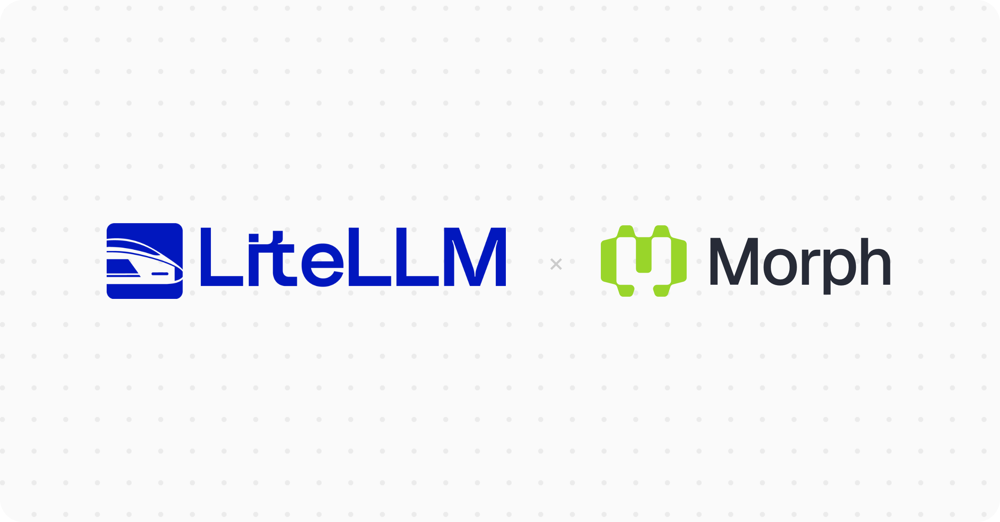

您現在可以透過 LiteLLM 使用 Morph 的開放權重聊天模型，以及它既有的 Fast Apply 模型。使用 `morph/` 前綴與一把 Morph API 金鑰，將請求路由到 Kimi K3、GLM-5.3 或 DeepSeek V4.1 Flash。

{/* truncate */}

[Morph](https://www.morphllm.com/) 在針對程式碼產生最佳化的推論堆疊上提供這些模型。此整合支援工具呼叫、結構化輸出、推理控制與串流。透過 LiteLLM AI Gateway，您可以在與其他提供者相同的地方管理模型存取、預算與請求記錄。

## 開始使用 {#get-started}

在 gateway 的環境中設定 `MORPH_API_KEY`，並將一個模型加入 `config.yaml`。

```yaml
model_list:
  - model_name: morph-deepseek
    litellm_params:
      model: morph/morph-dsv41flash
api_key: os.environ/MORPH_API_KEY
```

您的應用程式接著可以透過 gateway 的 `/v1/chat/completions` 端點請求 `morph-deepseek`。安裝方式與完整的請求範例，請參閱 [Morph 提供者指南](/docs/providers/morph)。

## 可用模型 {#available-models}

Morph 提供 Kimi K3 與 Kimi K3 Fast、GLM-5.3 與 GLM-5.3-Flash、DeepSeek V4.1 Flash 及其 1017 版本，以及 DeepSeek V4 Flash 0731。Morph 文件記載這些模型具有 1M-token 的上下文視窗。

DeepSeek V4.1 Flash Abliterated 也提供給獲得 [Morph 核准](https://docs.morphllm.com/sdk/components/fast-models#deepseek-uncensored) 的帳戶。既有的 `morph-v3-fast` 與 `morph-v3-large` 模型仍可用於套用程式碼編輯。

## Prompt 快取 {#prompt-caching}

Morph 會自動快取重複的 prompt 前綴。LiteLLM 讀取回傳的 token 使用量，並套用該模型的快取輸入費率。新的前綴以一般輸入費率計費，沒有額外的快取寫入費用。

對於對話，請在各回合之間重複使用 `x-session-id` 標頭，以提高快取命中率。將穩定的 prompts 與工具定義放在每個請求的開頭。提供者指南說明了如何傳遞該標頭，以及如何從串流回應中讀取快取的 token 數量。

費率請參閱 [Morph 的定價](https://www.morphllm.com/pricing)，快取會計細節請參閱[提供者指南](/docs/providers/morph)。
