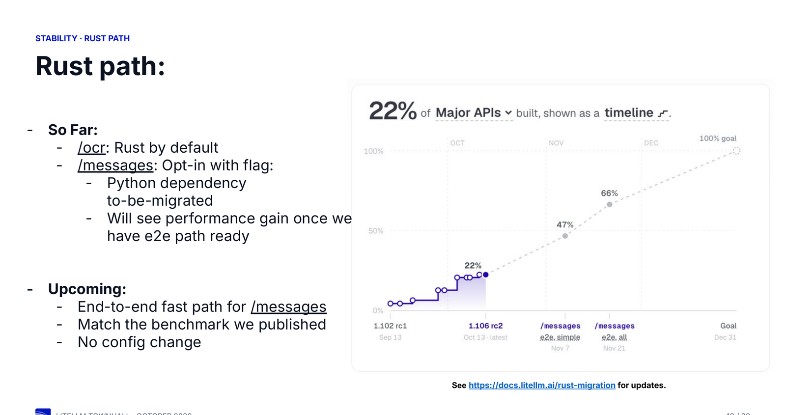
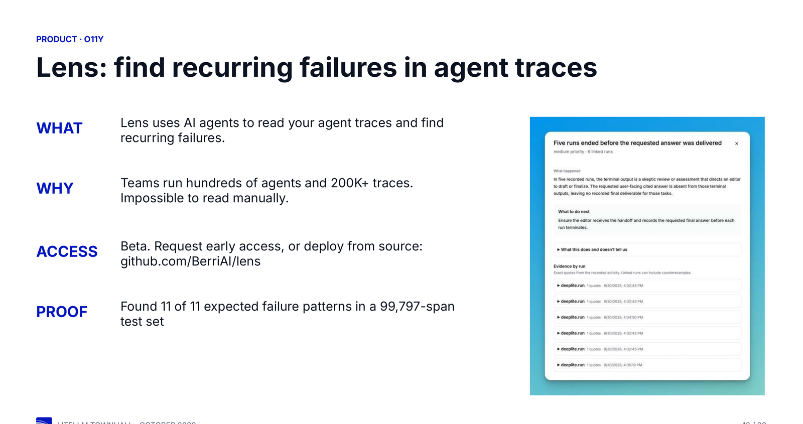
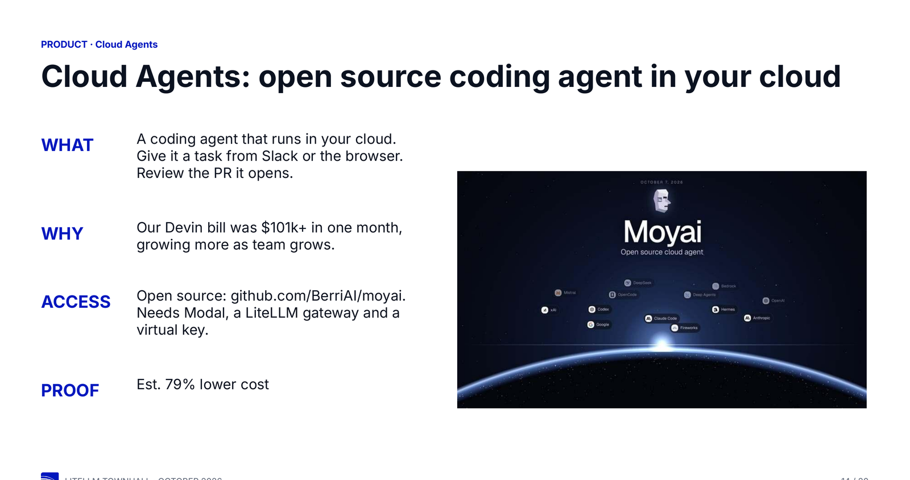
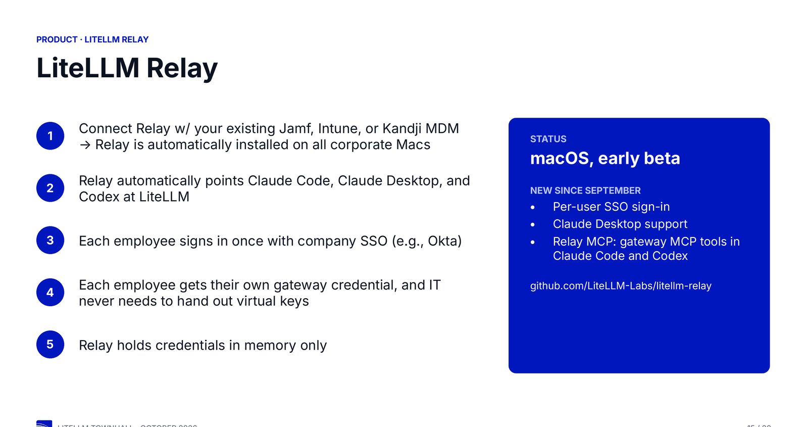

感謝所有參加我們十月 town hall 的人。我們涵蓋了安全性、穩定性與效能工作，以及本月的產品更新。

{/* truncate */}

## 安全性 {#security}

10 月 21 日，我們的發布管線發布了一個被入侵的 `litellm==1.107.0`。[攻擊鏈文章](https://docs.litellm.ai/blog/security-incident-oct-21-2026-attack-chain) 有完整紀錄與應對方式。

我們在 9 月 24 日至 10 月 12 日之間的穩定版本中發布了 65 個安全修復，依類別細分如下：

| 類別                          | 修復數 |
| ----------------------------- | ----- |
| 憑證 / 秘密 / PII             | 18    |
| 一般強化                      | 18    |
| 配額 / 預算 / 速率限制        | 15    |
| 存取控制 / 授權               | 14    |

**有三個變更需要在您升級前採取行動。**

| 變更                                                                      | 版本     |
| ------------------------------------------------------------------------- | -------- |
| 沒有強式 master key 時，proxy 不會啟動                                    | v1.104.0 |
| STDIO MCP 伺服器已關閉。`LITELLM_ENABLE_MCP_STDIO=true` 可將其開啟        | v1.104.0 |
| `/sso/debug` 已關閉。`ENABLE_SSO_DEBUG=true` 可將其開啟                   | v1.105.0 |

- 我們正在將安全團隊擴編一倍，增加第二個專責人力。
- 重心從被動反應轉為主動預防。
- 我們正在將如何處理漏洞、揭露與客戶安全請求正式化。

## 穩定性 {#stability}

十月我們發布了 **426 個錯誤修復**。

| 領域                          | 修復數 |
| ----------------------------- | ----- |
| 提供者                        | 120   |
| 支出、預算、可觀測性          | 94    |
| Proxy 核心                    | 82    |
| 串流 / 即時                   | 40    |
| UI、auth、SSO                 | 40    |
| MCP gateway                   | 27    |
| 其他 / SDK                    | 23    |

提供者占了最大比例，那也是模型發布或 API 變更最先顯現的地方。

- **覆蓋率。** 九月為 83.5%，今天為 **88.4%**。
- **使用者旅程。** 從 521 條增加到 7,048 條已涵蓋，對比十月 600 條的目標。
- **每個版本** 現在執行 7,048 個整合測試、877 個端到端測試與 3 個效能 benchmark。
- **路線圖。** 在 [issue #30484](https://github.com/BerriAI/litellm/issues/30484) 中追蹤。

### gateway 在哪裡變快了 {#where-the-gateway-got-faster}

| 指標                                     | 之前    | 之後    |
| ---------------------------------------- | ------- | ------- |
| 440K-token prompts 的第一個位元組時間    | 553 ms  | 35 ms   |
| 每個請求的 Redis 來回次數                | 22      | 8       |
| 5,000+ 把金鑰時的使用量頁面載入          | 6+ min  | 3.2 s   |

`litellm-core` 的安裝也小了 65.6 MB。

### Rust 路徑 {#rust-path}

OCR 預設在 Rust 上執行，而 `/v1/messages` 是旗標後方的選擇性功能。

- `/v1/messages` 仍有一個 Python 相依性要遷移，因此速度會隨著端到端路徑一起到來。
- 進度公開於 [docs.litellm.ai/rust-migration](https://docs.litellm.ai/rust-migration)，目前為 22%。

## 產品 {#product}

### Decisions API {#decisions-api}

`/v1/decisions` 針對一個輸入提出是非題、多選題或評分問題，並為每個答案回傳一個機率。

- 金鑰、預算、支出、備援與防護欄全部適用。
- 提供者：OpenAI、Perplexity、TypeSafe Jev、OpenRouter、Cloudflare、vLLM、Azure AI、Strands Decider、Databricks、Fireworks AI、Laya、Bespoke 與 Nace。
- **JevRank** 將那些模型放在 rerank API 後方，讓您無需變更應用程式就能換掉一個 rerank 呼叫。[JevRank 文章](https://docs.litellm.ai/blog/jevrank) 有 SciFact 結果。
- 設定請參閱 [decisions 文件](https://docs.litellm.ai/docs/decisions)。

### Auto Router {#auto-router}

- 使用任何決策模型作為分類器。
- 自架的 OSS 分類器 Laya 與 Bespoke Nimble 將在下一個版本推出。
- 上下文壓縮預設開啟。Prompt 快取成本路由是選擇性功能。
- 每個 router 的 tokens、成本與節省將在下一個版本推出。

### Lens {#lens}

Lens 使用 AI agents 讀取您的 agent traces 並找出重複出現的失敗。團隊執行數百個 agents 與 20 萬筆以上的 traces，沒有人會用人工方式閱讀。

- 它在一個 99,797 個 span 的測試集中，找到了 11 個預期失敗模式中的 11 個。
- Beta。申請早期存取，或從原始碼部署：[github.com/BerriAI/lens](https://github.com/BerriAI/lens)。

### Moyai {#moyai}

Moyai 是一個在您的雲端中執行的開源編碼 agent。從 Slack 或瀏覽器交給它一項任務，然後審查它開啟的 pull request。

- 我們自己的 Devin 帳單在單一個月內超過 $101k，而且隨著團隊成長。
- Moyai 的估計成本低 79%。
- 它需要 Modal、一個 LiteLLM gateway 與一把虛擬金鑰：[github.com/BerriAI/moyai](https://github.com/BerriAI/moyai)。

### LiteLLM Relay {#litellm-relay}

Relay 連接到您既有的 Jamf、Intune 或 Kandji MDM，安裝在每台公司 Mac 上，然後將 Claude Code、Claude Desktop 與 Codex 指向 LiteLLM。

- 每位員工以公司 SSO 登入一次，並取得自己的 gateway 憑證，因此 IT 永遠不需要發放虛擬金鑰。
- Relay 只將憑證保存在記憶體中。
- 自九月以來的更新：依使用者的 SSO 登入、Claude Desktop 支援，以及在 Claude Code 與 Codex 中使用 gateway MCP 工具的 Relay MCP。
- macOS 早期 beta 位於 [github.com/LiteLLM-Labs/litellm-relay](https://github.com/LiteLLM-Labs/litellm-relay)。

### 透過 gateway 使用 Claude Code 與 Codex {#claude-code-and-codex-through-the-gateway}

- 在 Claude Code 中，執行 `/login` 並選擇 "Cloud gateway"。在 Codex 中，以 `lite codex` 登入。
- Refresh tokens 將在下一個版本推出，讓您保持登入 14 天。之前，使用者每 24 小時登入一次。

### Handoff，我們的雲端 agent 工作坊 {#handoff-our-cloud-agent-workshop}

Handoff 於 10 月 26 日至 11 月 9 日遠距舉行。在 [handoff.litellm.ai](https://handoff.litellm.ai) 報名。

### 路線圖 {#roadmap}

- **現在。** 強化 CI/CD 與產品安全性，在 12 月 1 日前完成 Rust 遷移，並減少迴歸。
- **未來一到兩個月。** 解決一千多個開啟中的 GitHub issues，並改善開發者體驗。
- **未來三到六個月。** 為在 LiteLLM 上建立生產 agents 的開發者打造核心工作流程。

## 我們正在招募 {#were-hiring}

我們在核心 gateway 方面有多個職缺，以及兩個新的安全職缺。請透過 [recruiting@berri.ai](mailto:recruiting@berri.ai) 與我們聯絡，產品回饋請寄到 [product@berri.ai](mailto:product@berri.ai)。

感謝您使用 LiteLLM。**LiteLLM 團隊**
