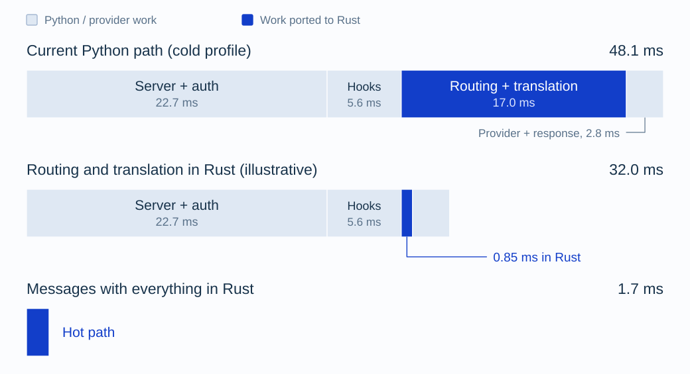
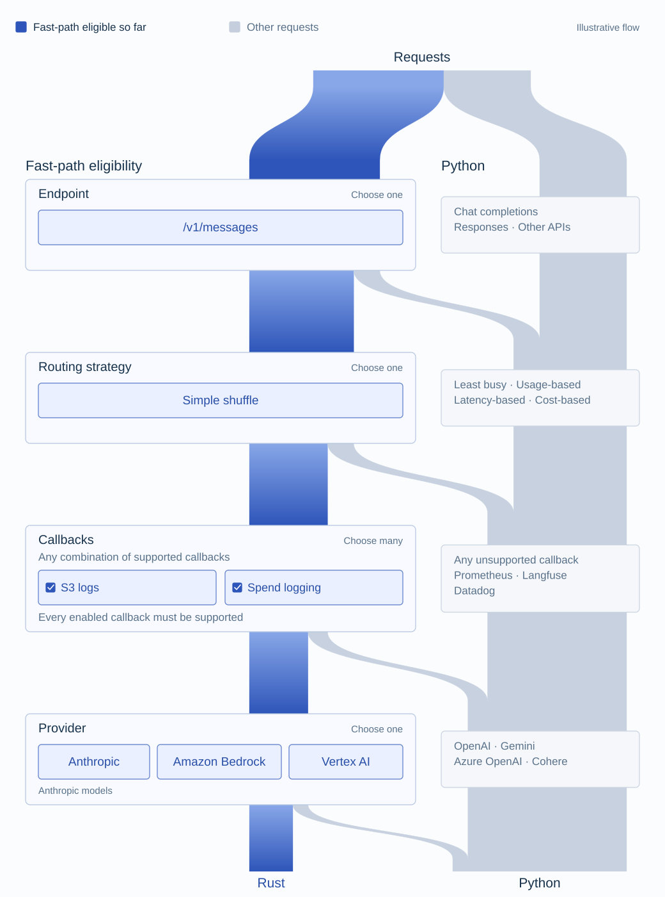
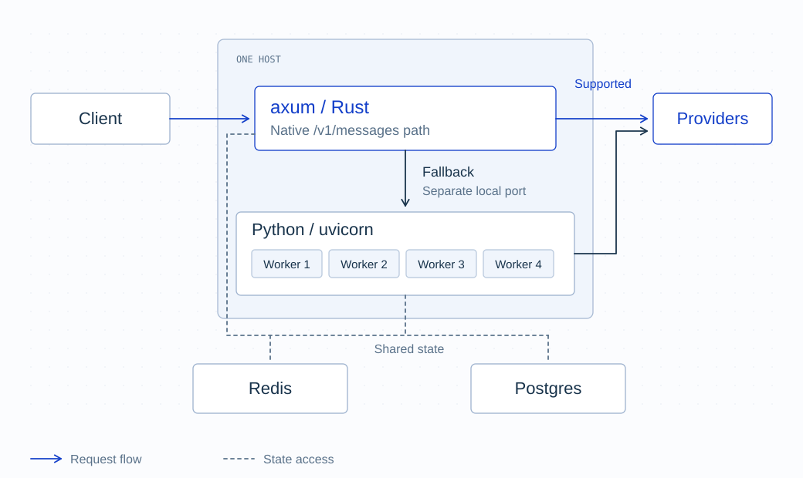

import RequestFlowHero from './RequestFlowHero';

export const Hero = RequestFlowHero;

Rust 遷移計畫將略微調整方向，以便盡快將最大的效能改善帶給最大比例的請求。我們將聚焦於傳送至原生支援 Anthropic 風格 API 的提供者的 `/v1/messages` 請求，並啟用最常見的一組 proxy 功能。到 12 月 1 日，您可以期待 proxy 以常見設定處理這些請求時，延遲約降低至原來的 20 分之一。

{/* truncate */}

先前，LiteLLM 讓 proxy 伺服器以 Rust 高速運作的路線是從底層往上建構。我們原先會先移植轉譯層，該層負責將某個提供者的請求轉換成另一個提供者的格式。接著，我們會移植核心路由邏輯，該邏輯負責為給定請求選出特定的部署。最後，我們才會遷移實際的 proxy 網頁伺服器。

這種做法能讓我們在移動相依項目時獲得最乾淨的界線，但也意味著使用者要等待更久才能看到真正的成效。即使轉譯層與路由器都已移植，一個請求仍然必須：

- 在進入時通過 FastAPI 伺服器與認證
- 在進入時檢查快取，並在離開時填入快取
- 提供給 callbacks，以便修改標頭、從本文中移除敏感資訊，或寫入支出記錄

這些環節占據了請求處理時間的相當大一部分，因此即使我們讓請求的其他部分快 10 到 50 倍，最終整體效能提升仍只有約 2 倍。
在某些情況下，callback 需要被_提供_哪些內容的邊界定義不清，反而可能因為反覆跨越 Python 與 Rust 的邊界而讓情況稍微變差！

我們希望盡快為使用者帶來出色的體驗。這意味著我們將先遷移最大比例請求的熱路徑，然後逐步擴展，讓更多設定與請求納入這條快速通道。目前的焦點是傳送至原生支援 `/v1/messages` 的提供者的 `/v1/messages` 請求路徑。

完成這項工作後，您可以期待 `/v1/messages` 請求的延遲約為 1.5 毫秒。我們有更新且更具代表性的基準測試，涵蓋所有這些常見功能，將於近期公布。

我們將透過以 Axum 撰寫的 Rust 伺服器來實現這一點，該伺服器位於所有請求的前方。
將會有 callbacks 與路由器的 Rust 實作，供 Python 與 Rust 共同使用。
Python 模組將只是業務邏輯的薄殼，業務邏輯本身位於 Rust 中。
如此一來，我們能確保 Rust 與 Python 實作完全相容。

請求進入後會先抵達 Axum 伺服器。伺服器會在早期檢查它是否知道如何處理該請求。如果知道，請求就通過快速路徑。如果 Axum 伺服器_無法_處理該請求，該請求會被轉送至同一主機上的 Python worker。這幾乎與我們現有 Python 實作用來在 ASGI 伺服器的不同執行個體之間分享請求的機制完全相同。

我們建議在具有 4 個 vCPU 的主機上以 4 個 worker 執行 LiteLLM。在此設定下，起始的 Uvicorn 程序會先在適當的連接埠上開始監聽，然後產生 4 個 worker 程序。這些 worker 透過 Redis 與我們的 Postgres 資料庫彼此通訊。它們不保存有意義的持久狀態。進入的連線會由作業系統自動分配給各個 worker，因為它們在分流之前都持有該連接埠的控制代碼。

Rust 伺服器將能以類似方式與 Python 伺服器並行運作，且它使用完全相同的 Redis 與 Postgres 通訊協定，因此我們將確保無縫的備援切換。

到 12 月 1 日，您將能在標準設定下自行執行這台伺服器，並親眼看到速度的改善！請持續關注我們的做法的更多更新。
