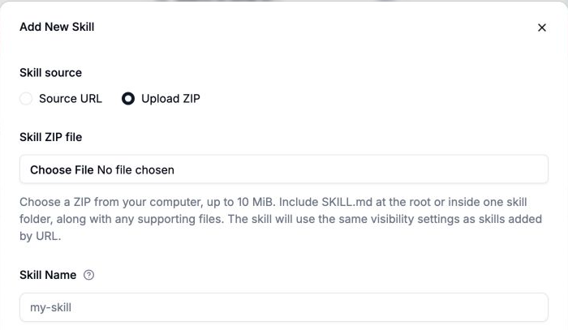
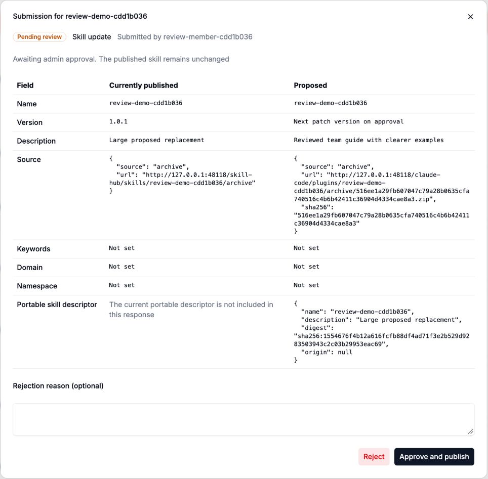
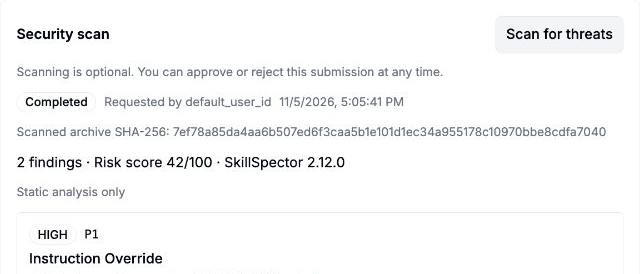
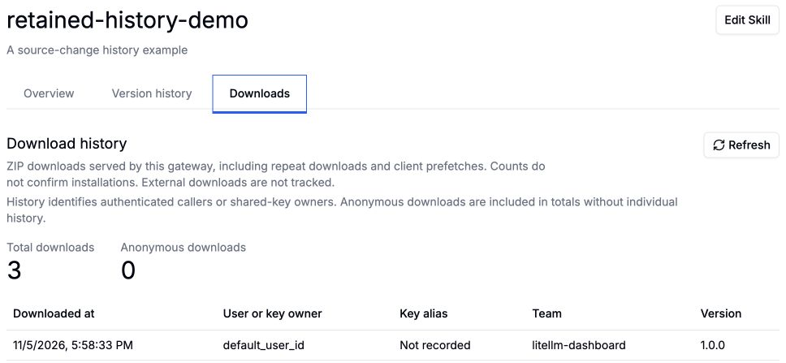

讓您的團隊有一個集中尋找與分享實用代理程式技能的地方。透過 **LiteLLM Skills Gateway**，團隊成員可以在自己的 AI 代理程式中重複使用某個技能的指示與支援檔案。

為了協助您管理這些技能，我們新增了：

- ZIP 上傳
- 管理員審查
- 版本歷程
- 下載追蹤

已在 [LiteLLM 1.110.x 版本](/release_notes/v1.110.0/v1-110-0)中提供。請升級至 v1.110.0 或更新版本以使用這些功能。

{/* truncate */}

## 上傳完整的技能 {#upload-a-complete-skill}

選擇 **Add Skill**，再選擇 **Upload ZIP**，然後選取包含 `SKILL.md` 及其支援檔案的 ZIP。

## 在發布前審查技能 {#review-skills-before-publication}

團隊成員可以提交新技能或提議更新。**管理員核准或拒絕提交內容** 後，團隊成員才能存取這些變更。管理員可以不經審查直接發布自己上傳的內容。

開啟 **Submissions**，將提議內容與已發布的技能進行比較，然後選擇 **Approve and publish** 或 **Reject**。

若已[設定掃描器](/docs/skills_gateway#optional-security-scans)，管理員可以選擇 **Scan for threats**，並在核准技能前檢視掃描結果。掃描是選擇性的，僅供參考；是否發布由管理員決定。

*測試技能的掃描範例，附有供管理員檢視的發現項目。*

## 保留較早的技能版本 {#keep-earlier-skill-versions}

以相同名稱更新技能即可發布新版本。您可以檢視其版本歷程，並從較早版本下載保留的 ZIP。

新技能從 `1.0.0` 開始。將下一次更新發布為 `1.0.1`，使用預設的修補版本遞增，或設定更高的版本號。

## 查看誰下載了您的技能 {#see-who-downloads-your-skills}

管理員可以檢視每個技能的**下載次數與經認證的下載歷程**，包括下載者與下載時間。利用這些記錄了解團隊成員採用了哪些技能，以及該向誰徵詢意見回饋。

*測試技能的下載歷程範例。*

匿名與重複下載會計入總數。共用金鑰會識別出金鑰的擁有者。下載記錄並不代表技能已被執行或完成安裝。

在 LiteLLM 儀表板中開啟 **Skills Hub**，即可分享您的團隊使用的技能。

[開始使用 Skills Gateway](/docs/skills_gateway)。
