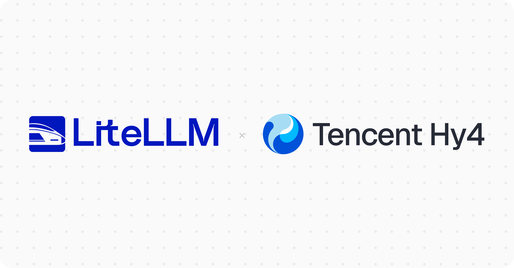

import Tabs from '@theme/Tabs';
import TabItem from '@theme/TabItem';



LiteLLM 透過 Tencent Cloud TokenHub 支援 [Tencent Hy4](https://www.tencent.com/tencent-launches-hy4-joining-the-ranks-of-the-worlds-leading-open-source-ai-models/)。使用與其他模型相同的 OpenAI 相容請求格式，並在 LiteLLM AI Gateway 中獲得支出追蹤、速率限制與記錄。

{/* truncate */}

## Tencent Hy4 定價 {#tencent-hy4-pricing}

**目前價格包含 TokenHub 的五折優惠**，優惠至**北京時間 2026 年 12 月 31 日 23:59:59** 止。價格以美元計，每 1M tokens，來自 [TokenHub 的國際定價頁面](https://www.tencentcloud.com/document/product/1300/78937)。

| Token 類型 | 目前價格 | 定價 |
|---|---:|---:|
| 輸入 | **$0.417** | $0.834 |
| 輸出 | **$1.2505** | $2.501 |
| 快取輸入 | **$0.021** | $0.042 |

Hy4 preview 的價格相同。促銷結束後，TokenHub 將恢復以定價計費。

## Hy4 的新功能 {#whats-new-in-hy4}

Hy4 在 preview 模型的推理、函式呼叫與結構化輸出之外，加入了影像理解。Tencent 表示其在長時間執行的代理程式任務上有改進，並引入 computer-use 功能。

[TokenHub 列出](https://www.tencentcloud.com/document/product/1300/78934) 1M-token 上下文視窗，最多 **960,000 個輸入 tokens** 與 **64,000 個輸出 tokens**。此版本請使用 `hy4`；`hy4-preview` 仍是獨立的模型 ID。

## 透過 LiteLLM 使用 Tencent Hy4 {#use-tencent-hy4-with-litellm}

使用 Tencent 的 [quickstart](https://www.tencentcloud.com/document/product/1300/78939) 建立 TokenHub API 金鑰，然後在您的終端機中匯出：

```bash
export TENCENT_API_KEY="YOUR_TENCENT_API_KEY"
```

<Tabs>
<TabItem value="proxy" label="LiteLLM Proxy">

**1. 將此內容儲存為 `config.yaml`**

```yaml
model_list:
  - model_name: hy4
    litellm_params:
      model: tencent/hy4
      api_key: os.environ/TENCENT_API_KEY

general_settings:
  master_key: os.environ/LITELLM_MASTER_KEY
```

**2. 啟動 proxy**

產生本機 proxy 金鑰並啟動 [v1.108.5 image](https://github.com/BerriAI/litellm/releases/tag/v1.108.5)：

```bash
export LITELLM_MASTER_KEY="sk-$(openssl rand -hex 24)"

docker run -d --name litellm-hy4 \
  -p 127.0.0.1:4000:4000 \
  -e TENCENT_API_KEY \
  -e LITELLM_MASTER_KEY \
  -v "$(pwd)/config.yaml:/app/config.yaml:ro" \
  ghcr.io/berriai/litellm:v1.108.5 \
  --config /app/config.yaml
```

**3. 測試**

proxy 就緒後，在同一個終端機中執行：

```bash
curl --fail-with-body http://localhost:4000/v1/chat/completions \
  -H "Content-Type: application/json" \
  -H "Authorization: Bearer $LITELLM_MASTER_KEY" \
  -d '{
    "model": "hy4",
    "messages": [{"role": "user", "content": "Write a Python function that checks whether a number is prime."}]
  }'
```

回應會在 `choices[0].message.content` 中包含產生的答案。

</TabItem>
<TabItem value="sdk" label="LiteLLM Python SDK">

安裝 LiteLLM，然後在已設定 `TENCENT_API_KEY` 的情況下執行 Python 範例：

```bash
pip install --upgrade litellm
```

```python
from litellm import completion

response = completion(
    model="tencent/hy4",
    messages=[
        {"role": "user", "content": "Write a Python function that checks whether a number is prime."}
    ],
)

print(response.choices[0].message.content)
```

</TabItem>
</Tabs>

對於既有的 proxy，將模型項目加入您的設定並重新啟動 proxy。若要刷新其定價，請開啟 **Models + Endpoints → Price Data → Reload Price Data**，或以管理員身分呼叫 `POST /reload/model_cost_map`。請保持預設的遠端成本對照表啟用：固定版本的 image 所附對照表早於 Hy4 項目。

## 常見問題 {#faq}

### 我該使用哪個提供者前綴與 API 金鑰？ {#which-provider-prefix-and-api-key-do-i-use}

使用 `tencent/hy4` 搭配 `TENCENT_API_KEY`。LiteLLM 預設使用 TokenHub 的國際端點。區域覆寫請參閱 [Tencent 提供者指南](/docs/providers/tencent)。

### Hy4 接受影像嗎？ {#does-hy4-accept-images}

可以。在您的訊息中送出文字與 `image_url` 內容部分。最終版 Hy4 加入了視覺功能；Hy4 preview 僅支援文字。

## 意見回饋 {#feedback}

對 Hy4 在 LiteLLM 上的使用有疑問嗎？請在 [GitHub Discussions](https://github.com/BerriAI/litellm/discussions) 分享您的使用案例或回報問題。
