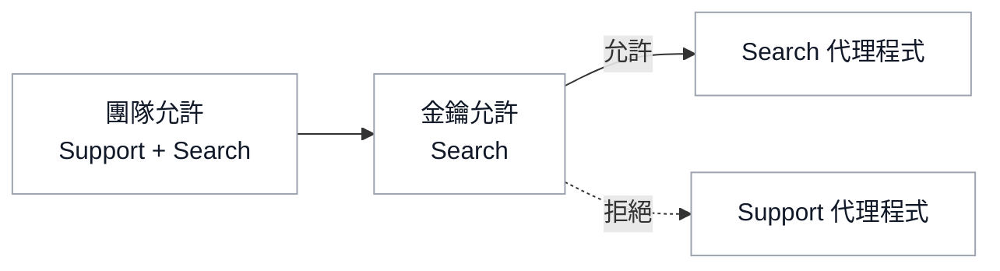

# 代理程式存取 {#agent-access}

{/* keep-version-note */}

以 [proxy 管理員](../access_control.md#global-proxy-roles)身分登入，並[註冊您的代理程式](../../a2a.md#adding-your-agent)。

## 讓團隊取得存取權 {#give-a-team-access}

開啟 **Teams → Create Team**。展開 **Agent Settings**，選取 **Allowed Agents**，然後建立團隊。

若要在多個團隊間重複使用同一份代理程式清單，請指派[存取群組](../access_groups.md#5-attach-the-access-group-to-a-team)。

## 讓應用程式取得存取權 {#give-an-application-access}

開啟 **Virtual Keys → Create New Key**。為金鑰命名並選取其團隊。在 **Agent Settings** 底下選擇應用程式需要的代理程式，然後按一下 **Create Key**。正式環境的應用程式請使用[服務帳號金鑰](../service_accounts.md#usage)。

[](../../../img/agent_key.png "開啟全尺寸截圖")

未選取任何代理程式的金鑰會繼承其團隊的存取權。當兩者都有限制時，代理程式必須同時被兩者允許，包括任何存取群組的授權。



若要要求非管理員金鑰必須有明確的代理程式權限，請在 proxy 設定中設定 `general_settings.agent_access_default_deny: true`。<SinceVersion v="1.108.0" />

## 讓代理程式代表呼叫者行事 {#act-for-the-caller}

呼叫代理程式的權限，與該代理程式呼叫模型、MCP 伺服器或其他代理程式的權限是分開的。請給代理程式它自己的虛擬金鑰，然後在它的下游請求中轉送呼叫者的情境資訊。

使用已註冊代理程式的 `agent_id` 建立金鑰。請將範例 ID 換成您的代理程式與其團隊；選擇該團隊允許的模型：

```bash
curl "$LITELLM_BASE_URL/key/generate" \
  -H "Authorization: Bearer $LITELLM_ADMIN_KEY" \
  -H "Content-Type: application/json" \
  -d '{
    "key_alias": "support-agent",
    "agent_id": "registered-agent-id",
    "team_id": "agent-team-id",
    "models": ["gpt-4o"]
  }'
```

將傳回的金鑰儲存為 `AGENT_API_KEY`。依需要設定它的 [MCP](./mcp.md) 與下游代理程式授權。沒有 `agent_id` 的金鑰不會套用此處所述的呼叫者限制。

呼叫者使用自己的憑證呼叫 `POST /a2a/{agent_id}`。LiteLLM 會將解析出的身分以 `X-LiteLLM-User-Id` 與 `X-LiteLLM-Team-Id`（若存在）轉送給代理程式後端。請只接受來自已驗證閘道請求的這類情境資訊。

在您的代理程式請求處理常式中，使用代理程式自己的金鑰轉送這些標頭。例如，使用 FastAPI 與 OpenAI Python SDK：

```python
import os

from fastapi import Request
from openai import AsyncOpenAI

client = AsyncOpenAI(
    api_key=os.environ["AGENT_API_KEY"],
    base_url=f"{os.environ['LITELLM_BASE_URL'].rstrip('/')}/v1",
)

async def call_model(request: Request):
    caller_headers = {
        name: request.headers[name]
        for name in ("X-LiteLLM-User-Id", "X-LiteLLM-Team-Id")
        if request.headers.get(name)
    }
    return await client.chat.completions.create(
        model="gpt-4o",
        messages=[{"role": "user", "content": "Summarize this support request."}],
        extra_headers=caller_headers,
    )
```

在 MCP 與代理程式對代理程式的請求中也轉送相同的標頭。LiteLLM 會進一步限制代理程式自身的權限：

- **模型：**套用呼叫者團隊的模型存取權與每位成員的限制；若沒有呼叫者團隊，則套用呼叫者使用者的模型清單。
- **MCP：**呼叫者團隊與使用者的權限可以縮小伺服器與工具的範圍。
- **其他代理程式：**套用呼叫者團隊的代理程式授權。

這些標頭無法擴大代理程式的授權。它們不會帶入呼叫者的虛擬金鑰限制，也不會選取呼叫者的上游 OAuth 憑證。缺少標頭時，代理程式自身的權限維持有效。模型請求的 `user` 欄位是另外的歸屬與客戶預算情境資訊。

使用代理程式可以存取但呼叫者無法存取的資源進行測試；下游請求應該被拒絕。更完整的設定請參閱[存取繼承](./inheritance.md)與[共用代理程式操作指南](/blog/ai-gateway-identity-and-finops)。

## 透過 IdP 管理存取 {#manage-access-through-your-idp}

[同步使用者與團隊](../identity_provisioning.md)，再將代理程式權限指派給這些團隊。應用程式可以透過 [JWT 金鑰對應](../jwt_key_mapping.md)使用 IdP token 進行驗證。

## 測試存取 {#test-access}

使用應用程式的靜態 API 憑證或對應的 JWT 呼叫 `GET /v1/agents`，列出其允許的代理程式。先呼叫一個允許的代理程式，再呼叫一個已註冊但不在權限範圍內的代理程式。被封鎖的 `POST /a2a/{agent_id}` 呼叫會傳回 `403 Forbidden`。

[代理程式權限 API 範例](../../a2a_agent_permissions.md)

## 變更或移除存取權 {#change-or-remove-access}

開啟金鑰或團隊，選取 **Settings → Edit Settings**，更新 **Agents / Access Groups**，然後按一下 **Save Changes**。移除任何同樣允許該代理程式的存取群組授權。

清除選取項目可以還原繼承的存取權。若要停止某個應用程式的所有請求，請開啟該金鑰的操作選單並選擇 **Block Key** 或 **Delete Key**。
