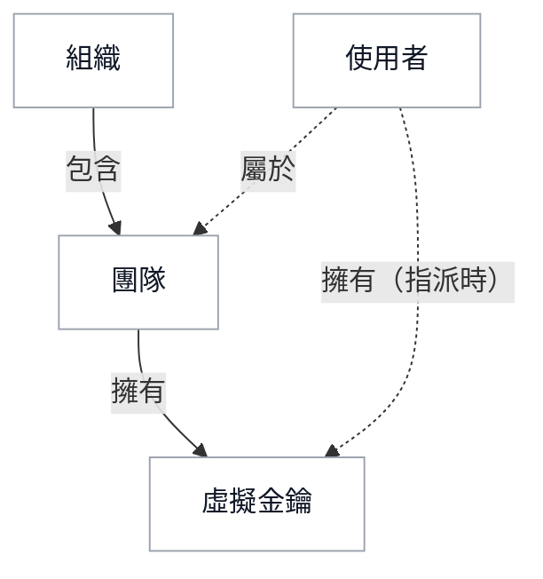

# 存取繼承 {#access-inheritance}

{/* keep-version-note */}

權限可以指派給組織、團隊、使用者與虛擬金鑰。LiteLLM 會檢查這些權限，決定請求可以存取哪些模型、MCP 伺服器與代理程式。本頁說明權限如何繼承與檢查。

虛擬金鑰可以指派給團隊與使用者。下表說明團隊、使用者與組織的權限如何影響金鑰可以存取的內容。

## 指派給團隊的金鑰 {#keys-assigned-to-a-team}

使用者可以屬於多個團隊，但虛擬金鑰使用的是指派給它的團隊權限。[代表呼叫者行事的代理程式](./agents.md#act-for-the-caller)也可以轉送該呼叫者的使用者與團隊 ID。

| 資源 | 金鑰與團隊 | 使用者與組織 |
| --- | --- | --- |
| **模型** | 金鑰與團隊都必須允許該模型。存取群組可以允許額外的模型，詳見下文。 | 團隊成員的模型限制可以進一步限制存取。使用者的模型清單適用於沒有團隊的金鑰。LiteLLM 會在建立或更新團隊時檢查組織的模型清單，不會在每個請求上另外做組織模型檢查。 |
| **MCP 伺服器與工具** | 金鑰與團隊都必須允許該伺服器。未設定任何 MCP 伺服器的金鑰，預設會繼承其團隊的伺服器。工具權限也會一併檢查。 | 使用者與組織的權限可以進一步限制伺服器與工具。 |
| **代理程式** | 金鑰與團隊都必須允許該代理程式。未設定代理程式限制的金鑰會繼承其團隊的存取權。 | 團隊金鑰沒有額外的使用者或組織代理程式限制。 |

例如，若團隊允許 **Search** 與 **Support**，而其金鑰只允許 **Search**，該金鑰就只能呼叫 Search 代理程式。

### 存取群組可以擴大存取範圍 {#access-groups-add-grants}

指派給金鑰的已授權[存取群組](../access_groups.md)可以允許其團隊不允許的模型與 MCP 伺服器。至於代理程式，團隊也必須允許該代理程式。移除存取權時，請一併檢查存取群組權限與金鑰本身的權限。

標示為[所有金鑰皆可使用](../../mcp_control.md#public-mcp-servers-allow_all_keys)的 MCP 伺服器也可以授予存取權。設定 `general_settings.mcp_allow_all_keys_respects_mcp_scope: true`，即可把虛擬金鑰的 MCP 限制套用到這些伺服器。

## 沒有團隊的金鑰 {#keys-without-a-team}

個人金鑰只有在金鑰與其使用者都允許時才能呼叫模型。若使用者設有 `no-default-models`，其個人金鑰就無法呼叫模型。

預設情況下，個人金鑰不會繼承其使用者所屬團隊的權限。設定 `litellm_settings.personal_key_model_access_from_teams: true` 後，使用者的團隊中至少要有一個也允許該模型。此設定也會讓 MCP 伺服器與代理程式繼承使用者團隊的權限。上述 MCP 與代理程式權限檢查仍然適用。此設定預設為關閉。

[服務帳號金鑰](../service_accounts.md)屬於某個團隊，沒有使用者擁有者。金鑰的擁有者是被指派給它的使用者，可能與建立它的管理員不同。

## 空的選取項目可以還原存取權 {#empty-selections-can-restore-access}

清除選取項目可以移除限制，或還原繼承的存取權。

| 選取項目 | 意義 |
| --- | --- |
| 金鑰模型清單為空 | 金鑰不加上任何模型限制。團隊與使用者的限制仍如上所述適用。**All Team Models** 使用指派團隊的模型清單。 |
| 金鑰沒有 MCP 選取項目 | 金鑰預設繼承其團隊的 MCP 伺服器。[要求每個金鑰都有明確的 MCP 權限](../../mcp_control.md#require-keys-to-define-their-own-mcp-access)即可關閉此行為。**No MCP Servers** 會封鎖該金鑰的所有 MCP 存取。 |
| 金鑰或團隊沒有代理程式限制 | 代理程式存取預設為開放。設定 `general_settings.agent_access_default_deny: true`，即可要求非管理員金鑰必須有明確的代理程式權限。 |

若要完全停止某個應用程式的請求，請封鎖或刪除其虛擬金鑰。

## 角色與限制 {#roles-and-limits}

[角色](../access_control.md)控制管理操作，例如建立金鑰或編輯團隊。模型、MCP 與代理程式權限控制金鑰可以呼叫的內容。[預算與速率限制](../users.md)限制使用量。金鑰自身的限制不會覆寫適用於該請求的其他限制。

設定方式請參閱 [LLM 存取](./llm.md)、[MCP 存取](./mcp.md)與[代理程式存取](./agents.md)。
