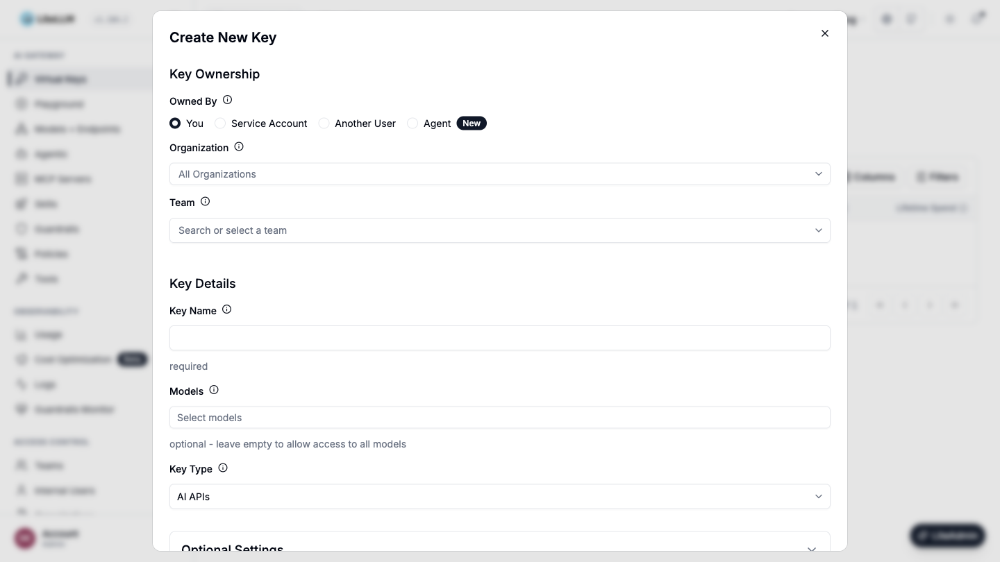

# LLM 存取 {#llm-access}

{/* keep-version-note */}

以 [proxy 管理員](../access_control.md#global-proxy-roles)身分登入，並[新增您的模型](../docker_quick_start.md#3-add-your-first-model)。

## 讓團隊取得存取權 {#give-a-team-access}

開啟 **Teams** 並建立團隊，或選取現有團隊並開啟 **Settings → Edit Settings**。在 **Models** 底下選取團隊需要的模型並儲存。

請使用在 LiteLLM 中設定的模型名稱，這些名稱可能與提供者的模型名稱不同。

## 讓應用程式取得存取權 {#give-an-application-access}

開啟 **Virtual Keys → Create New Key**。為金鑰命名，選取 **Team**，並選擇 **AI APIs** 作為金鑰類型。

在 **Models** 底下選取應用程式需要的模型，或選擇 **All Team Models**。按一下 **Create Key**。正式環境的應用程式請使用[服務帳號金鑰](../service_accounts.md#usage)。

直接選取模型時，金鑰與團隊都必須允許該模型。[模型存取群組](../model_access_groups.md#managing-access-groups-via-ui)可以授予額外的模型。

## 透過 IdP 管理存取 {#manage-access-through-your-idp}

[同步使用者與團隊](../identity_provisioning.md)，再將模型權限指派給這些團隊。應用程式可以透過 [JWT 金鑰對應](../jwt_key_mapping.md)使用 IdP token 進行驗證。

## 測試存取 {#test-access}

使用應用程式的靜態 API 憑證或對應的 JWT，執行[聊天補全範例](../docker_quick_start.md#6-call-the-gateway-from-your-app)。允許的模型應該可以成功執行。已設定但不在權限範圍內的模型應該會傳回模型存取錯誤。

## 變更或移除存取權 {#change-or-remove-access}

編輯團隊或金鑰的 **Models** 選取項目並儲存。移除任何同樣允許該模型的存取群組或萬用字元授權。

將金鑰的 **Models** 留空，表示在金鑰層級不加上任何限制。若要停止某個應用程式的所有請求，請開啟該金鑰的操作選單並選擇 **Block Key** 或 **Delete Key**。

[模型存取 API 範例](../model_access.md) · [金鑰權限規則](../key_auth_arch.md)
