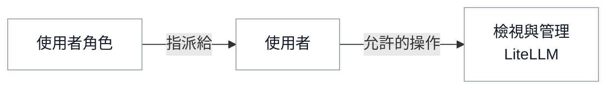

# 存取管理 {#access-management}

{/* keep-version-note */}

控制 LiteLLM 中模型、MCP 伺服器與代理程式的存取。

- [LLM 存取](./llm.md)
- [MCP 存取](./mcp.md)
- [代理程式存取](./agents.md)

## 使用者、團隊與虛擬金鑰 {#users-teams-and-virtual-keys}

在 LiteLLM 中建立使用者與團隊，或[從您的身分提供者 (IdP) 同步](../identity_provisioning.md)。

[虛擬金鑰](../virtual_keys.md)是使用者或團隊底下的子身分，擁有自己的權限、預算與速率限制。您可以使用其靜態 API 憑證進行驗證，或[將 JWT claims 對應到虛擬金鑰](../jwt_key_mapping.md)。

[服務帳號金鑰](../service_accounts.md)是由團隊擁有的虛擬金鑰，用於應用程式存取。

## 存取群組 {#access-groups}

[存取群組](../access_groups.md)定義團隊或虛擬金鑰可以使用哪些模型、MCP 伺服器與代理程式。您可以將同一個群組指派給多個團隊或金鑰。

若要在 IdP 中管理成員資格，請[使用 SCIM 同步使用者與群組](../../tutorials/scim_litellm.md)，再將存取群組指派給同步後建立的 LiteLLM 團隊。

## 角色 {#roles}

[角色與團隊成員權限](../access_control.md)定義使用者可以在 LiteLLM 中檢視與管理哪些內容，例如檢視使用量、建立金鑰或編輯團隊設定。[稽核記錄](../audit_logs.md)會記錄管理上的變更。

