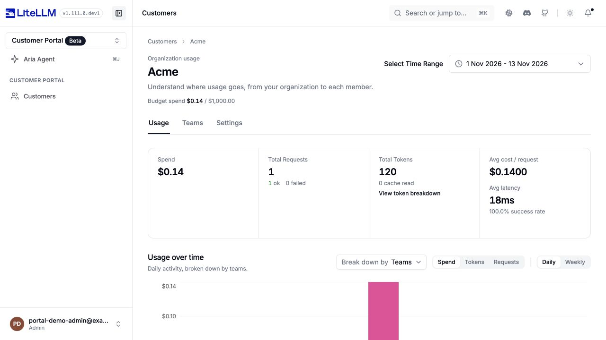
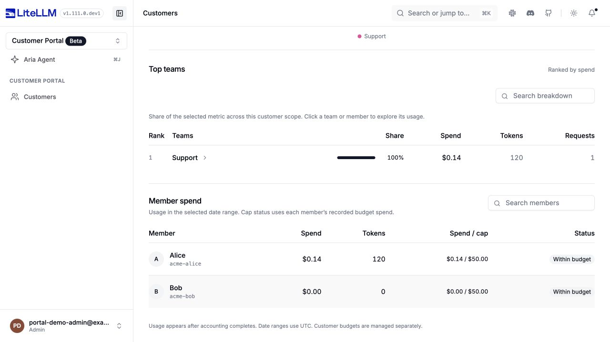
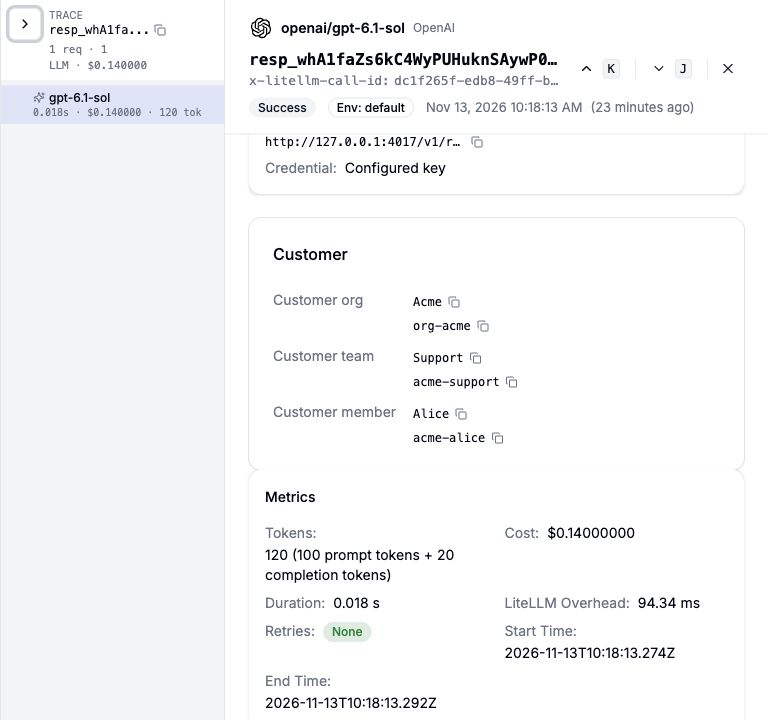

# 設定客戶 budget 並讀取使用量 {#set-customer-budgets-and-read-usage}

:::info

沒有 LiteLLM Enterprise 授權時，Customer Management 在 5 個客戶組織、每個組織 5 個客戶團隊、每個團隊 5 名客戶成員以內免費。自動建立的 `default` 團隊計入團隊上限。[LiteLLM Enterprise](https://www.litellm.ai/enterprise) 可移除這些限制。

:::

為您的客戶使用一個應用程式 API 金鑰。在每個請求中傳遞客戶的組織 alias 與成員 ID。LiteLLM 會解析成員的團隊與組織，檢查其 budget，並在三個層級記錄支出、token 與請求。

<SinceVersion v="1.111.0" />

請先參閱[客戶管理](../customers.md)，追蹤您的第一個請求。本指南說明如何在傳送流量之前建立有 budget 的客戶、新增團隊與成員，並從您的後端讀取使用量。Webhook 通知為選填。



*本機 Customer Management 在一次受控提供者請求後的使用情況，使用量讀自會計分類帳。*


## 免費層級限制 {#free-tier-limits}

會超過免費層級上限的管理建立操作會回傳 `403`。成員會在其 `parent_team_ids` 中的每個團隊各計入一次上限。

具有有效 virtual key 的請求會繼續運作，但仍受一般的驗證、模型存取、budget 與速率限制檢查約束。如果上限阻止自動註冊，新的組織 alias 或成員 ID 不會在該客戶層級被自動註冊或追蹤。Proxy 會記錄 `CUSTOMER TRACKING OFF` 警告。請求上已存在的客戶層級仍會被追蹤。

當任一免費層級上限達到時，Customers 儀表板會顯示橫幅。如果 Enterprise 授權失效，既有資料列仍會被追蹤，即使其數量超過免費層級上限。這些上限限制的是新的建立，而不是既有的追蹤。Proxy 管理員可以使用[限制 API](./api_reference.md#customer-management-limits) 檢查目前容量。

## 開始之前 {#before-you-start}

您需要一個執行中的 [LiteLLM Gateway](../docker_quick_start.md)、已套用客戶遷移的已連接 PostgreSQL 資料庫、您現有的應用程式 API 金鑰，以及用於管理與使用量讀取的 proxy 管理員金鑰。

請在您的應用程式環境，以及您執行 curl 的終端機中提供這些值：

| 變數 | 值 |
| --- | --- |
| `LITELLM_BASE_URL` | Gateway URL，不含 `/v1`，例如 `http://localhost:4000`。 |
| `LITELLM_MODEL` | 您的應用程式金鑰可以使用的既有 gateway 模型 alias。 |
| `LITELLM_API_KEY` | 您現有的應用程式 API 金鑰。同一個金鑰服務每個客戶。 |
| `LITELLM_ADMIN_KEY` | 用於 Customer Management、使用量與記錄讀取的 proxy 管理員金鑰。 |
| `START_DATE`、`END_DATE` | `YYYY-MM-DD` 格式的含起訖 UTC 日期。第一次執行時兩者都使用目前的 UTC 日期。 |

將金鑰保留在您的伺服器上。您的後端會先驗證客戶，並從該客戶的工作階段選擇身分標頭，然後才呼叫 LiteLLM。它也會在將使用量回傳給您的產品之前，先驗證客戶存取權。

## 1. 匯入客戶 {#2-import-a-customer}

先建立組織，然後建立其團隊與成員。使用您應用程式中的 ID，或在省略 ID 時儲存 LiteLLM 回傳的 ID。

### 建立組織與預設成員 budget {#create-the-organization-and-default-member-budget}

Acme 有 $1,000 的 budget。其預設成員範本給每位成員 $50 的 budget、$40 的軟性門檻與速率限制。

```bash title="POST /management/v1/customer_organizations"
curl --request POST "$LITELLM_BASE_URL/management/v1/customer_organizations" \
  --header "Authorization: Bearer $LITELLM_ADMIN_KEY" \
  --header "Content-Type: application/json" \
  --data '{
    "customer_org_id": "org-acme",
    "alias": "Acme",
    "budget": {
      "max_budget": 1000,
      "budget_duration": "30d"
    },
    "default_budgets": [
      {
        "name": "standard",
        "max_budget": 50,
        "soft_budget": 40,
        "budget_duration": "30d",
        "rpm_limit": 60,
        "tpm_limit": 100000
      }
    ],
    "default_budget_template": "standard"
  }'
```

預期回傳 `201 Created`。軟性 budget 是通知門檻，不會封鎖請求。[Webhook 傳遞](#1-set-up-budget-webhooks) 需要客戶 budget 回呼。

### 建立團隊 {#create-the-team}

```bash title="POST /management/v1/customer_teams"
curl --request POST "$LITELLM_BASE_URL/management/v1/customer_teams" \
  --header "Authorization: Bearer $LITELLM_ADMIN_KEY" \
  --header "Content-Type: application/json" \
  --data '{
    "customer_team_id": "acme-support",
    "parent_org_id": "org-acme",
    "alias": "Support",
    "budget": {
      "max_budget": 250,
      "budget_duration": "30d"
    }
  }'
```

預期回傳 `201`，且 `parent_org_id: "org-acme"`。

### 建立 Alice 與 Bob {#create-alice-and-bob}

建立每位成員時，在 `parent_team_ids` 中使用 Support 團隊的 ID。省略 `budget_id` 會選取 Acme 的預設成員範本。

```bash title="Create Alice"
curl --request POST "$LITELLM_BASE_URL/management/v1/customer_members" \
  --header "Authorization: Bearer $LITELLM_ADMIN_KEY" \
  --header "Content-Type: application/json" \
  --data '{
    "customer_member_id": "acme-alice",
    "parent_team_ids": ["acme-support"],
    "alias": "Alice"
  }'
```

```bash title="Create Bob"
curl --request POST "$LITELLM_BASE_URL/management/v1/customer_members" \
  --header "Authorization: Bearer $LITELLM_ADMIN_KEY" \
  --header "Content-Type: application/json" \
  --data '{
    "customer_member_id": "acme-bob",
    "parent_team_ids": ["acme-support"],
    "alias": "Bob"
  }'
```

每位成員預期回傳 `201`。讀取回應中的 `effective_budget` 以驗證繼承的 $50 上限。使用 `budget_id` 選取另一個範本，或使用 `budget_override` 自訂成員。目前的 API 會拒絕舊的 `budget_template_id` 欄位。

### 將電子郵件用作一個成員 ID {#add-an-email-preview}

若電子郵件字串在您的應用程式中是穩定且 gateway 範圍內唯一的 ID，您可以將其用作 `customer_member_id`。LiteLLM 會將其視為一個 ID；v1.111 沒有獨立的成員 `email` 欄位或 `x-litellm-customer-member-email` 查詢功能。若電子郵件可能變更，請使用應用程式擁有的 ID。

### 重複匯入 {#repeat-an-import}

以既有 ID 重複建立會回傳 `409`。取得該 ID，確認其父層，然後 patch 您需要變更的欄位。這讓您的後端能以現有 API 完成 upsert 流程。

```bash title="Retrieve the existing member"
curl "$LITELLM_BASE_URL/management/v1/customer_members/acme-alice" \
  --header "Authorization: Bearer $LITELLM_ADMIN_KEY"
```

確認 `parent_team_ids` 包含 `acme-support` 後，更新 Alice：

```bash title="Update the existing member"
curl --request PATCH "$LITELLM_BASE_URL/management/v1/customer_members/acme-alice" \
  --header "Authorization: Bearer $LITELLM_ADMIN_KEY" \
  --header "Content-Type: application/json" \
  --data '{
    "alias": "Alice"
  }'
```

組織與團隊也使用相同的建立、取得與更新流程。若要重複匯入組織與成員，請使用 [upsert 端點](./api_reference.md#retry-a-customer-import)。

## 2. 為 Alice 傳送請求 {#3-send-a-request-for-alice}

使用您現有的應用程式金鑰，並在請求標頭中傳遞 Alice 的身分：

```http
x-litellm-customer-org-alias: Acme
x-litellm-customer-member-id: acme-alice
```

LiteLLM 將 `acme-alice` 解析為 `acme-support`，再解析為 `org-acme`。相同的身分標頭適用於 Responses、Chat Completions 與 Anthropic Messages。

### OpenAI Responses SDK {#openai-responses-sdk}

在您的應用程式專案中執行 `pip install openai`。原始回應會公開 `x-litellm-call-id`，您可以用它在支出記錄中找到此請求。

```python
import os

from openai import OpenAI

client = OpenAI(
    api_key=os.environ["LITELLM_API_KEY"],
    base_url=f"{os.environ['LITELLM_BASE_URL'].rstrip('/')}/v1",
)
raw_response = client.responses.with_raw_response.create(
    model=os.environ["LITELLM_MODEL"],
    input="Write a short welcome message.",
    extra_headers={
        "x-litellm-customer-org-alias": "Acme",
        "x-litellm-customer-member-id": "acme-alice",
    },
)
response = raw_response.parse()
print(response.output_text)
print("LiteLLM call ID:", raw_response.headers.get("x-litellm-call-id"))
```

預期得到成功的 Responses 結果。LiteLLM 會檢查組織、團隊與成員的 budget、模型存取與速率限制，然後將使用量歸屬到三個記錄。

### LangChain Deep Agents {#langchain-deep-agents}

執行 `pip install deepagents langchain-openai`。使用支援工具呼叫的模型 alias。為已驗證客戶的請求設定模型：

```python
import os

from deepagents import create_deep_agent
from langchain_openai import ChatOpenAI

model = ChatOpenAI(
    model=os.environ["LITELLM_MODEL"],
    base_url=f"{os.environ['LITELLM_BASE_URL'].rstrip('/')}/v1",
    api_key=os.environ["LITELLM_API_KEY"],
    use_responses_api=True,
    default_headers={
        "x-litellm-customer-org-alias": "Acme",
        "x-litellm-customer-member-id": "acme-alice",
    },
)
agent = create_deep_agent(model=model)
result = agent.invoke({"messages": [{"role": "user", "content": "Say hello to Alice."}]})
print(result["messages"][-1].text)
```

為每個已驗證的請求選擇該客戶的標頭。當共用模型實例正在服務其他客戶時，不要變更其標頭。

既有成員 ID 不需要組織標頭即可解析其父層。有既有組織 alias 與新成員 ID 時，LiteLLM 會將成員註冊在 `org-acme:default` 下，並指派組織的預設成員範本。只有 alias 時，使用量歸屬到組織。

如需首次請求註冊與團隊選取，請參閱[推論身分標頭](./api_reference.md#attribute-inference-requests)。

若要以 JWT 而非標頭傳送客戶身分，請參閱[來自 JWT 聲明的客戶身分](./jwt-customer-identity.md)。

## 3. 為您的產品取得使用量 {#5-fetch-usage-for-your-product}

組織彙總端點會回傳日期範圍內完整的支出、token 與請求總計，不需分頁。它接受最多 100 個客戶組織 ID。

```bash title="Complete Acme usage"
curl --get "$LITELLM_BASE_URL/management/v1/customer_organizations/daily/activity/aggregated" \
  --header "Authorization: Bearer $LITELLM_ADMIN_KEY" \
  --data-urlencode "customer_org_ids=org-acme" \
  --data-urlencode "start_date=$START_DATE" \
  --data-urlencode "end_date=$END_DATE"
```

讀取回應最上層的 metadata：

```json title="Usage response excerpt from the local example"
{
  "metadata": {
    "total_spend": 0.14,
    "total_tokens": 120,
    "total_api_requests": 1
  }
}
```

日期為含起訖的 UTC 日，起訖最多相差 400 天。`total_spend` 是以 USD 計的成本。您可以在產品的定價或 chargeback 計算中使用它；此 API 不會建立發票或收款。金鑰明細顯示最高的金鑰，而總計包含每個金鑰。

### 團隊與成員使用量 {#team-and-member-usage}

```bash title="Support team usage, first page"
curl --get "$LITELLM_BASE_URL/management/v1/customer_teams/daily/activity" \
  --header "Authorization: Bearer $LITELLM_ADMIN_KEY" \
  --data-urlencode "customer_team_ids=acme-support" \
  --data-urlencode "start_date=$START_DATE" \
  --data-urlencode "end_date=$END_DATE" \
  --data-urlencode "page=1" \
  --data-urlencode "page_size=100"
```

```bash title="Alice's usage, first page"
curl --get "$LITELLM_BASE_URL/management/v1/customer_members/daily/activity" \
  --header "Authorization: Bearer $LITELLM_ADMIN_KEY" \
  --data-urlencode "customer_member_ids=acme-alice" \
  --data-urlencode "start_date=$START_DATE" \
  --data-urlencode "end_date=$END_DATE" \
  --data-urlencode "page=1" \
  --data-urlencode "page_size=100"
```

這些端點會對儲存的列分頁。跟隨 `metadata.has_more` 並遞增 `page` 直到它為 `false`。將每頁的總計加總一次；同一日期可能出現在多頁上。請參閱[分頁契約](./api_reference.md#usage-pagination)。不要將組織、團隊與成員的總計相加：它們包含相同的請求。

帳務在背景執行。如果成功請求後使用量尚未出現，請檢查帳務完成情況、UTC 日期與身分標頭。零成本模型可以回報請求與 token，但支出為 $0。

## 4. 取得 budget 與上限 {#6-fetch-budgets-and-caps}

取得 Acme 目前的 budget 支出與組織上限：

```bash title="Organization budget"
curl "$LITELLM_BASE_URL/management/v1/customer_organizations/org-acme" \
  --header "Authorization: Bearer $LITELLM_ADMIN_KEY"
```

取得 Support 團隊目前的支出與上限：

```bash title="Team budget"
curl "$LITELLM_BASE_URL/management/v1/customer_teams/acme-support" \
  --header "Authorization: Bearer $LITELLM_ADMIN_KEY"
```

取得 Alice 繼承的 budget 與生效中的覆寫：

```bash title="Member budget"
curl "$LITELLM_BASE_URL/management/v1/customer_members/acme-alice" \
  --header "Authorization: Bearer $LITELLM_ADMIN_KEY"
```

組織請讀取 `budget.max_budget`，團隊或成員請讀取 `effective_budget.max_budget`。相同的物件包含 `rpm_limit`、`tpm_limit`、模型限制與允許的模型。團隊或成員的有效 budget 結合其範本與生效中的覆寫；已到期的覆寫不再適用。

`spend` 是目前的 budget 計數器，`budget_usage` 列出每個 budget 視窗目前的計數器與 `reset_at`，`budget_reset_at` 記錄下一次重置。使用量讀取會依您選取的日期回報 UTC 日的歷史支出。重置會將計數器歸零，但不會清除該歷史。Budget 依另行設定的[budget 重置時區](../budget_reset_and_tz.md) 重置，因此視窗邊界不一定與 UTC 日對齊。若要在您的產品中解析成員的父層，請讀取其 `parent_org_id` 與 `parent_team_ids`。第一個團隊是其預設團隊。

開啟 **Customer Management → Customers**，選取 **Acme**，並選擇 **Select Time Range** 以包含您的請求。使用量頁面顯示支出、請求、token 與成員上限。在 **Break down by** 中選擇 **Teams** 以檢查 Support。



*本機 Customer Management 中的實際客戶記錄與會計資料。Alice 的受控提供者請求記錄了 $0.14 與 120 個 token。*

## 設定 budget webhooks（選填） {#1-set-up-budget-webhooks}

若您不需要 budget 通知，請跳過本節。請在您的產品中準備一個接受 JSON 並在 10 秒內回傳成功 `2xx` 回應的 POST 端點。Gateway 必須能連到它。

將下方的範例端點替換為您的接收端 URL。在測試 webhook 傳遞之前加入此設定，然後重新啟動 gateway：

```yaml title="config.yaml, additions to your existing configuration"
general_settings:
  use_spend_logs_ledger: true

litellm_settings:
  callbacks: [customer_budget_webhook]

callback_settings:
  customer_budget_webhook:
    endpoint: https://billing.example.com/litellm/customer-budget
    headers:
      X-Source: litellm
```

將這些項目與您現有的設定合併。如果您已有 callbacks，請將 `customer_budget_webhook` 加入該清單。透過 secret store 提供的值，請使用 `CUSTOMER_BUDGET_WEBHOOK_URL` 與 `CUSTOMER_BUDGET_WEBHOOK_HEADERS`；請參閱[設定優先順序](./api_reference.md#customer-budget-events)。

在正支出更新提交後，LiteLLM 會檢查受影響的組織、團隊與成員。支出達到或超過 `soft_budget` 會產生 `soft_budget_crossed`；達到或超過 `max_budget` 會產生 `budget_crossed`。一次更新可以在多個層級產生兩個事件。免費請求與在推論前被拒絕的請求，不會產生客戶 budget 支出事件。

```json title="Example event for Alice's $40 soft threshold"
{
  "event": "soft_budget_crossed",
  "scope": "customer_member",
  "entity_id": "acme-alice",
  "customer_org_id": "org-acme",
  "customer_org_alias": "Acme",
  "customer_team_id": null,
  "customer_team_alias": null,
  "customer_member_id": "acme-alice",
  "customer_member_alias": "Alice",
  "spend": 41.25,
  "budget": 40,
  "period": "2026-12-13T12:00:00+00:00",
  "timestamp": "2026-11-13T12:00:00Z"
}
```

`budget` 是觸發的門檻。`period` 是記錄的下一次重置時間戳記，未記錄重置時為 `"lifetime"`。使用 `customer_org_id` 路由事件，以更新您產品中的客戶餘額。成員 budget 涵蓋該成員在各團隊間的使用，因此成員事件包含組織與成員 ID；團隊欄位為 `null`。

在 10 秒內回傳成功的 `2xx` 回應。傳遞採盡力而為：快取 claim 會抑制相同的事件、範圍、實體與期間，直到 budget 重置為止，包括傳遞失敗後。Lifetime budget 使用 TTL 為 100 年的快取 claim。跨 worker 去重需要共用的 Redis；本機備援可能產生重複。HTTP 用戶端會在連線錯誤時重試一次，但對於逾時或不成功的 HTTP 回應，沒有持久的重試佇列或排程。請透過使用量 API 核對，以找回漏掉的事件。

在客戶與 SDK 範例就緒後，請以 [webhook 測試](#verify-webhook-delivery)驗證傳遞。

## 檢查 budget 與 webhook 傳遞 {#4-check-budgets-and-webhook-delivery}

建立另一個 budget 為零的客戶，在不變更 Acme 設定的情況下檢查拒絕行為：

```bash title="Create a zero-cap test customer"
curl --request POST "$LITELLM_BASE_URL/management/v1/customer_organizations" \
  --header "Authorization: Bearer $LITELLM_ADMIN_KEY" \
  --header "Content-Type: application/json" \
  --data '{
    "customer_org_id": "org-budget-check",
    "alias": "Budget check",
    "budget": {
      "max_budget": 0
    }
  }'
```

使用[為 Alice 傳送請求](#3-send-a-request-for-alice)中的 `client`、相同的應用程式金鑰與模型，以及此客戶的 alias：

```python
from openai import APIStatusError

try:
    response = client.responses.create(
        model=os.environ["LITELLM_MODEL"],
        input="Budget check",
        extra_headers={"x-litellm-customer-org-alias": "Budget check"},
    )
    print("Request succeeded:", response.id)
except APIStatusError as error:
    print(error.status_code)
```

預期回傳 `422` 與指名 `customer_org=org-budget-check` 的 budget 錯誤，且發生在向提供者送出請求之前。部署可以將此狀態改為 `429`；請參閱[在您的用戶端處理 budget 拒絕](#handle-a-budget-refusal-in-your-client)。

### 驗證 webhook 傳遞 {#verify-webhook-delivery}

若您未設定 [budget webhooks](#1-set-up-budget-webhooks)，請跳過此測試。使用正成本模型測試 webhook。將測試上限設為 $1、軟性門檻設為 $0，然後重新執行相同的 SDK 呼叫。請求會成功並產生模型的正常成本。零成本請求不會產生支出事件。

```bash title="Allow the test request and trigger a soft-budget alert"
curl --request PATCH "$LITELLM_BASE_URL/management/v1/customer_organizations/org-budget-check" \
  --header "Authorization: Bearer $LITELLM_ADMIN_KEY" \
  --header "Content-Type: application/json" \
  --data '{
    "budget": {
      "max_budget": 1,
      "soft_budget": 0
    }
  }'
```

在帳務提交該請求的成本後，檢查您的 webhook 接收端是否有 `soft_budget_crossed`，其 `scope: "customer_org"` 且 `entity_id: "org-budget-check"`。事件的 `budget` 為 `0`，`spend` 大於 `0`。先前被拒絕的請求不會產生此事件。

```json title="Expected webhook excerpt, using the local demo cost"
{
  "event": "soft_budget_crossed",
  "scope": "customer_org",
  "entity_id": "org-budget-check",
  "customer_org_id": "org-budget-check",
  "spend": 0.14,
  "budget": 0
}
```

如果事件未送達，請確認回呼已啟用、gateway 能連到您的端點，且帳務已記錄正支出。檢查 gateway 記錄中的傳遞錯誤。重複此測試時請使用新的測試組織 ID 與 alias：重複事件在 budget 期間內仍會被抑制，包括傳遞失敗後。

還原測試客戶的零上限並移除其軟性門檻：

```bash title="Restore the test cap after the check"
curl --request PATCH "$LITELLM_BASE_URL/management/v1/customer_organizations/org-budget-check" \
  --header "Authorization: Bearer $LITELLM_ADMIN_KEY" \
  --header "Content-Type: application/json" \
  --data '{
    "budget": {
      "max_budget": 0,
      "soft_budget": null
    }
  }'
```

第一個耗盡的範圍會拒絕請求：先是組織，接著團隊，然後成員。在顯示餘額時，請將已在進行中的請求與背景帳務納入考量。

### 在您的用戶端處理 budget 拒絕 {#handle-a-budget-refusal-in-your-client}

Budget 拒絕預設回傳 `422`。在 `litellm_settings` 下設定 `budget_exceeded_status_code: 429` 的部署會回傳 `429`，因此請從解析後的錯誤內文識別拒絕，而不是從狀態或訊息文字。

```yaml title="config.yaml, optional: return 429 for budget refusals"
litellm_settings:
  budget_exceeded_status_code: 429
```

`/v1/chat/completions` 等 OpenAI 相容路由會將 `error.type` 設為 `budget_exceeded`：

```json title="Chat Completions, default 422"
{
  "error": {
    "message": "ExceededBudget: customer_org=org-budget-check over budget. Spend=0.0, Budget=0.0. Spend resumes when the budget window resets.",
    "type": "budget_exceeded",
    "param": null,
    "code": "422"
  }
}
```

`/v1/messages` 保留 Anthropic 錯誤類型，並新增 `error.litellm_error_type`：

```json title="Anthropic Messages, default 422"
{
  "type": "error",
  "error": {
    "type": "invalid_request_error",
    "message": "ExceededBudget: customer_org=org-budget-check over budget. Spend=0.0, Budget=0.0. Spend resumes when the budget window resets.",
    "litellm_error_type": "budget_exceeded"
  }
}
```

| 路由 | 狀態 | `error.type` | `error.litellm_error_type` |
| --- | --- | --- | --- |
| `/v1/chat/completions` | `422`，預設 | `budget_exceeded` | 無 |
| `/v1/messages` | `422`，預設 | `invalid_request_error` | `budget_exceeded` |
| `/v1/chat/completions` | `429`，已設定 | `budget_exceeded` | 無 |
| `/v1/messages` | `429`，已設定 | `rate_limit_error` | `budget_exceeded` |

一般的速率限制（例如某個範圍的 `rpm_limit`）也是 `429`，但內文不同：在 OpenAI 相容路由上 `error.type` 為 `throttling_error`，在 `/v1/messages` 上為 `rate_limit_error` 且沒有 `litellm_error_type`。

OpenAI SDK 將內層的 `error` 物件公開為 `error.body`：

```python title="Detect a budget refusal with the OpenAI SDK"
import os

from openai import APIStatusError, OpenAI

client = OpenAI(
    api_key=os.environ["LITELLM_API_KEY"],
    base_url=f"{os.environ['LITELLM_BASE_URL'].rstrip('/')}/v1",
)


def is_budget_refusal(error: APIStatusError) -> bool:
    body = error.body
    return isinstance(body, dict) and body.get("type") == "budget_exceeded"


try:
    client.chat.completions.create(
        model=os.environ["LITELLM_MODEL"],
        messages=[{"role": "user", "content": "Budget check"}],
        extra_headers={"x-litellm-customer-org-alias": "Budget check"},
    )
except APIStatusError as error:
    if is_budget_refusal(error):
        print("Budget exhausted, do not retry:", error.status_code)
    else:
        raise
```

Anthropic SDK 公開整個回應內文，因此請讀取巢狀的 `error` 物件。先執行 `pip install anthropic`。Anthropic 需要 `max_tokens`；請將 `LITELLM_MODEL_MAX_OUTPUT_TOKENS` 設為您所設定模型的文件所記載的原生輸出上限。

```python title="Detect a budget refusal with the Anthropic SDK"
import os

from anthropic import Anthropic, APIStatusError

client = Anthropic(
    api_key=os.environ["LITELLM_API_KEY"],
    base_url=os.environ["LITELLM_BASE_URL"].rstrip("/"),
)


def is_budget_refusal(error: APIStatusError) -> bool:
    body = error.body
    detail = body.get("error") if isinstance(body, dict) else None
    return isinstance(detail, dict) and detail.get("litellm_error_type") == "budget_exceeded"


try:
    client.messages.create(
        model=os.environ["LITELLM_MODEL"],
        max_tokens=int(os.environ["LITELLM_MODEL_MAX_OUTPUT_TOKENS"]),
        messages=[{"role": "user", "content": "Budget check"}],
        extra_headers={"x-litellm-customer-org-alias": "Budget check"},
    )
except APIStatusError as error:
    if is_budget_refusal(error):
        print("Budget exhausted, do not retry:", error.status_code)
    else:
        raise
```

立即重試沒有幫助：請求在到達提供者之前就被拒絕，且回應不帶 `Retry-After` 標頭。同一個請求可以在耗盡的 budget 或視窗重置後、在核准的[budget 提高請求](./api_reference.md#budget-increase-requests) 後，或在管理員提高上限後成功。沒有 `budget_duration` 或視窗的 budget 不會自動重置，無論訊息文字怎麼說，因此在告訴客戶何時重試之前，請先從管理 API 讀取 `budget_reset_at` 與 `budget_limits[].reset_at`。

兩個 SDK 預設都會以退避方式重試 `429` 兩次，然後您的程式碼才會看到例外。使用預設的 `422` 時，拒絕在一次請求後就到達您的 `except` 區塊。使用設定的 `429` 時，上面的檢查仍可識別拒絕，但要等 SDK 已傳送請求三次之後。若要避免這些額外請求，請保留預設的 `422`，或在建立 client 時傳入 `max_retries=0`，或對單次呼叫使用 `client.with_options(max_retries=0)`，並且只在錯誤不是 budget 拒絕時，才在您自己的程式碼中重試。

## 在支出記錄中偵錯請求 {#7-debug-a-request-in-spend-logs}

使用 Responses SDK 印出的 `x-litellm-call-id`。在您執行 curl 的環境中，將該值設為 `LITELLM_CALL_ID`。

```bash title="Find a request by its LiteLLM call ID"
curl --get "$LITELLM_BASE_URL/spend/logs/v2" \
  --header "Authorization: Bearer $LITELLM_ADMIN_KEY" \
  --data-urlencode "request_id=$LITELLM_CALL_ID" \
  --data-urlencode "start_date=$START_DATE 00:00:00" \
  --data-urlencode "end_date=$END_DATE 23:59:59"
```

此 API 即使有請求 ID 也需要日期範圍。檢查已儲存的 metadata 以驗證 Alice → Support → Acme：

```json title="Saved customer identity excerpt"
{
  "metadata": {
    "user_api_key_customer_member_id": "acme-alice",
    "user_api_key_customer_member_alias": "Alice",
    "user_api_key_customer_team_id": "acme-support",
    "user_api_key_customer_team_alias": "Support",
    "user_api_key_customer_org_id": "org-acme",
    "user_api_key_customer_org_alias": "Acme"
  }
}
```

將 `spend` 與 `total_tokens` 與使用量比對。`metadata.status` 為 `"failure"` 表示請求失敗；狀態缺失或為 null 時遵循預設的成功行為。

開啟 `/ui/logs/?log_id=<x-litellm-call-id>`。在請求詳細資料中，檢查 **Customer** 的解析階層與 **Metrics** 的成本與 token：



*本機 gateway 中實際儲存的請求，使用受控提供者與會計分類帳。*

記錄 API 沒有客戶組織、團隊或成員篩選。`user_id`、`team_id` 與 `end_user` 指的是分開的 LiteLLM 實體。請以 call ID 尋找個別請求，並使用客戶使用量 API 取得客戶總計。

## 共用團隊 budget 或每位成員額度 {#shared-team-budget-or-per-member-allowance}

團隊 budget 是整個團隊共用的一個計數器：每位成員的支出都從同一個金額扣減。成員範本是一組限制，每位被指派的成員繼承它並擁有自己的計數器，因此三位成員在 $10 範本下可以各花 $10。使用團隊 budget 限制群組總額，使用範本給每個人一個額度。兩者也可以併用。

以下範例接續[匯入客戶](#2-import-a-customer)，使用 `org-acme`。它們需要 `jq` 從回應讀取 ID。`effective_budget` 回應來自本機 gateway；內文中的支出數字是示意。

### 一個共用團隊 budget {#one-shared-team-budget}

建立一個 budget 為 $100 的 Research 團隊並新增三位成員。他們繼承 Acme 的 `standard` 範本，因此每位也有 $50 的成員上限。

```bash title="Create a team with a $100 shared budget"
curl --request POST "$LITELLM_BASE_URL/management/v1/customer_teams" \
  --header "Authorization: Bearer $LITELLM_ADMIN_KEY" \
  --header "Content-Type: application/json" \
  --data '{
    "customer_team_id": "acme-research",
    "parent_org_id": "org-acme",
    "alias": "Research",
    "budget": {
      "max_budget": 100,
      "budget_duration": "30d"
    }
  }'
```

```bash title="Add three members to the team"
for member in acme-carol acme-dan acme-erin; do
  curl --request POST "$LITELLM_BASE_URL/management/v1/customer_members" \
    --header "Authorization: Bearer $LITELLM_ADMIN_KEY" \
    --header "Content-Type: application/json" \
    --data "{
      \"customer_member_id\": \"$member\",
      \"parent_team_ids\": [\"acme-research\"]
    }"
done
```

團隊的 `spend` 是其成員請求的總和。如果 Carol 花了 $45、Dan $40、Erin $15，團隊計數器達到 $100，LiteLLM 會拒絕三人中任何人的下一個請求，即使每位都低於 $50 的成員上限。

### 每位成員各自的額度 {#a-separate-allowance-for-each-member}

新增一個具有 $10 每月視窗與 $100 每年視窗的範本。回應是組織，因此請依名稱從其 `default_budgets` 陣列讀取新範本的 ID。

```bash title="Add a template with monthly and annual windows"
export TEMPLATE_ID="$(curl --silent --request POST \
  "$LITELLM_BASE_URL/management/v1/customer_organizations/org-acme/default_budgets" \
  --header "Authorization: Bearer $LITELLM_ADMIN_KEY" \
  --header "Content-Type: application/json" \
  --data '{
    "name": "monthly-allowance",
    "budget_limits": [
      {"budget_duration": "1mo", "max_budget": 10},
      {"budget_duration": "12mo", "max_budget": 100}
    ]
  }' | jq -r '.default_budgets[] | select(.name == "monthly-allowance") | .budget_id')"
echo "$TEMPLATE_ID"
```

建立一個沒有團隊 budget 的 Sales 團隊，並透過 `budget_id` 將範本指派給三位成員。

```bash title="Create a team and assign the template to three members"
curl --request POST "$LITELLM_BASE_URL/management/v1/customer_teams" \
  --header "Authorization: Bearer $LITELLM_ADMIN_KEY" \
  --header "Content-Type: application/json" \
  --data '{
    "customer_team_id": "acme-sales",
    "parent_org_id": "org-acme",
    "alias": "Sales"
  }'

for member in acme-frank acme-grace acme-heidi; do
  curl --request POST "$LITELLM_BASE_URL/management/v1/customer_members" \
    --header "Authorization: Bearer $LITELLM_ADMIN_KEY" \
    --header "Content-Type: application/json" \
    --data "{
      \"customer_member_id\": \"$member\",
      \"parent_team_ids\": [\"acme-sales\"],
      \"budget_id\": \"$TEMPLATE_ID\"
    }"
done
```

每個回應都有相同的繼承限制：

```json title="effective_budget excerpt for each member"
{
  "budget_limits": [
    {"budget_duration": "1mo", "max_budget": 10, "reset_at": "2026-12-01T00:00:00Z"},
    {"budget_duration": "12mo", "max_budget": 100, "reset_at": "2027-01-01T00:00:00Z"}
  ]
}
```

三人都從範本繼承相同的限制，但各自有獨立的支出計數器。如果 Frank 本月花了 $10，LiteLLM 會拒絕 Frank 的下一個請求，直到每月視窗重置，而 Grace 與 Heidi 仍可各花 $10。Sales 沒有團隊 budget，因此三人一個月合計可以花 $30。

### 變更每位已指派成員的額度 {#change-the-allowance-for-every-assigned-member}

Patch 範本，將每月視窗提高到 $20。`budget_limits` patch 會取代整個陣列，因此請再次傳送每年視窗以保留它。

```bash title="Raise the monthly allowance to $20"
curl --request PATCH \
  "$LITELLM_BASE_URL/management/v1/customer_organizations/org-acme/default_budgets/$TEMPLATE_ID" \
  --header "Authorization: Bearer $LITELLM_ADMIN_KEY" \
  --header "Content-Type: application/json" \
  --data '{
    "budget_limits": [
      {"budget_duration": "1mo", "max_budget": 20},
      {"budget_duration": "12mo", "max_budget": 100}
    ]
  }'
```

取得其中兩位成員：

```bash title="Read the effective limits for Frank and Grace"
for member in acme-frank acme-grace; do
  curl --silent "$LITELLM_BASE_URL/management/v1/customer_members/$member" \
    --header "Authorization: Bearer $LITELLM_ADMIN_KEY" \
    | jq '{customer_member_id, spend, limits: .effective_budget.budget_limits}'
done
```

兩人現在都回報 $20 的每月視窗，且各自保留自己的 `spend`：

```text title="Output after the template edit"
{
  "customer_member_id": "acme-frank",
  "spend": 0,
  "limits": [
    {"budget_duration": "1mo", "max_budget": 20, "reset_at": "2026-12-01T00:00:00Z"},
    {"budget_duration": "12mo", "max_budget": 100, "reset_at": "2027-01-01T00:00:00Z"}
  ]
}
{
  "customer_member_id": "acme-grace",
  "spend": 0,
  "limits": [
    {"budget_duration": "1mo", "max_budget": 20, "reset_at": "2026-12-01T00:00:00Z"},
    {"budget_duration": "12mo", "max_budget": 100, "reset_at": "2027-01-01T00:00:00Z"}
  ]
}
```

範本編輯會影響仍被指派到它的每位成員。變更組織的 `default_budget_template_id` 不同：它選取的是之後建立的成員所用的範本，不會重新指派既有成員。如果 `monthly-allowance` 成為預設，Carol、Dan 與 Erin 仍留在 `standard`。

### 覆寫單一成員 {#override-one-member}

給 Frank 一個 $50 的每月視窗，直到年底。使用帶有時區的未來時間戳記。

```bash title="Override Frank's monthly window"
curl --request PATCH "$LITELLM_BASE_URL/management/v1/customer_members/acme-frank" \
  --header "Authorization: Bearer $LITELLM_ADMIN_KEY" \
  --header "Content-Type: application/json" \
  --data '{
    "budget_override": {
      "budget_limits": [
        {"budget_duration": "1mo", "max_budget": 50}
      ]
    },
    "budget_override_expires_at": "2027-01-01T00:00:00Z"
  }'
```

Frank 的 `effective_budget` 現在有 $50 的每月視窗與範本的 $100 每年視窗。覆寫視窗會取代具有相同 `budget_duration` 的範本視窗，其他範本視窗仍適用。其他非 null 的覆寫欄位會取代相符的範本欄位。有兩個情況不同：設定了自己 `max_budget` 的覆寫會捨棄每個範本視窗，只保留覆寫中的視窗；非空的 `allowed_models` 覆寫會取代繼承的清單。

在 `budget_override_expires_at` 過後，Frank 的 `effective_budget` 會回到範本的 $20 與 $100 視窗。回應仍包含已儲存的 `budget_override`，因此請讀取 `effective_budget` 以取得目前適用的限制。

### 每月與每年視窗 {#monthly-and-annual-windows}

每個 `budget_limits` 項目接受 `"1mo"` 作為每月視窗或 `"12mo"` 作為每年視窗，每種最多一個。其他值（包括 `"1y"`）會回傳 `422`，並帶有 `Input should be '1mo' or '12mo'`。此規則只涵蓋視窗項目。`max_budget` 旁邊的純量 `budget_duration` 欄位有自己的格式，例如 `"30d"`。

### 限制如何組合 {#how-the-limits-combine}

請求必須通過適用於它的每個限制：組織的 budget、請求解析到的團隊的 budget，以及成員的有效 budget（包括其每個視窗）。每個限制都與自己的計數器比對，因此最小的數字不會單獨決定結果。Erin 可能在個人支出 $15 時被拒絕，因為 Research 已達到 $100；Frank 也可能在他的 $20 每月視窗被拒絕，而 Acme 與 Sales 仍有餘額。LiteLLM 先檢查組織，接著團隊，然後成員，錯誤會指名第一個耗盡的範圍。

## 未解析的客戶身分 {#fail-open-handling-pending}

若 LiteLLM 無法註冊未知的組織或成員，它會記錄警告，並在不追蹤該客戶層級的情況下繼續進行。它仍會追蹤任何已解析的層級，並強制執行請求的其他驗證、模型、budget 與速率限制。衝突的組織、成員或團隊身分會回傳 `403`。請在設定完成後驗證使用量，而不是將成功的模型回應視為歸屬正確的證明。請參閱[身分處理](./api_reference.md#attribute-inference-requests)。

## 疑難排解 {#troubleshooting}

| 結果 | 檢查 |
| --- | --- |
| 匯入時出現 `409` | 取得既有 ID，驗證其父層，然後 patch 可變更的欄位。 |
| 成員建立時出現 `422` | 使用 `parent_team_ids` 與 `budget_id`。如果組織沒有預設範本，請提供範本或覆寫。 |
| 推論時出現 `401` | 檢查應用程式金鑰與 gateway 驗證。 |
| 推論時出現 `403` | 確認組織 alias 與成員的組織相符。 |
| Budget `422`，或設定時出現 `429` | 確認它是[budget 拒絕](#handle-a-budget-refusal-in-your-client)，然後讀取組織、團隊與成員的支出與上限，找出第一個耗盡的範圍。 |
| 沒有 budget 錯誤類型的 `429` | 檢查該範圍的 RPM、TPM 與模型限制。 |
| 記錄中缺少客戶使用量或 ID | 檢查身分標頭、註冊警告、免費層級容量與帳務完成情況。 |
