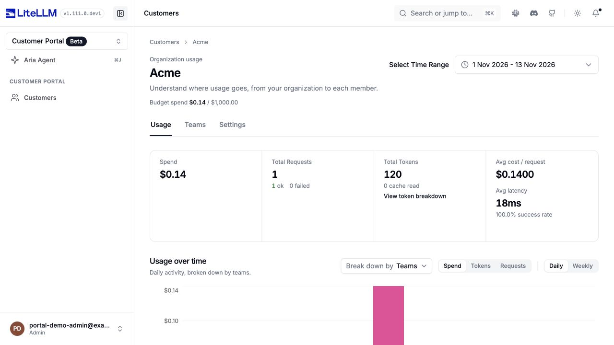

# 客戶管理 {#customer-management}

<SinceVersion v="1.111.0" />

追蹤您應用程式客戶與終端使用者的 LLM 花費。對於新的整合，請使用客戶管理，依客戶組織、團隊與成員查看用量並設定預算。

請使用您現有的應用程式金鑰，隨每次請求傳送客戶的身分。您無須為每位客戶建立金鑰或設定 Webhook，即可開始追蹤。

| 客戶層級 | 用途 |
| --- | --- |
| 組織 | 客戶帳戶，例如 Acme，及其總預算。 |
| 團隊 | 該客戶內部的群組，例如 Support，共用一份預算。 |
| 成員 | 個別終端使用者，例如 Alice，擁有自己的額度。 |

這些客戶記錄與 LiteLLM 內部的組織、團隊與使用者是分開的。如果您使用 `user`、`x-litellm-customer-id`、`x-litellm-end-user-id` 或 `/customer/*`，請參閱[從舊版終端使用者追蹤移轉](#moving-from-legacy-end-user-tracking)。這些 API 仍受支援。

## 開始之前 {#before-you-start}

請使用 v1.111 或更新版本的 [LiteLLM 閘道](./docker_quick_start.md)，搭配 PostgreSQL 並套用其資料庫遷移。您需要一把可呼叫所選模型的應用程式金鑰，以及代理管理員存取權限，才能查看客戶管理或讀取其管理 API。

請透過您現有的環境或祕密儲存區設定下列環境變數：

| 變數 | 值 |
| --- | --- |
| `LITELLM_BASE_URL` | 您的閘道根 URL，不含 `/v1` 或 `/ui`，例如 `http://localhost:4000`。 |
| `LITELLM_API_KEY` | 您現有的應用程式金鑰。 |
| `LITELLM_MODEL` | 在您的閘道上設定且該金鑰允許使用的 Chat Completions 模型別名。 |

請將金鑰保留在您的伺服器上。您的後端會驗證客戶身分，並從其工作階段中選擇組織別名與成員 ID。請使用穩定的成員 ID，在您的閘道內保持唯一，例如 `acme-alice`。

若無 Enterprise，您最多可建立 **5 個客戶組織、每個組織 5 個團隊，以及每個團隊 5 位成員**。`default` 團隊會計入該上限。請參閱[達到上限時的容量與追蹤](./customer_management/track-customer-spend.md#free-tier-limits)。

## 1. 傳送請求 {#track-customer-spend}

請在標頭中傳送組織別名與成員 ID：

```bash title="Track a request for Alice at Acme"
curl --fail-with-body "$LITELLM_BASE_URL/v1/chat/completions" \
  --header "Authorization: Bearer $LITELLM_API_KEY" \
  --header "Content-Type: application/json" \
  --header "x-litellm-customer-org-alias: Acme" \
  --header "x-litellm-customer-member-id: acme-alice" \
  --data "{
    \"model\": \"$LITELLM_MODEL\",
    \"messages\": [{\"role\": \"user\", \"content\": \"Say hello.\"}]
  }"
```

請預期收到模型回應。在第一次請求時，LiteLLM 會註冊未知的組織別名，並將新成員加入其 `default` 團隊，但須受容量上限限制。現有成員會保留其已指派的團隊。相同的標頭也適用於 Responses 與 Anthropic Messages；請參閱 [SDK 範例](./customer_management/track-customer-spend.md#3-send-a-request-for-alice)。

如果您已設定組織的預設成員預算，新成員會繼承該預算。若未設定預設值，成員一開始不會有自己的上限。若要從第一次請求起就強制執行客戶上限，請[先建立組織與預算](./customer_management/track-customer-spend.md#2-import-a-customer)。

## 2. 查看客戶用量 {#view-usage}

在管理介面中開啟 **客戶管理 → 客戶**，選取 **Acme**，再選擇 **選取時間範圍**，以納入您的請求。請查看花費、請求與權杖。使用 **依下列項目細分** 檢查團隊與成員。



*範例取自使用受控提供者的本機閘道。您的成本與權杖數量取決於模型與請求。*

記帳會在背景執行。如果用量尚未出現，請確認日期範圍與標頭，再檢查記帳完成狀態與閘道警告。僅有成功的模型回應，並不足以確認客戶追蹤已完成。達到免費方案上限時，請求可能成功，但不會註冊或追蹤新的客戶層級。現有層級仍會持續追蹤。零成本請求可能顯示權杖與請求數，但花費為 $0。

若要從您的後端讀取用量，請使用代理管理員金鑰呼叫[客戶用量 API](./customer_management/track-customer-spend.md#5-fetch-usage-for-your-product)。在將該資料傳回您的產品之前，請先授權該客戶的存取權限。組織、團隊與成員的總計描述的是相同的請求，請勿將各層級加總。

## 3. 設定預算並新增客戶結構 {#customer-budgets}

請開啟客戶的 **設定**，使用 **設定預算** 或 **編輯預算** 選擇 **花費上限 (USD)** 與 **重設週期**。請使用成員的 **預算範本** 設定其預設額度。

團隊預算會限制該群組的合計花費。成員範本會為每位已指派的成員提供各自的額度。您可以同時使用兩者。請依循[設定預算並讀取用量](./customer_management/track-customer-spend.md)，完成完整的 API 設定，並查看共用預算範例、速率限制、模型存取權限、預算拒絕情形，以及選用的 Webhook 通知。

| 下一項工作 | 指南 |
| --- | --- |
| 在第一次請求前建立含預算的團隊與成員 | [匯入客戶](./customer_management/track-customer-spend.md#2-import-a-customer) |
| 比較共用團隊預算與每位成員的額度 | [預算範例](./customer_management/track-customer-spend.md#shared-team-budget-or-per-member-allowance) |
| 在您的產品中顯示花費與剩餘上限 | [讀取用量](./customer_management/track-customer-spend.md#5-fetch-usage-for-your-product) 與 [讀取預算](./customer_management/track-customer-spend.md#6-fetch-budgets-and-caps) |
| 當客戶達到門檻時通知您的後端 | [預算 Webhook](./customer_management/track-customer-spend.md#1-set-up-budget-webhooks) |
| 查詢某次請求的客戶與成本 | [花費記錄](./customer_management/track-customer-spend.md#7-debug-a-request-in-spend-logs) |
| 查詢欄位、端點或錯誤 | [客戶管理 API 參考](./customer_management/api_reference.md) |

<span id="tracking-customer-spend--permissions" />
<span id="1-make-llm-api-call-w-customer-id" />
<span id="2-get-customer-spend" />
<span id="restricting-which-ids-become-customers" />
<span id="keeping-a-default-budget-for-unregistered-customers" />
<span id="bucketing-internal-traffic-under-one-customer" />
<span id="restricting-which-models-a-customer-can-use" />
<span id="setting-customer-object-permissions" />
<span id="what-are-object-permissions" />
<span id="creating-a-customer-with-object-permissions" />
<span id="updating-customer-object-permissions" />
<span id="viewing-customer-object-permissions" />
<span id="use-cases" />
<span id="setting-customer-budgets" />
<span id="default-budget-for-all-customers" />
<span id="quick-start" />
<span id="assign-pricing-tiers" />
<span id="1-create-a-budget" />
<span id="2-assign-budget-to-customer" />
<span id="3-test-it" />

## 從舊版終端使用者追蹤移轉 {#moving-from-legacy-end-user-tracking}

自 v1.111 起，建議使用客戶管理設定。現有的終端使用者追蹤仍可繼續運作。這兩個系統有各自獨立的記錄與用量 API；傳送舊版身分欄位不會建立客戶管理成員。

| 現有整合 | 客戶管理 |
| --- | --- |
| `user`、`x-litellm-customer-id` 或 `x-litellm-end-user-id` 中的扁平終端使用者 ID | `x-litellm-customer-org-alias` 與 `x-litellm-customer-member-id` 中的組織別名與成員 ID。 |
| `/customer/new`、`/customer/update`、`/customer/info` | `/management/v1/customer_organizations`、`/management/v1/customer_teams` 與 `/management/v1/customer_members`。 |
| 預設終端使用者預算或已指派的舊版預算 | 組織與團隊上限，外加成員預算範本與覆寫設定。 |
| **用量 → 客戶用量**與 **終端使用者**記錄篩選器 | **客戶管理 → 客戶**、客戶用量 API，以及該請求的 **客戶**詳細資料。 |

請為每位現有終端使用者選擇組織與團隊。在確認該 ID 於您的閘道內唯一之後，您可以重複使用穩定的終端使用者 ID 作為成員 ID。請建立客戶記錄與對等的預算，切換應用程式的身分標頭，再於客戶管理中驗證一次請求及其用量。

請保留舊版記錄，以供歷史報表使用。此設定不會將舊的花費或預算計數器複製到新記錄中。請規劃預算切換時程，避免客戶在週期中途因誤操作而獲得新的額度。在重疊期間，請勿將舊版與新版的總計相加，因為兩者描述的是相同的請求。

請保留舊版整合，以支援依賴其身分路徑的功能，包括 JWT 終端使用者對應，以及適用於 MCP 伺服器、向量儲存區與代理程式的客戶物件權限。新的客戶標頭不會取代這些控制項。請參閱[舊版參考](./legacy_end_users.md)與[舊版用量儀表板](./customer_usage.md).
