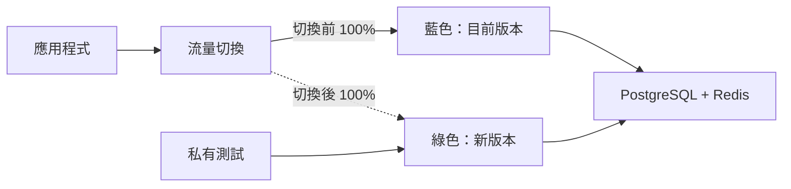

# 藍綠部署 {#bluegreen-deployment}

{/* keep-version-note */}

藍綠部署在升級期間保持兩組完整的 LiteLLM 執行個體可用。藍色服務目前版本。綠色執行新版本並接收測試流量。綠色通過您的檢查後，將新請求切換給它並排空藍色。



## 準備替代部署 {#prepare-the-replacement}

以固定的映像部署綠色。使用與藍色相同的資料庫、加密 salt、驗證設定與區域 Redis。使用不同的服務名稱或後端池，讓入口可以選取每個版本。兩組都使用正式環境狀態。會建立金鑰或變更設定的測試會影響該共用狀態。

為兩組及其資料庫連線規劃容量。透過綠色的私有測試路由執行 `/health/readiness`、一個已驗證的模型請求與一個串流請求。推廣前檢查模型權限、提供者憑證、支出記錄與必要的回呼。

## 切換入口流量 {#switch-ingress-traffic}

這個 [Gateway API HTTPRoute](https://gateway-api.sigs.k8s.io/guides/user-guides/traffic-splitting/) 範例假設已有一個名為 `litellm-ingress` 的 HTTPS `Gateway`，以及同一個命名空間中的 `litellm-blue` 與 `litellm-green` Service。每個 Service 公開連接埠 4000，且僅選取自己的版本。請先在 Gateway 上設定 TLS，並在 pod 上設定 readiness。

```yaml title="litellm-route.yaml"
apiVersion: gateway.networking.k8s.io/v1
kind: HTTPRoute
metadata:
  name: litellm
spec:
  parentRefs:
    - name: litellm-ingress
  hostnames:
    - llm.example.com
  rules:
    - backendRefs:
        - name: litellm-blue
          port: 4000
          weight: 100
        - name: litellm-green
          port: 4000
          weight: 0
```

切換時，將藍色的權重設為 `0`、綠色的權重設為 `100`，然後套用該路由。確認控制器接受該路由，且新請求到達綠色。讓藍色保持就緒，直到路由變更生效且其請求完成。在 Gateway API 之外，使用負載平衡器後端權重或服務選取器實現相同模式。

## 排空現有請求 {#drain-existing-requests}

流量權重控制的是新請求。它們不會移動已開啟的串流。在移除藍色之前，等待其進行中的請求歸零，或等到您的排空期限到期。檢查您的入口控制器如何處理持續連線與後端移除。

對於 600 秒的請求，請為路由變更與程序清理預留額外的關閉時間。將此片段合併到每個 Deployment 的 pod 規格中，並以您的工作負載測試這些值：

```yaml title="Deployment pod template fragment"
spec:
  template:
    spec:
      terminationGracePeriodSeconds: 650
      containers:
        - name: litellm
          env:
            - name: GRACEFUL_SHUTDOWN_TIMEOUT
              value: "610"
          readinessProbe:
            httpGet:
              path: /health/readiness
              port: 4000
          lifecycle:
            preStop:
              exec:
                command: ["sh", "-c", "sleep 10"]
```

Kubernetes 將 `preStop` hook 計入 pod 的終止寬限期。sleep 讓端點變更有時間生效。它不會排空請求。讓應用程式伺服器與入口的逾時符合此關閉預算。以接近最大時長的串流測試。請參閱 [pod 終止](https://kubernetes.io/docs/concepts/workloads/pods/pod-lifecycle/#pod-termination) 與[伺服器調整](../../server_tuning.md#keep-restarts-hitless)。

LiteLLM 也有一個可選用的[排空端點](../../health.md#other-health-endpoints)。若您啟用它，請設定 `DRAIN_ENDPOINT_TOKEN` 以要求 `X-Drain-Token` 標頭。將存取限制在內部呼叫者。

## 保持遷移相容 {#keep-migrations-compatible}

為共用資料庫執行一個遷移作業，並在兩組服務執行個體上都設定 `DISABLE_SCHEMA_UPDATE=true`。協調 Helm 發佈，避免各自啟動互相競爭的遷移。請參閱[遷移](../../prod.md#run-migrations-from-the-helm-presync-hook)。

確認綠色遷移後，藍色仍可讀寫。遵循該版本的遷移程序，並在正式環境之前以資料庫副本測試回滾。

## 回滾 {#roll-back}

若綠色在切換後失敗，將新請求路由回藍色。藍色必須仍可用且與目前的結構描述相容。移除前先排空綠色。還原舊的資料庫備份可能丟棄新的金鑰、設定與支出記錄。不要將它用於例行流量回滾。若要漸進式移轉流量，請使用[金絲雀部署](./canary.md)。
