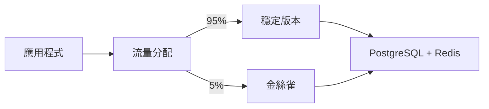

# 金絲雀部署 {#canary-deployment}

{/* keep-version-note */}

金絲雀發佈會將一小部分新請求送到新的 LiteLLM 版本。其餘由穩定版本服務。在真實流量下比較兩者的行為。然後增加金絲雀的比例，或將其歸零。



選擇一個能在不超過金絲雀容量的情況下測試您一般流量組成的比例。5% 的請求比例可能用掉多於或少於 5% 的 token、同時串流或提供者成本。

## 準備可比較的發佈 {#prepare-a-comparable-release}

將穩定版與金絲雀部署在不同的 Service 或後端池之後。使用相同的模型別名、驗證政策、資料庫、加密 salt 與區域 Redis。僅在測試需要時才變更這些項目。固定兩個映像。依發佈為記錄、指標與追蹤加上標籤，以便比較結果。

在啟用正式流量之前，先執行私有冒煙測試。包括一個虛擬金鑰請求、一個串流、一個被拒絕的請求，以及您的應用程式需要的回呼。提供者延遲各不相同。測試閘道變更時，請比較相同的模型與請求類型。

## 設定流量分配 {#set-the-traffic-split}

此範例使用 [Gateway API 加權後端](https://gateway-api.sigs.k8s.io/guides/user-guides/traffic-splitting/)。它假設已有一個名為 `litellm-ingress` 的 HTTPS `Gateway`，以及同一個命名空間中分離的 `litellm-stable` 與 `litellm-canary` Service。在附加路由之前，先設定 pod readiness 與 Gateway 的 TLS 監聽器。

```yaml title="litellm-canary-route.yaml"
apiVersion: gateway.networking.k8s.io/v1
kind: HTTPRoute
metadata:
  name: litellm
spec:
  parentRefs:
    - name: litellm-ingress
  hostnames:
    - llm.example.com
  rules:
    - backendRefs:
        - name: litellm-stable
          port: 4000
          weight: 95
        - name: litellm-canary
          port: 4000
          weight: 5
```

權重是相對的。實際流量取決於樣本大小、連線重用與親和性。在比較金絲雀指標之前，先檢查分配情況。若要路由特定團隊的流量，請使用受信任的入口規則。不要透過用戶端可設定的公開標頭授權存取。

## 推廣金絲雀 {#promote-the-canary}

在推出之前，記錄穩定版本的錯誤率與延遲。為金絲雀設定可接受的上限。監控驗證失敗、閘道錯誤、第一個 token 的時間、完成的串流、佇列深度與資料庫連線。檢查支出記錄與回呼傳遞。請參閱 [Prometheus 指標](../../prometheus.md)。

範例順序為 `5% → 25% → 50% → 100%`。在每個步驟，等待足夠的請求與長時間串流完成。當金絲雀超過您的閾值時，停止或反轉推出。在下一次流量增加之前，讓自動擴展有時間增加容量。

鏡像正式環境的 LLM 請求可能呼叫提供者兩次、使成本加倍，並重複副作用。使用受控的測試請求，或能考量這些影響的重播程序。

## 保護共用狀態與串流 {#protect-shared-state-and-streams}

兩個發佈都寫入同一個資料庫。遷移只執行一次，並在服務執行個體上保持 `DISABLE_SCHEMA_UPDATE=true`。確認兩個版本都支援遷移後的結構描述。小比例的金絲雀流量並不能限制破壞性遷移或共用設定變更的影響。請參閱[遷移相容性](./blue_green.md#keep-migrations-compatible)。

讓每個進行中的串流留在接受它的版本上。推廣或回滾時，變更的是新請求的權重。然後排空您計畫移除的版本。讓其副本持續執行，直到這些請求完成或達到您記錄的期限。設定涵蓋該期間的逾時。請遵循[排空範例](./blue_green.md#drain-existing-requests)。

## 回滾 {#roll-back}

將金絲雀的權重設為 `0`，並將穩定版恢復為 `100`。確認新請求到達穩定版。保存金絲雀的記錄與指標。移除前先排空其現有請求。穩定版必須仍支援共用的資料庫結構描述。路由不會反轉遷移。在單次流量切換之前，使用[藍綠部署](./blue_green.md) 測試完整的替代部署。
