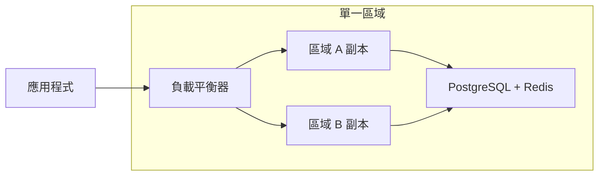

# 高可用性 {#high-availability}

{/* keep-version-note */}

將副本分散在多個可用性區域，以因應執行個體故障與升級。加入另一個區域以滿足復原或延遲需求。

| 主題 | 用途 |
| --- | --- |
| [藍綠部署](./blue_green.md) | 測試完整的替代部署，然後切換流量。 |
| [金絲雀部署](./canary.md) | 在正式推廣之前，先將一小部分請求送到新版本。 |
| [多區域](../../multi_region.md) | 執行區域閘道，搭配共用資料庫與區域 Redis。 |
| [路由](../multi_region/routing.md) | 選擇由哪個區域接收請求。 |
| [故障轉移](../multi_region/failover.md) | 決定何時移除一個區域以及如何復原。 |

## 讓單一區域具備韌性 {#make-one-region-resilient}

至少在不同節點上執行兩個服務副本，並將它們分散到多個可用性區域。預留足夠的備用容量，讓故障後剩餘的副本能承載流量。請參閱[大小規劃與擴展](../sizing.md) 與各雲端專屬的[參考架構](../architecture.md)。

在 Kubernetes 上，使用[拓撲分散限制](https://kubernetes.io/docs/concepts/scheduling-eviction/topology-spread-constraints/) 安排副本。[PodDisruptionBudget](https://kubernetes.io/docs/tasks/run-application/configure-pdb/) 限制自願性驅逐，例如節點排空。它無法防止節點或可用性區域故障。請設定 Deployment 的推出策略，讓升級期間有足夠的副本保持可用。

## 保護資料服務 {#protect-the-data-services}

部署中的所有副本使用同一個邏輯 PostgreSQL 資料庫。使用資料庫複寫與跨可用性區域的自動故障轉移。測試寫入者變更後的連線復原，並測試備份還原。連線池大小請依最大副本數規劃，包括部署推出期間的額外 pod。請參閱[資料庫規劃大小](../../db_sizing.md)。

對於需要共用速率限制計數器、路由器狀態與快取的副本，使用共用 Redis。設定 Redis 複寫與故障轉移。測試 Redis 不可用時您的功能的行為。請參閱[哪些功能需要 Redis](../../redis_requirements.md) 與 [Redis 規劃大小](../../redis_sizing.md)。

為提供者中斷設定並測試[模型備援](../../reliability.md)。

## 使用正確的健康訊號 {#use-the-right-health-signal}

使用 `/health/liveliness` 檢查程序存活狀態，使用 `/health/readiness` 決定執行個體是否可接收流量。兩者都不會發出 LLM 請求。另外加入一個受控的合成請求，以檢查驗證、模型存取與提供者連通性。請參閱[健康檢查](../../health.md)。

預設情況下，當設定的資料庫無法連線時，readiness 會回傳 503。若您啟用 `allow_requests_on_db_unavailable`，資料庫中斷期間 readiness 可保持 200。此設定會改變中斷期間的驗證與強制執行行為。啟用前請先閱讀[優雅地處理資料庫不可用](../../prod.md#gracefully-handle-db-unavailability)。當多個區域共用資料庫時，請使用[多區域健康政策](../multi_region/failover.md#choose-a-health-policy)。

## 驗證復原 {#verify-recovery}

在測試環境中，移除一個副本、排空一個節點、觸發資料庫故障轉移，並中斷 Redis 存取。確認剩餘容量符合您的延遲與錯誤目標。檢查串流在計畫性排空期間能完成，且支出佇列能復原。記錄偵測故障與恢復服務所需的時間。若您的復原計畫涵蓋整個區域中斷，請繼續參閱[多區域](../../multi_region.md)。
