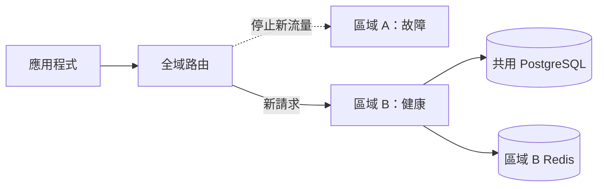

# 多區域故障轉移 {#multi-region-failover}

{/* keep-version-note */}

故障轉移會在某個區域故障後，將新請求送到健康的區域。現有串流可能失敗，而存活的區域仍依賴[共用資料庫](../../multi_region.md)。



## 選擇健康政策 {#choose-a-health-policy}

使用 `/health/liveliness` 偵測執行中的程序。使用 `/health/readiness` 決定閘道是否已準備好接收流量。兩者在優雅關閉期間都回傳 503。兩者都不會端到端測試模型請求。請參閱[健康檢查](../../health.md) 與 [readiness 實作](https://github.com/BerriAI/litellm/blob/fdafffb84285892c1e97bf8b31d5eba0cbd7420a/litellm/proxy/health_endpoints/_health_endpoints.py)。

| 政策 | 探針行為 | 營運影響 |
| --- | --- | --- |
| 一般資料庫支援的服務 | 當其設定的資料庫無法連線時，readiness 回傳 503。 | 移除無法滿足一般服務需求的閘道。共用資料庫中斷可能讓每個區域都變成未就緒。 |
| 明確的降級服務 | 使用 `allow_requests_on_db_unavailable: true` 時，即使資料庫遺失，readiness 仍可保持 200。 | 僅在降級的驗證與強制執行政策可接受時才路由。另外監控資料庫狀態與失敗的操作。 |
| 僅程序存活檢查 | 當相依服務不可用時，liveliness 仍可回傳 200。 | 用它來監控程序。它不能證明一個區域可以服務一般流量。 |

在選擇健康政策之前，先決定資料庫中斷期間您允許哪些操作。不要只為了讓流量持續而以 liveliness 取代 readiness。`allow_requests_on_db_unavailable` 可能允許請求在未經一般虛擬金鑰資料庫檢查的情況下通過。請遵循[優雅地處理資料庫不可用](../../prod.md#gracefully-handle-db-unavailability) 中的私有網路限制，並檢視其錯誤行為。以您部署的版本測試未快取的金鑰、快取到期、預算與模型憑證。

加入一個低量的測試請求，以檢查已驗證的模型存取。另外監控 PostgreSQL 與 Redis 的健康狀態。若某個共用提供者模型失敗，讓區域繼續為其他正常運作的模型提供服務。設定故障與復原閾值，避免在短暫事件期間發生快速的流量移轉。

## 範例：使用 HAProxy 的主動-被動 {#example-active-passive-with-haproxy}

這個後端片段需要一個既有的備援 HAProxy 前端。前端終止用戶端 TLS，並將閘道流量送到 `litellm_regions`。請替換範例中的私有入口位址與 CA 路徑。兩個區域入口端點都必須以對該主機名稱有效的憑證服務 `llm.example.com`。

```text title="haproxy.cfg backend fragment"
backend litellm_regions
    mode http
    retries 0
    option httpchk
    http-check send meth GET uri /health/readiness ver HTTP/1.1 hdr Host llm.example.com
    http-check expect status 200
    timeout connect 5s
    timeout server 650s
    default-server check inter 3s fall 3 rise 3
    server region_a 10.10.0.10:443 ssl verify required ca-file /etc/haproxy/ca.pem verifyhost llm.example.com sni str(llm.example.com) check-sni llm.example.com
    server region_b 10.20.0.10:443 ssl verify required ca-file /etc/haproxy/ca.pem verifyhost llm.example.com sni str(llm.example.com) check-sni llm.example.com backup
```

當沒有一般伺服器可用時，備援伺服器接收新流量。連續三次探針失敗會移除區域 A。連續三次探針成功會使其重新符合資格。探針逾時與連線失敗會影響偵測時間。`retries 0` 停用後端重試。由用戶端決定是否重試失敗的操作。讓前端的逾時與串流處理與後端一致。請參閱 [HAProxy 健康檢查](https://www.haproxy.com/documentation/haproxy-configuration-tutorials/reliability/health-checks/) 與[伺服器選項](https://docs.haproxy.org/3.2/configuration.html#5.2)。

此設定會在區域 A 復原時使其重新啟用。若要手動故障回復，在它通過您的檢查之前，先將它排除在路由之外。然後透過您的入口控制程序將其還原。為您的[代管路由服務](./routing.md#implementation-examples) 設定等效的健康、優先順序與復原設定。

## 區分區域故障與共用故障 {#separate-regional-and-shared-failures}

| 故障 | 變化 | 故障轉移能做什麼 |
| --- | --- | --- |
| 單一閘道或可用性區域 | 該區域失去部分容量。 | 區域入口使用存活的就緒副本。僅在該區域無法服務其負載時才使用全域故障轉移。 |
| 某個區域的入口或網路 | 該區域端點變得無法使用。 | 將新請求送到另一個可以連線到資料庫與模型提供者的區域。 |
| 區域 Redis | 本地計數器、快取或路由器狀態可能失敗。 | 另一個區域有獨立的 Redis，但其計數器不包含故障區域的用量。啟用自動故障轉移前先測試該政策。 |
| 共用 PostgreSQL 寫入者 | 每個區域都失去同一個相依服務。 | 僅靠閘道路由無法恢復一般的資料庫支援服務。復原資料庫，或使用先前核准的降級政策。 |
| 共用提供者端點 | 同一個模型可能從每個區域都失敗。 | 使用經過測試的模型備援，或等待提供者復原。移動閘道可能沒有幫助。 |

檢查您的路由產品在每個端點都不健康時的行為。例如，[AWS Global Accelerator 在沒有健康端點時，可以將流量送到不健康的端點](https://docs.aws.amazon.com/global-accelerator/latest/dg/about-endpoints.html)。不健康的狀態並不總是會停止請求。

## 復原共用資料庫 {#recover-the-shared-database}

設定復原時間目標與復原點目標。非同步的區域副本可能落後，因此推廣可能遺失最近的寫入。備份復原需要額外時間。

使用您的資料庫服務文件記載的故障轉移程序。建立單一可寫入的主資料庫，並防止舊的寫入者接受衝突的寫入。為每個區域更新或還原寫入者端點。驗證 TLS、DNS 與連通性。在恢復全部流量之前，測試金鑰查詢、管理寫入、支出更新與排隊的工作。不要在每個閘道區域各推廣一個獨立的可寫入資料庫。

`DATABASE_URL_READ_REPLICA` 路由讀取。它不會推廣讀取者，也不會變更 `DATABASE_URL`。請參閱[資料庫唯讀副本](../../db_read_replica.md)。若要隔離區域之間的資料庫故障，請使用具有獨立金鑰與預算的[獨立部署](../../global_control_plane.md)。

## 測試故障轉移與故障回復 {#test-failover-and-failback}

先測試計畫性的區域排空。停止新路由，讓現有串流完成，並確認存活的區域能處理負載。然後測試突然的區域故障。它可能中斷串流，並使請求結果不確定。為每個操作設定用戶端重試上限。連線遺失後，不要自動重播每個請求。

分別測量故障偵測、路由變更、DNS 快取、新連線成功、串流失敗與資料庫復原。故障回復之前，檢查已復原區域的發佈、密鑰、提供者配額與相依服務。逐漸加入流量。讓健康的區域保持可用，直到已復原的區域在負載下保持穩定。
