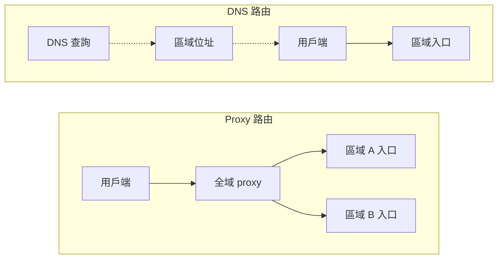

# 多區域路由 {#multi-region-routing}

{/* keep-version-note */}

使用單一閘道主機名稱。讓區域端點保持可用，以供健康探針與受控測試。共用資料請參閱[多區域總覽](../../multi_region.md)，健康政策與復原請參閱[故障轉移](./failover.md)。

## 選擇路由層 {#choose-the-routing-layer}

遞迴解析器與用戶端會快取 DNS 答案。現有連線的存活時間可能超過 DNS TTL。DNS 權重控制 DNS 回傳每個位址的頻率，而不是每個區域接收的確切請求比例。

全域 proxy 會留在請求路徑中，並透過其路由政策選擇來源。請為其容量、TLS 與串流逾時做規劃。若您自行管理，請部署備援執行個體。

## 選擇政策 {#choose-a-policy}

| 政策 | 適用時機 | 啟用前檢查 |
| --- | --- | --- |
| 延遲或鄰近性 | 使用者在多個區域工作。 | 測量完整的請求路徑，包括共用資料庫與模型提供者的延遲。最近的閘道不一定最快完成請求。 |
| 加權 | 您想要受控的分配或漸進式的區域推出。 | 驗證實際流量與容量。連線重用與 DNS 快取可能使觀察到的分配偏差。 |
| 優先順序 | 一個區域服務流量，另一個是備援。 | 讓備援保持健康、已設定，且規模足以接管。 |
| 區域限制 | 請求必須留在核准的位置集合內。 | 將限制套用到故障轉移目標、提供者、記錄與資料儲存，以及入口。 |

僅靠以位置為基礎的路由並不能強制資料落地。此設計仍會將資料庫操作送到共用的寫入者。在選擇區域之前，先決定提示、回應、記錄與中繼資料可以傳輸到哪些地方。

## 實作範例 {#implementation-examples}

| 實作 | 路由層 | 如何適用 |
| --- | --- | --- |
| [AWS Route 53](https://docs.aws.amazon.com/Route53/latest/DeveloperGuide/routing-policy.html) | DNS | 延遲、加權、地理位置與故障轉移記錄選取區域端點。 |
| [AWS Global Accelerator](https://docs.aws.amazon.com/global-accelerator/latest/dg/about-endpoints.html) | 全域網路前端 | 靜態位址將連線路由到受支援的區域端點，例如 ALB 與 NLB。 |
| [Google Cloud global external Application Load Balancer](https://docs.cloud.google.com/load-balancing/docs/https) | HTTP proxy | 單一前端可連線到多個區域中受支援的後端。後端類型決定可用的路由與健康控制。 |
| [Azure Traffic Manager](https://learn.microsoft.com/en-us/azure/traffic-manager/traffic-manager-routing-methods) | DNS | 效能、加權、地理或優先順序政策選擇端點。 |
| [Azure Front Door](https://learn.microsoft.com/en-us/azure/frontdoor/routing-methods) | HTTP proxy | 健康、優先順序、延遲與權重選取區域來源。權重在符合其他設定的來源之間套用。 |
| [HAProxy](https://www.haproxy.com/documentation/haproxy-configuration-tutorials/reliability/health-checks/) | 自行管理的 proxy | 後端代表區域入口端點。使用健康檢查與加權或備援伺服器。請參閱[故障轉移範例](./failover.md#example-active-passive-with-haproxy)。 |

對於 Cloud Run，無伺服器 NEG 不支援一般的負載平衡器健康檢查。請使用[受支援的無伺服器健康與離群偵測機制](https://docs.cloud.google.com/load-balancing/docs/negs/serverless-neg-concepts)。在區域與相依服務故障期間測試它們。啟用 IAP 的後端服務無法使用離群偵測。

## 保留請求行為 {#preserve-request-behavior}

透過路由層轉送用戶端的授權與請求主體。設定從用戶端到入口、以及從跨區域 proxy 到來源的 TLS。檢查每個區域端點都接受共用主機名稱與必要路徑。包括模型 API 與您公開的任何管理路由。

保持回應串流啟用，避免緩衝整個回應。在每個跳點設定閒置與請求逾時，以支援您的 API 行為。串流回應會留在其原始連線上。路由變更不會將它轉移到另一個區域。

網路錯誤可能使請求結果不明。重播一個 completion 可能產生重複的輸出或費用。重試管理請求可能重複一項變更。讓應用程式決定是否重試失敗的操作。不要為每個 POST 啟用 proxy 重試。

## 驗證路由 {#verify-the-route}

透過閘道主機名稱送出受控請求，並在區域入口記錄或追蹤中找到它們。直接檢查兩個區域端點，然後將實際流量與您的路由政策比較。測試長時間串流、DNS 變更後的新連線，以及偏好區域不可用時的請求。健康政策與復原程序請繼續參閱[故障轉移](./failover.md)。
