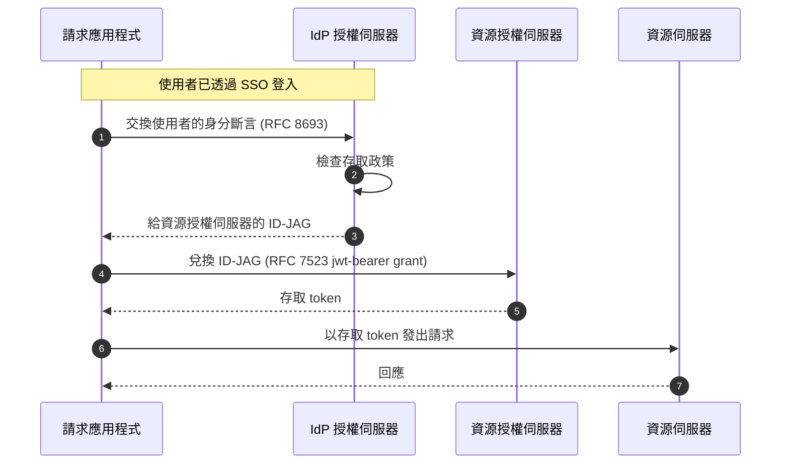

# ID-JAG {#id-jag}

ID-JAG（[Identity Assertion JWT Authorization Grant](https://datatracker.ietf.org/doc/html/draft-ietf-oauth-identity-assertion-authz-grant)）讓應用程式能代表已登入的使用者存取另一個服務。身分提供者（IdP）核准這項交換，目標服務的授權伺服器則在發出存取 token 之前，套用它自己的存取政策。

LiteLLM 可以同時扮演資源與請求應用程式：

| 指南 | 使用案例 | LiteLLM 的行為 |
|-------|----------|------------------|
| [LiteLLM as resource app](./resource_app.md) | 應用程式需要透過 LiteLLM 執行推論或存取 MCP 工具。 | 在 `POST /token` 接受 ID-JAG，並為使用者發出 LiteLLM 憑證。 |
| [LiteLLM as requesting app](./requesting_app.md) | 使用 LiteLLM 的代理程式需要存取具有獨立授權伺服器的 MCP 伺服器。 | 將使用者的身分斷言交換為 ID-JAG，再以它兌換 MCP 存取 token。 |

:::info 何時使用 ID-JAG

當應用程式需要代表已登入的使用者行事，且您希望由 IdP 控制哪些應用程式可以請求存取時，請使用 ID-JAG。IdP 與目標服務的授權伺服器都必須支援 ID-JAG。

若要以現有的 JWT 直接存取 LiteLLM，請[將其 claims 對應到使用者與團隊](../jwt_user_team_auth.md)，或使用 [Virtual Keys](../jwt_key_mapping.md)。若要與上游 MCP 伺服器進行其他 token 交換流程，請參閱 [OBO token exchange](../../mcp_obo_auth.md)。

:::

## 運作方式 {#how-it-works}

這項交換涉及四個角色：

| 角色 | 職責 |
|------|----------------|
| 請求應用程式（用戶端） | 代表使用者請求存取。 |
| IdP 授權伺服器 | 驗證使用者的身分斷言，並依其存取政策發出 ID-JAG。 |
| 資源授權伺服器 | 驗證 ID-JAG、套用其存取政策，並發出存取 token。它的 issuer 識別碼就是 ID-JAG 的 `aud` claim。 |
| 資源伺服器 | 接受存取 token 以授權 API 請求。 |

## 身分提供者設定 {#identity-provider-setup}

### Okta {#okta}

Okta 將 ID-JAG 實作為 [Cross App Access (XAA)](https://developer.okta.com/docs/concepts/xaa/)。將請求應用程式註冊為 **AI agent**，並在資源應用程式上啟用 Cross App Access。管理員透過 **resource connection** 連接兩者，並選取允許的 scopes。

完整設定請在 [LiteLLM as resource app](./resource_app.md#get-started) 或 [LiteLLM as requesting app](./requesting_app.md#get-started) 的 **Setup** 下選取 **Okta**。
