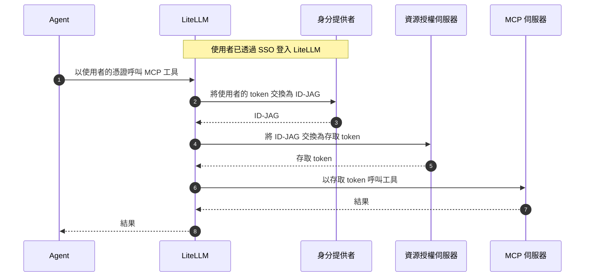

import Tabs from '@theme/Tabs';
import TabItem from '@theme/TabItem';
import IdJagScreenshot from '@site/src/components/IdJagScreenshot';

# LiteLLM 作為請求應用程式 {#litellm-as-requesting-app}

讓 LiteLLM 代表已登入的使用者呼叫 MCP 工具。LiteLLM 將使用者的登入 token 交換為 ID-JAG，再在 MCP 伺服器的授權伺服器將 ID-JAG 交換為存取 token。

## 運作方式 {#how-it-works}



## 必要條件 {#prerequisites}

:::info
此功能需要 enterprise 授權、資料庫，以及 [LiteLLM SSO](../admin_ui_sso.md)。
:::

## 設定 {#get-started}

選取您的身分提供者。

<Tabs groupId="id-jag-idp" queryString="idp">
<TabItem value="okta" label="Okta" default>

本逐步解說使用您在 Okta 中現有的 LiteLLM OIDC 應用程式。

### 1. 將 LiteLLM 註冊為 AI agent {#okta}

在 **Applications and Resources > Applications** 中開啟 LiteLLM。

1. 在 **Grant type** 下，啟用 **Authorization Code** 與 **Refresh Token**。
2. 在 **Assignments** 中，指派將測試此流程的使用者。
3. 開啟 **Machine Assignments > Resources** 並選取 **Register AI agent**。在 **User access and authentication** 下，選擇 **Select an existing app**，選取 LiteLLM，並完成註冊。

<IdJagScreenshot
  src="/img/id-jag/okta-oidc-grant-types.jpg"
  alt="已選取 Authorization Code 與 Refresh Token 的 Okta grant types"
  caption="啟用 Authorization Code 與 Refresh Token"
  width={690}
  height={126}
/>

<IdJagScreenshot
  src="/img/id-jag/okta-agent-link-litellm.jpg"
  alt="已選取 Select an existing app 與 LiteLLM Admin UI 的 Okta AI agent 註冊"
  caption="將 agent 連結至您現有的 LiteLLM 應用程式"
  width={880}
  height={510}
/>

在該 agent 的 **Client registration** 中，選取 **Client secret** 驗證。在您的 LiteLLM SSO 設定中，將它的 client ID 與 secret 用作 `GENERIC_CLIENT_ID` 與 `GENERIC_CLIENT_SECRET`。使用 `https://your-org.okta.com` 作為 SSO issuer。

<IdJagScreenshot
  src="/img/id-jag/okta-agent-client-credentials.jpg"
  alt="顯示遮罩後 client secret 與 client ID 欄位的 Okta client registration"
  caption="Client secret 與 client ID"
  width={800}
  height={330}
/>

### 2. 設定 MCP 資源應用程式 {#okta-connect-resource}

MCP 授權伺服器必須接受來自您的 Okta org 的 ID-JAG。如果該資源是另一個 LiteLLM proxy，請依照它的 [resource-app 設定](./resource_app.md#get-started)。

1. 在 MCP 授權伺服器上，將 LiteLLM 註冊為用戶端。保存它的 client ID 與 secret，以及伺服器的 issuer 與 token endpoint，供步驟 4 使用。
2. 在 Okta 的 **Applications and Resources > Applications** 中，使用提供者的 SSO 設定新增或開啟 MCP 資源應用程式。指派 LiteLLM 應用程式中的使用者。
3. 開啟 **Machine Assignments > Callers > Cross App Access > Edit** 並啟用 XAA。將 **Issuer URL** 設為 MCP 授權伺服器的 issuer，並加入它支援的 scopes。

<IdJagScreenshot
  src="/img/id-jag/okta-mcp-xaa-issuer-scopes.jpg"
  alt="具有 as.mcp.example.com issuer 與 mcp.tools.read scope 的 Okta XAA 設定"
  caption="MCP 資源的 XAA 設定範例"
  width={400}
  height={532}
/>

### 3. 將 LiteLLM 連接到資源 {#okta-resource-connection}

回到 LiteLLM AI agent 的 **Resource connections** 分頁，加入 MCP 資源應用程式。

| 欄位 | 值 |
|-------|-------|
| 在此應用程式中註冊的 AI agent client ID | 步驟 2 中 MCP 授權伺服器的 client ID。 |
| 資源識別碼 | MCP 服務的資源 URL。 |
| Scopes | 選取 **Allow specific scopes**，並選擇 LiteLLM 可以請求的 scopes。 |

<IdJagScreenshot
  src="/img/id-jag/okta-mcp-resource-connection.jpg"
  alt="client ID 為 litellm-client、資源為 https://mcp.example.com、scope 為 mcp.tools.read 的 Okta resource connection"
  caption="將 LiteLLM 連接到 MCP 資源"
  width={510}
  height={608}
/>

如果該 agent 的狀態是 **STAGED**，請啟用它。

### 4. 設定 LiteLLM {#okta-configure-sso}

使用您的 Okta SSO 憑證進行 ID-JAG 交換。將 `RESOURCE_AS_CLIENT_SECRET` 設為 LiteLLM 在 MCP 授權伺服器的 client secret。

將這些設定加入您現有的部署。將範例 URL、`<resource-client-id>` 與 scopes 換成步驟 2 與 3 的值。

<Tabs groupId="id-jag-deployment">
<TabItem value="helm" label="Helm" default>

```yaml title="values.yaml"
envVars:
  GENERIC_SCOPE: "openid profile email offline_access"
environmentSecrets: [litellm-id-jag]
proxy_config:
  mcp_servers:
    internal_tools:
      url: "https://mcp.example.com/mcp"
      transport: http
      auth_type: oauth2_id_jag
      token_exchange_endpoint: "https://your-org.okta.com/oauth2/v1/token"
      client_id: os.environ/GENERIC_CLIENT_ID
      client_secret: os.environ/GENERIC_CLIENT_SECRET
      id_jag_subject_source: refresh_token
      id_jag_resource_token_endpoint: "https://as.mcp.example.com/oauth2/token"
      id_jag_resource_client_id: "<resource-client-id>"
      id_jag_resource_client_secret: os.environ/RESOURCE_AS_CLIENT_SECRET
      audience: "https://as.mcp.example.com"
      id_jag_resource: "https://mcp.example.com"
      scopes: [mcp.tools.read]
```

</TabItem>
<TabItem value="terraform" label="Terraform">

將這些輸入加入您現有的 [LiteLLM AWS 或 Google Cloud 模組](../deploy/terraform.md)。將 `var.resource_client_secret_ref` 設為資源用戶端的 secret ARN（在 AWS 上）或 Secret Manager 資源 ID（在 Google Cloud 上）。

```hcl title="Existing LiteLLM module inputs"
gateway_extra_env = { GENERIC_SCOPE = "openid profile email offline_access" }
backend_extra_env = { GENERIC_SCOPE = "openid profile email offline_access" }
gateway_extra_secrets = { RESOURCE_AS_CLIENT_SECRET = var.resource_client_secret_ref }
backend_extra_secrets = { RESOURCE_AS_CLIENT_SECRET = var.resource_client_secret_ref }
proxy_config = {
  mcp_servers = {
    internal_tools = {
      url                                = "https://mcp.example.com/mcp"
      transport                          = "http"
      auth_type                          = "oauth2_id_jag"
      token_exchange_endpoint            = "https://your-org.okta.com/oauth2/v1/token"
      client_id                          = "os.environ/GENERIC_CLIENT_ID"
      client_secret                      = "os.environ/GENERIC_CLIENT_SECRET"
      id_jag_subject_source              = "refresh_token"
      id_jag_resource_token_endpoint     = "https://as.mcp.example.com/oauth2/token"
      id_jag_resource_client_id          = "<resource-client-id>"
      id_jag_resource_client_secret      = "os.environ/RESOURCE_AS_CLIENT_SECRET"
      audience                           = "https://as.mcp.example.com"
      id_jag_resource                    = "https://mcp.example.com"
      scopes                             = ["mcp.tools.read"]
    }
  }
}
```

執行 `terraform plan`，然後執行 `terraform apply`。

</TabItem>
</Tabs>

</TabItem>
<TabItem value="other" label="Other IdP">

本逐步解說使用您現有的 OIDC SSO 設定。您的 IdP 必須支援以 OIDC ID token 進行 ID-JAG 交換。

### 1. 為 LiteLLM 啟用 ID-JAG {#other-register-clients}

為 LiteLLM 的 SSO 用戶端啟用 ID-JAG 交換，或在您的 IdP 有要求時註冊一個獨立的交換用戶端。使用 client-secret 驗證（`client_secret_post`），並允許它交換發給 SSO 應用程式的 ID token。

保存交換用戶端的 ID、secret 與 ID-JAG token endpoint。範例從 `IDP_EXCHANGE_CLIENT_SECRET` 讀取它的 secret。

### 2. 設定 MCP 資源應用程式 {#other-connect-resource}

在 MCP 授權伺服器上，將 LiteLLM 註冊為可兌換 ID-JAG 的用戶端。為您的 IdP 設定信任並對應其使用者。保存 LiteLLM 的資源用戶端 ID 與 secret、伺服器的 issuer 與 token endpoint，以及它支援的 scopes。

如果該資源是另一個 LiteLLM proxy，請依照它的 [resource-app 設定](./resource_app.md#get-started)。

### 3. 將 LiteLLM 連接到資源 {#other-resource-connection}

在您的 IdP 中，將 MCP 授權伺服器的 issuer 註冊為資源 audience。允許步驟 1 中 LiteLLM 的交換用戶端為此資源及其 scopes 請求 ID-JAG。指派將測試此流程的使用者。

在此連接中使用步驟 2 的資源用戶端 ID。

### 4. 設定 LiteLLM {#other-configure-sso}

將 `IDP_EXCHANGE_CLIENT_SECRET` 設為步驟 1 的交換 secret，將 `RESOURCE_AS_CLIENT_SECRET` 設為步驟 2 的資源用戶端 secret。

將這些設定加入您現有的部署。將範例 URL、client ID 與 scopes 換成您的提供者的值。

<Tabs groupId="id-jag-deployment">
<TabItem value="helm" label="Helm" default>

```yaml title="values.yaml"
environmentSecrets: [litellm-id-jag]
proxy_config:
  mcp_servers:
    internal_tools:
      url: "https://mcp.example.com/mcp"
      transport: http
      auth_type: oauth2_id_jag
      token_exchange_endpoint: "https://idp.example.com/oauth2/token"
      client_id: "<idp-exchange-client-id>"
      client_secret: os.environ/IDP_EXCHANGE_CLIENT_SECRET
      id_jag_resource_token_endpoint: "https://as.mcp.example.com/oauth2/token"
      id_jag_resource_client_id: "<resource-client-id>"
      id_jag_resource_client_secret: os.environ/RESOURCE_AS_CLIENT_SECRET
      audience: "https://as.mcp.example.com"
      scopes: [mcp.tools.read]
```

</TabItem>
<TabItem value="terraform" label="Terraform">

將這些輸入加入您現有的 [LiteLLM AWS 或 Google Cloud 模組](../deploy/terraform.md)。這些 secret 參考在 AWS 上是 ARN，在 Google Cloud 上是 Secret Manager 資源 ID。

```hcl title="Existing LiteLLM module inputs"
gateway_extra_secrets = {
  IDP_EXCHANGE_CLIENT_SECRET = var.idp_exchange_client_secret_ref
  RESOURCE_AS_CLIENT_SECRET  = var.resource_client_secret_ref
}
backend_extra_secrets = {
  IDP_EXCHANGE_CLIENT_SECRET = var.idp_exchange_client_secret_ref
  RESOURCE_AS_CLIENT_SECRET  = var.resource_client_secret_ref
}
proxy_config = {
  mcp_servers = {
    internal_tools = {
      url                                = "https://mcp.example.com/mcp"
      transport                          = "http"
      auth_type                          = "oauth2_id_jag"
      token_exchange_endpoint            = "https://idp.example.com/oauth2/token"
      client_id                          = "<idp-exchange-client-id>"
      client_secret                      = "os.environ/IDP_EXCHANGE_CLIENT_SECRET"
      id_jag_resource_token_endpoint     = "https://as.mcp.example.com/oauth2/token"
      id_jag_resource_client_id          = "<resource-client-id>"
      id_jag_resource_client_secret      = "os.environ/RESOURCE_AS_CLIENT_SECRET"
      audience                           = "https://as.mcp.example.com"
      scopes                             = ["mcp.tools.read"]
    }
  }
}
```

執行 `terraform plan`，然後執行 `terraform apply`。

</TabItem>
</Tabs>

如果您的 IdP 需要資源識別碼，請加入 `id_jag_resource`，其值為 MCP 服務的資源 URL。

</TabItem>
</Tabs>

## 測試驗證 {#test-authentication}

選取與設定時相同的身分提供者。

<Tabs groupId="id-jag-idp" queryString="idp">
<TabItem value="okta" label="Okta" default>

### 登入並呼叫 MCP 伺服器 {#okta-test}

部署後，透過 Okta 登入 `https://litellm.example.com/ui`。使用該使用者可存取 `internal_tools` 的憑證：

```bash
curl -X POST "https://litellm.example.com/internal_tools/mcp" \
  -H "Content-Type: application/json" \
  -H "Accept: application/json, text/event-stream" \
  -H "x-litellm-api-key: Bearer <user-credential>" \
  -d '{"jsonrpc":"2.0","id":1,"method":"tools/list","params":{}}'
```

成功的回應會列出該伺服器的工具。

</TabItem>
<TabItem value="other" label="Other IdP">

### 登入並呼叫 MCP 伺服器 {#other-test}

部署後，透過您的 IdP 登入 `https://litellm.example.com/ui`。使用該使用者可存取 `internal_tools` 的憑證：

```bash
curl -X POST "https://litellm.example.com/internal_tools/mcp" \
  -H "Content-Type: application/json" \
  -H "Accept: application/json, text/event-stream" \
  -H "x-litellm-api-key: Bearer <user-credential>" \
  -d '{"jsonrpc":"2.0","id":1,"method":"tools/list","params":{}}'
```

成功的回應會列出該伺服器的工具。

</TabItem>
</Tabs>

## 疑難排解 {#troubleshooting}

<Tabs groupId="id-jag-idp" queryString="idp">
<TabItem value="okta" label="Okta" default>

| 回應或記錄 | 原因與修復方式 |
|-----------------|---------------|
| `401 invalid_client` | 將 IdP 用戶端憑證與 AI agent 的 **Client registration** 相符對應。 |
| `invalid_target` | 將 `audience` 與資源應用程式的 **Issuer URL** 相符對應，並將 `id_jag_resource` 與其資源識別碼相符對應。 |
| `unauthorized_client` | 在 agent 的 **Resource connection** 上允許所請求的 scopes。 |
| `requested_token_type invalid or not supported` | ID-JAG 交換請使用 `https://<your-org>.okta.com/oauth2/v1/token`。 |
| `invalid_grant` with a SAML subject | 將 `id_jag_subject_source: refresh_token` 設定好，並將 SAML 應用程式的 audience 設為 AI agent 的 client ID。檢查斷言是否過期。[Okta SAML 設定](https://developer.okta.com/docs/guides/xaa-request-token-ex/saml2/main/)。 |
| `412`: missing or expired credentials | 重新登入 LiteLLM。若缺少 refresh token，請檢查登入記錄，並在 Okta 應用程式上啟用 **Refresh Token**。 |
| Login logs report multiple refresh-token clients | 讓所有使用 `id_jag_subject_source: refresh_token` 的伺服器使用相同的 `client_id` 與 `token_exchange_endpoint`。 |
| Resource authorization server rejects the ID-JAG | 檢查資源用戶端憑證，並將 `audience` 與 `id_jag_resource_token_endpoint` 與資源授權伺服器相符對應。 |
| MCP server receives the user's credential | 在 `x-litellm-api-key` 中傳送憑證。 |
| `503` on connect | 檢查資料庫連線。 |
| No tools; `_meta` contains `http_status: 412` | 呼叫 `/internal_tools/mcp` 以讀取完整錯誤。 |

</TabItem>
<TabItem value="other" label="Other IdP">

| 回應或記錄 | 原因與修復方式 |
|-----------------|---------------|
| ID-JAG exchange rejects the subject | 確認 IdP 接受該斷言的 issuer 與 token 類型進行 ID-JAG 交換。 |
| `412`: no assertion stored | 設定 MCP 伺服器後，透過 LiteLLM SSO 登入。 |
| `412`: assertion expired | 重新登入。若要自動更新 OIDC 斷言，請將 SSO 應用程式設定為發出 refresh token。 |
| `412`: no refresh token stored | 檢查登入記錄，以及 IdP 是否支援此用戶端的 refresh-token 交換，然後重新登入。 |
| `412`: refresh token expired | 重新登入。 |
| Login logs report multiple refresh-token clients | 讓所有使用 `id_jag_subject_source: refresh_token` 的伺服器使用相同的 `client_id` 與 `token_exchange_endpoint`。 |
| Resource authorization server rejects the ID-JAG | 檢查資源用戶端憑證，並將 `audience` 與 `id_jag_resource_token_endpoint` 與資源授權伺服器相符對應。 |
| MCP server receives the user's credential | 在 `x-litellm-api-key` 中傳送憑證。 |
| `503` on connect | 檢查資料庫連線。 |
| No tools; `_meta` contains `http_status: 412` | 呼叫 `/internal_tools/mcp` 以讀取完整錯誤。 |

</TabItem>
</Tabs>

## 相關指南 {#related-guides}

交換角色請參閱 [ID-JAG 概觀](./overview.md)；當另一個應用程式需要 LiteLLM 憑證時，請參閱 [LiteLLM as resource app](./resource_app.md)。

登入請設定 [OIDC SSO](../admin_ui_sso.md)，並使用 [MCP Access](../access_management/mcp.md) 授予呼叫者存取 MCP 伺服器的權限。
