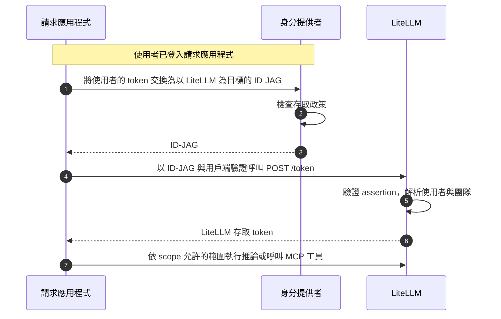

import Tabs from '@theme/Tabs';
import TabItem from '@theme/TabItem';
import IdJagScreenshot from '@site/src/components/IdJagScreenshot';

# LiteLLM 作為資源應用程式 {#litellm-as-resource-app}

讓應用程式將 ID-JAG 交換為 LiteLLM 存取 token，然後代表現有的 LiteLLM 使用者執行推論或呼叫 MCP 工具。

## 運作方式 {#how-it-works}

LiteLLM 的 `POST /token` 端點發出 token。推論端點（例如 `/v1/chat/completions`）與 MCP 閘道接受它。



## 先決條件 {#prerequisites}

:::info
此功能需要企業授權、資料庫、共用的 Redis 與 JWT 驗證。完成[身分提供者設定](../token_auth.md)。透過 `litellm_settings.cache` 搭配 Redis `cache_params`，或透過 `general_settings.coordination_redis` 設定 Redis，讓每個 ID-JAG 在所有 worker 與複本之間只被兌換一次。設定 `PROXY_BASE_URL` 並至少將一個請求應用程式加入允許清單，以啟用此授權。
:::

## 設定 {#get-started}

選取您的身分提供者以進行完整設定。

<Tabs groupId="id-jag-idp" queryString="idp">
<TabItem value="okta" label="Okta" default>

<span id="okta" />

本逐步解說假設 LiteLLM 已在 Okta 中註冊。它使用 [Okta Cross App Access](https://developer.okta.com/docs/guides/xaa-agent-to-app/main/) 與一個 OIDC 請求應用程式。將 `your-org.okta.com` 與 `litellm.example.com` 換成您的網域。

### 1. 在 Okta 中註冊請求應用程式 {#1-register-the-requesting-app-in-okta}

在 **Applications and Resources > Applications** 中，為將呼叫 LiteLLM 的應用程式建立或選取一個 **OIDC Web Application**。

<IdJagScreenshot
  src="/img/id-jag/okta-oidc-web-app.jpg"
  alt="選取了 OIDC 與 Web Application 的 Okta 應用程式整合對話框"
  caption="為請求應用程式建立 OIDC Web Application。"
  width={800}
  height={724}
/>

設定請求應用程式，讓使用者可以以 Okta 登入：

1. 在 **Grant type** 下，選取 **Authorization Code**。
2. 在 **Sign-in redirect URIs** 中，輸入請求應用程式登入設定中的回呼 URL。這是 Okta 在登入後將使用者送回的位置。
3. 儲存應用程式。開啟 **Assignments**，並指派您要用來測試流程的 Okta 使用者。

<IdJagScreenshot
  src="/img/id-jag/okta-oidc-sign-in-callback.jpg"
  alt="Okta 登入重新導向 URI 設定為 https://agent.example.com/callback"
  caption="設定請求應用程式的回呼 URL"
  width={690}
  height={184}
/>

從應用程式的 **Machine Assignments > Resources** 分頁，選取 **Register AI agent** 並完成註冊。

在代理程式的 **Client registration** 中，使用 client-secret 驗證。將其 client ID 與 secret 儲存為請求應用程式中的 `IDP_CLIENT_ID` 與 `IDP_CLIENT_SECRET`。這些也是它的 OIDC 登入憑證。如果代理程式處於 **STAGED** 狀態，請啟用它。

<IdJagScreenshot
  src="/img/id-jag/okta-agent-client-credentials.jpg"
  alt="顯示已遮罩的 client secret 與 client ID 欄位的 Okta client registration"
  caption="Client secret 與 client ID"
  width={800}
  height={330}
/>

### 2. 將請求應用程式連接到 LiteLLM {#2-connect-the-requesting-app-to-litellm}

在 **Applications and Resources > Applications** 中，開啟您現有的 LiteLLM 應用程式。在 **Assignments** 下，確認步驟 1 的使用者已指派給它。

開啟 **Machine Assignments > Callers > Cross App Access > Edit** 並啟用 XAA。將 **Issuer URL** 設為您的 LiteLLM URL。將 `litellm:mcp` 與 `litellm:llm` 定義為受支援的 scopes。在此單一租戶範例中，將 **Audience/tenant ID** 保持空白。

| 值 | URL |
|-------|-----|
| Issuer URL / ID-JAG audience | `https://litellm.example.com` |
| Token 端點 | `https://litellm.example.com/token` |
| 授權伺服器中繼資料 | `https://litellm.example.com/.well-known/oauth-authorization-server` |
| 原生用戶端探索 | `https://litellm.example.com/.well-known/litellm-cli-auth` |

<IdJagScreenshot
  src="/img/id-jag/okta-xaa-issuer-scopes.jpg"
  alt="具有裸來源 LiteLLM issuer 與 litellm:mcp 和 litellm:llm scopes 的 Okta Cross App Access 設定"
  caption="LiteLLM 的 XAA 設定範例"
  width={400}
  height={932}
/>

在 AI 代理程式的 **Resource connections** 分頁，選取您的 LiteLLM 應用程式。將在 LiteLLM 註冊的 client ID 設為 `agent-client`，**Resource identifier** 設為 `https://litellm.example.com`，並選取 **Allow specific scopes**。選擇要允許的 scopes：

<IdJagScreenshot
  src="/img/id-jag/okta-litellm-resource-connection.jpg"
  alt="Client ID 為 agent-client、資源為 https://litellm.example.com，並具有 litellm:mcp 與 litellm:llm scopes 的 Okta 資源連線"
  caption="將請求應用程式連接到 LiteLLM"
  width={510}
  height={670}
/>

| 授予的 scope | 存取權 |
|---------------|--------|
| `litellm:mcp` | 僅 MCP 閘道路由。 |
| `litellm:llm` | 僅 LLM API 路由。 |
| `litellm:mcp litellm:llm` | MCP 閘道與 LLM API 兩種路由。 |
| 無 scope | 在使用者與團隊權限內的完整存取權，與 `lite login` 相同。 |

### 3. 設定 LiteLLM {#3-configure-litellm}

以請求應用程式的 client ID 與現有 client secret 設定 LiteLLM。此範例使用 `agent-client`，並從 `AGENT_CLIENT_SECRET` 讀取其 secret。

<Tabs groupId="id-jag-deployment">
<TabItem value="helm" label="Helm" default>

```yaml title="values.yaml"
envVars:
  PROXY_BASE_URL: "https://litellm.example.com"
environmentSecrets: [litellm-id-jag]
proxy_config:
  general_settings:
    enable_jwt_auth: true
    litellm_jwtauth:
      id_jag_requesting_apps:
        - client_id: agent-client
          client_secret: os.environ/AGENT_CLIENT_SECRET
```

</TabItem>
<TabItem value="terraform" label="Terraform">

將這些輸入加入您現有的 [LiteLLM AWS 或 Google Cloud 模組](../deploy/terraform.md)。將 `var.agent_client_secret_ref` 設為 AWS 上的 secret ARN，或 Google Cloud 上的 Secret Manager 資源 ID。

```hcl title="Existing LiteLLM module inputs"
gateway_extra_env = { PROXY_BASE_URL = "https://litellm.example.com" }
backend_extra_env = { PROXY_BASE_URL = "https://litellm.example.com" }
gateway_extra_secrets = { AGENT_CLIENT_SECRET = var.agent_client_secret_ref }
backend_extra_secrets = { AGENT_CLIENT_SECRET = var.agent_client_secret_ref }
proxy_config = {
  general_settings = {
    enable_jwt_auth = true
    litellm_jwtauth = {
      id_jag_requesting_apps = [{
        client_id     = "agent-client"
        client_secret = "os.environ/AGENT_CLIENT_SECRET"
      }]
    }
  }
}
```

執行 `terraform plan`，然後執行 `terraform apply`。

</TabItem>
</Tabs>

建立或選取一位電子郵件與 IdP 帳戶相符的 LiteLLM 使用者。給予該使用者您想呼叫的模型或 MCP 工具的存取權。部署後，檢查探索是否列出 `urn:ietf:params:oauth:grant-type:jwt-bearer`：

```bash
curl -s https://litellm.example.com/.well-known/oauth-authorization-server \
  | jq '.grant_types_supported'
```

在您現有的 JWT 設定中，使用 Okta 的組織 issuer（`https://your-org.okta.com`）與 JWKS URL（`https://your-org.okta.com/oauth2/v1/keys`）。

</TabItem>
<TabItem value="other" label="其他 IdP">

您的 IdP 必須支援 ID-JAG 發行，並接受 OIDC ID token 作為 subject。此範例使用 client-secret 驗證；請選擇您的提供者支援的方法。

### 1. 註冊請求應用程式 {#other-register-requesting-app}

在您的 IdP 中建立 OIDC 用戶端。啟用 Authorization Code，註冊請求應用程式的登入回呼 URL，並指派可以登入的使用者。以提供者的 issuer 與 `openid profile email` scopes 設定應用程式的 OIDC 登入。

為該用戶端啟用 ID-JAG token 交換。將其憑證儲存為 `IDP_CLIENT_ID` 與 `IDP_CLIENT_SECRET`，並從提供者的中繼資料記下 issuer、JWKS URL 與 ID-JAG token 端點。

### 2. 將 LiteLLM 註冊為資源 {#other-register-resource}

在您的 IdP 中註冊這些值：

| 設定 | 值 |
|---------|-------|
| 資源 issuer / ID-JAG audience | `https://litellm.example.com` |
| Token 端點 | `https://litellm.example.com/token` |
| 授權伺服器中繼資料 | `https://litellm.example.com/.well-known/oauth-authorization-server` |
| 原生用戶端探索 | `https://litellm.example.com/.well-known/litellm-cli-auth` |
| 資源識別碼 | `https://litellm.example.com` |
| 請求應用程式在 LiteLLM 的 client ID | `agent-client` |

允許請求應用程式為您的測試使用者存取此資源。IdP 必須將 `agent-client` 放入 ID-JAG 的 `client_id` claim。選擇允許的 scopes：

| 授予的 scope | 存取權 |
|---------------|--------|
| `litellm:mcp` | 僅 MCP 閘道路由。 |
| `litellm:llm` | 僅 LLM API 路由。 |
| `litellm:mcp litellm:llm` | MCP 閘道與 LLM API 兩種路由。 |
| 無 scope | 在使用者與團隊權限內的完整存取權，與 `lite login` 相同。 |

### 3. 設定 LiteLLM {#other-configure-litellm}

以請求應用程式的 client ID 與現有 client secret 設定 LiteLLM。此範例使用 `agent-client`，並從 `AGENT_CLIENT_SECRET` 讀取其 secret。

<Tabs groupId="id-jag-deployment">
<TabItem value="helm" label="Helm" default>

```yaml title="values.yaml"
envVars:
  PROXY_BASE_URL: "https://litellm.example.com"
environmentSecrets: [litellm-id-jag]
proxy_config:
  general_settings:
    enable_jwt_auth: true
    litellm_jwtauth:
      id_jag_requesting_apps:
        - client_id: agent-client
          client_secret: os.environ/AGENT_CLIENT_SECRET
```

</TabItem>
<TabItem value="terraform" label="Terraform">

將這些輸入加入您現有的 [LiteLLM AWS 或 Google Cloud 模組](../deploy/terraform.md)。將 `var.agent_client_secret_ref` 設為 AWS 上的 secret ARN，或 Google Cloud 上的 Secret Manager 資源 ID。

```hcl title="Existing LiteLLM module inputs"
gateway_extra_env = { PROXY_BASE_URL = "https://litellm.example.com" }
backend_extra_env = { PROXY_BASE_URL = "https://litellm.example.com" }
gateway_extra_secrets = { AGENT_CLIENT_SECRET = var.agent_client_secret_ref }
backend_extra_secrets = { AGENT_CLIENT_SECRET = var.agent_client_secret_ref }
proxy_config = {
  general_settings = {
    enable_jwt_auth = true
    litellm_jwtauth = {
      id_jag_requesting_apps = [{
        client_id     = "agent-client"
        client_secret = "os.environ/AGENT_CLIENT_SECRET"
      }]
    }
  }
}
```

執行 `terraform plan`，然後執行 `terraform apply`。

</TabItem>
</Tabs>

建立或選取一位電子郵件與 IdP 帳戶相符的 LiteLLM 使用者。給予該使用者您想呼叫的模型或 MCP 工具的存取權。部署後，檢查探索是否列出 `urn:ietf:params:oauth:grant-type:jwt-bearer`：

```bash
curl -s https://litellm.example.com/.well-known/oauth-authorization-server \
  | jq '.grant_types_supported'
```

</TabItem>
</Tabs>

## 測試驗證 {#test-authentication}

選取與設定時相同的身分提供者。

<Tabs groupId="id-jag-idp" queryString="idp">
<TabItem value="okta" label="Okta" default>

### 1. 登入並請求 ID-JAG {#4-sign-in-and-request-an-id-jag}

以 issuer `https://your-org.okta.com` 與 scopes `openid profile email` 設定請求應用程式的 OIDC 登入。以指派的測試使用者登入，並將登入回應的 `id_token` 儲存為 `ID_TOKEN`。設定 `REQUESTED_SCOPES="litellm:mcp litellm:llm"` 以嘗試下方兩個範例，或只請求資源連線上允許的其中一個 scope。

使用[設定步驟 1](#1-register-the-requesting-app-in-okta) 中代理程式的 Okta 憑證來[交換 ID token](https://developer.okta.com/docs/guides/xaa-request-token-ex/openidconnect/main/)：

```bash title="Request an ID-JAG" showLineNumbers
curl -s -X POST https://your-org.okta.com/oauth2/v1/token \
  -d grant_type=urn:ietf:params:oauth:grant-type:token-exchange \
  -d requested_token_type=urn:ietf:params:oauth:token-type:id-jag \
  -d subject_token_type=urn:ietf:params:oauth:token-type:id_token \
  --data-urlencode "subject_token=$ID_TOKEN" \
  -d audience=https://litellm.example.com \
  -d resource=https://litellm.example.com \
  --data-urlencode "scope=$REQUESTED_SCOPES" \
  --data-urlencode "client_id=$IDP_CLIENT_ID" \
  --data-urlencode "client_secret=$IDP_CLIENT_SECRET"
```

將回應的 `access_token` 儲存為 `ID_JAG`。

### 2. 取得 LiteLLM 存取 token {#5-get-a-litellm-access-token}

以 `jwt-bearer` 授權將 ID-JAG 作為 `assertion` 傳送。使用請求應用程式**在 LiteLLM 的** client ID 與 secret，如 `id_jag_requesting_apps` 中所設定。

```bash title="Get a LiteLLM credential" showLineNumbers
curl -s -X POST https://litellm.example.com/token \
  -d grant_type=urn:ietf:params:oauth:grant-type:jwt-bearer \
  -d client_id=agent-client \
  --data-urlencode "client_secret=$AGENT_CLIENT_SECRET" \
  --data-urlencode "assertion=$ID_JAG"
```

機密用戶端也可以使用 HTTP Basic 驗證（`-u "agent-client:$AGENT_CLIENT_SECRET"`），而非 client ID 與 secret 表單欄位。公開用戶端傳送 `client_id`，不附 secret。

```json
{
  "access_token": "LneZuxEFqvemEwK6lRzgg6BN...",
  "token_type": "Bearer",
  "expires_in": 86400,
  "scope": "litellm:mcp litellm:llm",
  "user_id": "user@example.com",
  "team_id": "125eca86-fbde-44de-8cb9-cf1432933fcd"
}
```

將 `access_token` 儲存為 `LITELLM_ACCESS_TOKEN`。`scope` 會回顯授予的 scope，它限制路由存取權。不會發出 refresh token。憑證到期時，請請求新的 ID-JAG 並再次兌換。

### 3. 呼叫 LiteLLM {#6-call-litellm}

使用存取 token 進行其 scope 與使用者 LiteLLM 權限所允許的呼叫。支出會歸屬到他們的 `user_id` 與 `team_id`。

<Tabs>
<TabItem value="inference" label="推論" default>

將 `<your-model-name>` 換成在您的 proxy 上設定的模型。

```bash title="Run inference" showLineNumbers
curl -s https://litellm.example.com/v1/chat/completions \
  -H "Authorization: Bearer $LITELLM_ACCESS_TOKEN" \
  -H "Content-Type: application/json" \
  -d '{"model":"<your-model-name>","messages":[{"role":"user","content":"Hello"}]}'
```

</TabItem>
<TabItem value="mcp" label="MCP 工具">

```bash title="List MCP tools" showLineNumbers
curl -s -X POST https://litellm.example.com/mcp \
  -H "Authorization: Bearer $LITELLM_ACCESS_TOKEN" \
  -H "Content-Type: application/json" \
  -H "Accept: application/json, text/event-stream" \
  -d '{"jsonrpc":"2.0","id":1,"method":"tools/list","params":{}}'
```

</TabItem>
</Tabs>

</TabItem>
<TabItem value="other" label="其他 IdP">

### 1. 登入並請求 ID-JAG {#other-request-id-jag}

以指派的使用者登入請求應用程式。將登入回應的 `id_token` 儲存為 `ID_TOKEN`，並設定 `REQUESTED_SCOPES="litellm:mcp litellm:llm"` 以嘗試下方兩個範例。依您的 IdP 政策允許的範圍，只請求一個 scope 以限制存取權。

將下方的 token 端點換成您提供者的 ID-JAG 端點。使用[設定步驟 1](#other-register-requesting-app) 中的 IdP 用戶端憑證：

```bash title="Request an ID-JAG" showLineNumbers
curl -s -X POST https://idp.example.com/oauth2/v1/token \
  -d grant_type=urn:ietf:params:oauth:grant-type:token-exchange \
  -d requested_token_type=urn:ietf:params:oauth:token-type:id-jag \
  -d subject_token_type=urn:ietf:params:oauth:token-type:id_token \
  --data-urlencode "subject_token=$ID_TOKEN" \
  -d audience=https://litellm.example.com \
  -d resource=https://litellm.example.com \
  --data-urlencode "scope=$REQUESTED_SCOPES" \
  --data-urlencode "client_id=$IDP_CLIENT_ID" \
  --data-urlencode "client_secret=$IDP_CLIENT_SECRET"
```

將回應的 `access_token` 儲存為 `ID_JAG`。

### 2. 取得 LiteLLM 存取 token {#other-get-access-token}

以 `jwt-bearer` 授權將 ID-JAG 作為 `assertion` 傳送。使用請求應用程式**在 LiteLLM 的** client ID 與 secret，如 `id_jag_requesting_apps` 中所設定。

```bash title="Get a LiteLLM credential" showLineNumbers
curl -s -X POST https://litellm.example.com/token \
  -d grant_type=urn:ietf:params:oauth:grant-type:jwt-bearer \
  -d client_id=agent-client \
  --data-urlencode "client_secret=$AGENT_CLIENT_SECRET" \
  --data-urlencode "assertion=$ID_JAG"
```

機密用戶端也可以使用 HTTP Basic 驗證（`-u "agent-client:$AGENT_CLIENT_SECRET"`），而非 client ID 與 secret 表單欄位。公開用戶端傳送 `client_id`，不附 secret。

```json
{
  "access_token": "LneZuxEFqvemEwK6lRzgg6BN...",
  "token_type": "Bearer",
  "expires_in": 86400,
  "scope": "litellm:mcp litellm:llm",
  "user_id": "user@example.com",
  "team_id": "125eca86-fbde-44de-8cb9-cf1432933fcd"
}
```

將 `access_token` 儲存為 `LITELLM_ACCESS_TOKEN`。`scope` 會回顯授予的 scope，它限制路由存取權。不會發出 refresh token。憑證到期時，請請求新的 ID-JAG 並再次兌換。

### 3. 呼叫 LiteLLM {#other-call-litellm}

使用存取 token 進行其 scope 與使用者 LiteLLM 權限所允許的呼叫。支出會歸屬到他們的 `user_id` 與 `team_id`。

<Tabs>
<TabItem value="inference" label="推論" default>

將 `<your-model-name>` 換成在您的 proxy 上設定的模型。

```bash title="Run inference" showLineNumbers
curl -s https://litellm.example.com/v1/chat/completions \
  -H "Authorization: Bearer $LITELLM_ACCESS_TOKEN" \
  -H "Content-Type: application/json" \
  -d '{"model":"<your-model-name>","messages":[{"role":"user","content":"Hello"}]}'
```

</TabItem>
<TabItem value="mcp" label="MCP 工具">

```bash title="List MCP tools" showLineNumbers
curl -s -X POST https://litellm.example.com/mcp \
  -H "Authorization: Bearer $LITELLM_ACCESS_TOKEN" \
  -H "Content-Type: application/json" \
  -H "Accept: application/json, text/event-stream" \
  -d '{"jsonrpc":"2.0","id":1,"method":"tools/list","params":{}}'
```

</TabItem>
</Tabs>

</TabItem>
</Tabs>

## 疑難排解 {#troubleshooting}

<Tabs groupId="id-jag-idp" queryString="idp">
<TabItem value="okta" label="Okta" default>

| 回應或記錄 | 原因與修正 |
|-----------------|---------------|
| 來自 Okta 的 `invalid_target` 或 `unauthorized_client` | 在 **Directory > AI Agents > Resource connections** 下，檢查 LiteLLM issuer URL、允許的 scopes、使用者指派與代理程式啟用狀態。 |
| `400 unsupported_grant_type` | 檢查企業授權、資料庫、共用的 Redis、JWT 驗證、`PROXY_BASE_URL`，以及非空的請求應用程式允許清單。設定變更後請重新啟動。在此閘道上將 `virtual_key_claim_field` 與 `jwt_client_id_field` 保持未設定。 |
| `400 invalid_request`：缺少 `client_id` 或 `assertion` | 在表單或 HTTP Basic 驗證中傳送 `client_id`，並在 `assertion` 表單欄位中傳送 ID-JAG。 |
| `401 invalid_client` | 比對允許清單中的 client ID 與 secret。只為機密用戶端設定 secret。 |
| `400 invalid_grant`：錯誤的 `typ` 或格式不正確的 JWT | 傳送 IdP 交換回傳的 ID-JAG，而非使用者的登入 token 或一般的 bearer token。 |
| `400 invalid_grant`：assertion 已被兌換 | 請求新的 ID-JAG。每個 assertion 只能兌換一次。 |
| `400 invalid_grant`；記錄回報 audience 不符 | 將 **Machine Assignments > Callers > Issuer URL** 設為裸來源 `<PROXY_BASE_URL>`。檢查 scheme 與結尾斜線。 |
| `400 invalid_grant`；記錄回報不受信任的 issuer 或缺少簽章金鑰 | 使用 Okta issuer `https://your-org.okta.com` 與 JWKS URL `https://your-org.okta.com/oauth2/v1/keys`。 |
| `400 invalid_grant`；記錄回報 `client_id` 不符 | 將 **AI agent's client ID registered in this app** 設為代理程式傳送給 LiteLLM 的 ID。 |
| `400 invalid_grant`；記錄回報使用者不存在 | 將 Okta 的 `email` 或 `sub` 對應到現有的 LiteLLM 使用者。 |
| `400 invalid_request`：團隊選取或成員資格 | 以使用者某個團隊的 ID 或別名傳送 `x-litellm-team-id`。 |
| `503 temporarily_unavailable`：無法讀取使用者團隊 | 重試。Assertion 尚未被消耗。 |
| 在 `/mcp` 上使用 ID-JAG 時的 `401` | 在 `/token` 兌換它，並使用回傳的 `access_token`。 |

</TabItem>
<TabItem value="other" label="其他 IdP">

| 回應或記錄 | 原因與修正 |
|-----------------|---------------|
| `400 unsupported_grant_type` | 檢查企業授權、資料庫、共用的 Redis、JWT 驗證、`PROXY_BASE_URL`，以及非空的請求應用程式允許清單。設定變更後請重新啟動。在此閘道上將 `virtual_key_claim_field` 與 `jwt_client_id_field` 保持未設定。 |
| `400 invalid_request`：缺少 `client_id` 或 `assertion` | 在表單或 HTTP Basic 驗證中傳送 `client_id`，並在 `assertion` 表單欄位中傳送 ID-JAG。 |
| `401 invalid_client` | 比對允許清單中的 client ID 與 secret。只為機密用戶端設定 secret。 |
| `400 invalid_grant`：錯誤的 `typ` 或格式不正確的 JWT | 傳送 IdP 交換回傳的 ID-JAG，而非使用者的登入 token 或一般的 bearer token。 |
| `400 invalid_grant`：assertion 已被兌換 | 請求新的 ID-JAG。每個 assertion 只能兌換一次。 |
| `400 invalid_grant`；記錄回報 audience 不符 | 將 IdP 的資源 audience 與裸來源 `<PROXY_BASE_URL>` 比對一致。檢查 scheme 與結尾斜線。 |
| `400 invalid_grant`；記錄回報不受信任的 issuer 或缺少簽章金鑰 | 將 `issuers[].issuer` 與 assertion 的 `iss` 比對一致，並設定該 issuer 的 JWKS。 |
| `400 invalid_grant`；記錄回報 `client_id` 不符 | 設定 IdP 將應用程式的 LiteLLM client ID 放入 assertion。 |
| `400 invalid_grant`；記錄回報使用者不存在 | 建立 LiteLLM 使用者，或修正使用者 ID/電子郵件 claim 對應。 |
| `400 invalid_request`：團隊選取或成員資格 | 以使用者某個團隊的 ID 或別名傳送 `x-litellm-team-id`。 |
| `503 temporarily_unavailable`：無法讀取使用者團隊 | 重試。Assertion 尚未被消耗。 |
| 在 `/mcp` 上使用 ID-JAG 時的 `401` | 在 `/token` 兌換它，並使用回傳的 `access_token`。 |

</TabItem>
</Tabs>

## 相關指南 {#related-guides}

交換角色請參閱 [ID-JAG 概觀](./overview.md)；當 LiteLLM 需要代表使用者呼叫上游 MCP 伺服器時，請參閱 [LiteLLM 作為請求應用程式](./requesting_app.md)。

Issuer 與簽章金鑰設定請使用[身分提供者設定](../token_auth.md)。透過 [LLM 存取](../access_management/llm.md) 與 [MCP 存取](../access_management/mcp.md) 設定使用者的資源權限。
