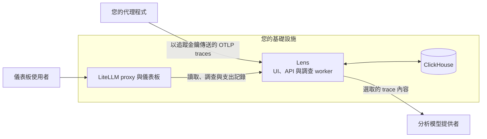

# 設定 Lens {#set-up-lens}

Lens 可讓您檢視代理程式 traces、調查失敗，並將有用的執行儲存為資料集。您可以在 LiteLLM 儀表板內開啟它，或將它作為獨立應用程式使用。

在這兩種情況下，Lens 都以自己的服務執行，並將資料儲存在 ClickHouse 中。您的代理程式可以保留其既有的模型提供者。

## 元件如何連接 {#architecture}

Lens 是一個服務。它提供 UI 與 API，並在背景 worker 中執行調查。它將 traces、LiteLLM 支出記錄與調查結果儲存在 ClickHouse 中。每個 Lens 複本都共用該 ClickHouse 狀態，因此您可以執行多個複本。

代理程式以追蹤金鑰將 OpenTelemetry traces 直接傳送至 Lens。Traces 不會經過 LiteLLM。當您在 LiteLLM 內使用 Lens 時，儀表板以及 LiteLLM 的 trace 與調查路由會代表使用者呼叫 Lens。LiteLLM 以 `LITELLM_LENS_SERVICE_TOKEN` 驗證這些呼叫，以 `LENS_GATEWAY_SECRET` 簽署使用者身分，並傳送其支出記錄，讓每次執行都能顯示成本。

調查只會將選取的 trace 內容傳送至您設定的分析模型。其他一切都留在您的基礎設施上。獨立 Lens 只需要 Lens 與 ClickHouse。

## 選擇您的起點 {#new-deployment}

| 您的起點 | 請遵循此指南 |
| --- | --- |
| 您使用 LiteLLM，並希望 Lens 出現在其側邊欄 | [將 Lens 加入 LiteLLM](./deployment/litellm.md) |
| 您已在執行 Lens，並希望將它連接到閘道 | [連接您現有的 Lens 部署](./deployment/litellm.md#1-get-the-lens-address) |
| 您希望在沒有閘道的情況下執行 Lens | [啟動獨立 Lens](./deployment/local.md) |
| 您的團隊已設定好 Lens | [傳送您的第一個 trace](./first-trace.md) |

若要進行持久性的獨立部署，請使用[伺服器上的 Docker Compose](./deployment/server.md) 或 [Kubernetes](./deployment/kubernetes.md)。本機快速入門會從原始碼建置。發行狀態請參閱[發行版本與映像](./deployment/releases.md)。

## 在 LiteLLM 內使用 Lens {#configure-an-existing-proxy}

閘道管理員只需設定一次連線。之後使用者在 LiteLLM 側邊欄開啟 **Lens**，並使用其既有的 LiteLLM 工作階段。他們不需要輸入獨立 Lens 的管理員 token。LiteLLM 會將其身分與存取範圍提供給 Lens。

如果 Lens 尚未設定，儀表板會顯示其設定頁面。連接服務並不會為您的代理程式加入檢測。連線就緒後，請從代理程式傳送一個 trace。

請遵循[將 Lens 加入 LiteLLM](./deployment/litellm.md)。如果 Lens 已在執行，請使用其目前的位址、儲存與憑證。您不需要安裝第二份或搬移其資料。

## 單獨使用 Lens {#use-lens-on-its-own}

一個指令 `./deploy/lens/start` 即可同時啟動 Lens 與 ClickHouse。然後在 Lens URL 以其管理員 token 登入。不需要 LiteLLM 閘道與 PostgreSQL。您可以在設定分析模型之前，先記錄並檢視 traces。

請遵循[獨立快速入門](./deployment/local.md)。當您想執行調查時，再加入[分析模型](https://github.com/BerriAI/lens/blob/main/docs/analysis.md)。

## 檢查您的第一個結果 {#check-the-installation}

開啟 Lens，產生一把追蹤金鑰，並遵循[傳送您的第一個 trace](./first-trace.md)。開啟產生的執行並檢視其內容。健康檢查確認服務已就緒；已儲存的 trace 確認您的匯出器可以傳送資料，且您可以讀取它。

如需程式碼代理程式的協助，請複製 [Lens 設定指南](https://github.com/BerriAI/lens/blob/main/docs/setup-with-agent.md) 中的 **Set it up for me** 提示。它涵蓋獨立設定、現有閘道，以及連接代理程式。
