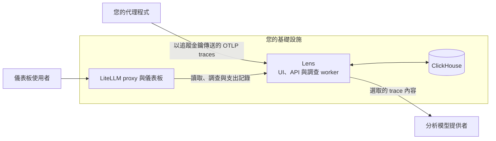

# 設定 Lens {#set-up-lens}

Lens 可讓您檢視代理程式 traces、調查失敗，並將有用的執行儲存為資料集。您可以在 LiteLLM 儀表板內開啟它，或將它作為獨立應用程式使用。

在這兩種情況下，Lens 都以自己的服務執行，並將資料儲存在 ClickHouse 中。您的代理程式可以保留其既有的模型提供者。

## 元件如何連接 {#architecture}

代理程式以追蹤金鑰將 traces 直接傳送至 Lens。調查會將選取的 trace 內容傳送至您的分析模型。Compose 檔案、發行套件與 Helm chart 各自都包含 Lens 與 ClickHouse。

## 選擇您的起點 {#new-deployment}

| 您的起點 | 請遵循此指南 |
| --- | --- |
| 在一台機器或伺服器上使用 Docker | [下載一個 Compose 檔案並執行它](./deployment/local.md) |
| Kubernetes | [安裝 Helm chart](./deployment/kubernetes.md) |
| 加入現有的 LiteLLM 閘道 | [將 Lens 連接至 LiteLLM](./deployment/litellm.md) |

已經設定好了？[傳送您的第一個 trace](./first-trace.md)。

連接閘道後，Lens 會沿用閘道的使用者、團隊、SSO 與追蹤權限。請參閱[存取控制](./rbac.md#gateway-permissions)。

## 記錄程式碼代理程式工作階段 {#record-coding-agent-sessions}

Lens 啟動後，請產生追蹤金鑰，並為 [Claude Code](./coding-agents.md#claude-code) 或 [Codex](./coding-agents.md#codex) 安裝 Lens 外掛程式。請保留您既有的模型登入。開啟 Lens 中的 **Traces** 以尋找您的工作階段；不需要 Python 範例或 LiteLLM 閘道。

## 在 LiteLLM 內使用 Lens {#configure-an-existing-proxy}

閘道管理員只需[連接 Lens](./deployment/litellm.md)一次。之後使用者以其既有的工作階段，在側邊欄開啟 **Lens**。如果 Lens 已在執行，請保留其位址、儲存與憑證。您不需要第二份副本。

## 單獨使用 Lens {#use-lens-on-its-own}

下載 [Lens Compose 檔案](https://github.com/BerriAI/lens/blob/main/deploy/lens/compose.yaml) 並執行 `docker compose up --wait`。它會從已發佈的映像啟動 Lens 與 ClickHouse。請以產生的管理員 token 登入。不需要 LiteLLM 閘道與 PostgreSQL。

請遵循[快速入門](./deployment/local.md)。您不需要分析模型也可以檢視 traces。當您想執行調查時，再加入[分析模型](https://github.com/BerriAI/lens/blob/main/docs/analysis.md)。

## 檢查您的第一個結果 {#check-the-installation}

開啟 Lens，產生一把追蹤金鑰，並遵循[傳送您的第一個 trace](./first-trace.md)。開啟產生的執行並檢視其內容。健康檢查確認服務已就緒；已儲存的 trace 確認您的匯出器可以傳送資料，且您可以讀取它。

如需程式碼代理程式的協助，請複製 [Lens 設定指南](https://github.com/BerriAI/lens/blob/main/docs/setup-with-agent.md) 中的 **Set it up for me** 提示。它涵蓋獨立設定、現有閘道，以及連接代理程式。
