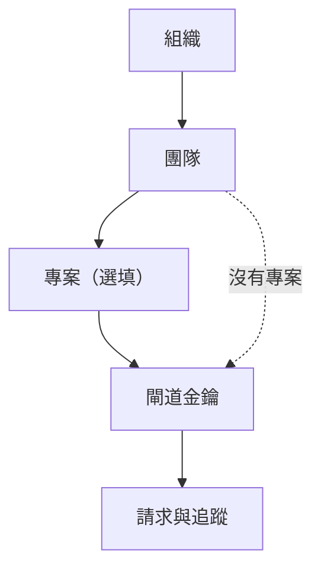

# 存取控制與工作區篩選器 {#access-control-and-workspace-filters}

{/* keep-version-note: This overview covers existing trace permissions and upcoming workspace controls, with no verified release that includes all controls. */}

:::info 即將推出的工作區控制

這些團隊／金鑰追蹤控制與組織、團隊、專案與金鑰選擇器，是即將推出的 Gateway 與 Lens 更新的一部分。截圖顯示的是預覽版本。

:::

將 Lens 連接到您的 LiteLLM 閘道，您已在該處設定好的權限就會套用到 Lens。您不需要再次建立 Lens 使用者、對應團隊或定義角色。您的 Gateway 帳號決定您可以讀取哪些追蹤，且這適用於每個透過閘道執行的請求。

## 使用您已有的權限 {#gateway-permissions}

管理員[將 Lens 連接到 LiteLLM](./deployment/litellm.md)一次即可，閘道上需要四個環境變數，Lens 上需要兩個。此後，Lens 會向閘道詢問每個人的身分與可見內容。

| 已經在 LiteLLM 中設定 | 它在 Lens 中的作用 |
| --- | --- |
| 使用者與單一登入 (SSO) | 使用者以其 LiteLLM 登入登入 Lens。Lens 沒有獨立的使用者清單或身分提供者設定。 |
| Proxy 管理員與管理員檢視者角色 | 這些角色可以讀取每筆追蹤。 |
| 團隊與團隊管理員 | 追蹤屬於發出請求的金鑰所屬團隊。團隊管理員可以讀取其團隊的追蹤。 |
| 團隊成員權限 | 當團隊授予 `/spend/logs` 時，成員可以讀取其團隊的追蹤，該權限與分享其支出記錄的權限相同。 |
| 虛擬金鑰 | 每筆追蹤都會記錄傳送它的金鑰、使用者與團隊，因此使用者無需額外設定即可看到自己的流量。 |

閘道上的變更也會沿用。將某人加入團隊或在 LiteLLM 中變更成員權限，會在該人下次開啟 Lens 或登入時套用到 Lens。Lens 中沒有需要對應變更的設定。

### 使用您的 LiteLLM 登入 {#log-in-with-litellm}

在 LiteLLM 儀表板側邊欄中選取 **Lens**，即可使用您目前的閘道工作階段開啟 Lens。在 Lens 位址本身，請在登入頁面選取 **Log in with LiteLLM**。閘道會為您登入，透過 SSO 進行（如果您使用 SSO），再將您帶回 Lens，並套用您的閘道權限。[在 Lens 登入頁面提供「使用 LiteLLM 登入」](./deployment/litellm.md#log-in-with-litellm)涵蓋 Lens 登入頁面的一項額外設定。

團隊成員不需要為每個金鑰另外輸入 Lens 整合憑證。工作區篩選器會縮小您可以讀取的追蹤。選取另一個組織、團隊、專案或金鑰並不會授予存取權。

Lens 也可以在沒有閘道的情況下執行。獨立 Lens 只有一個管理員 token，且沒有依團隊區分的權限，因此當不同的人需要不同的存取權時，請連接閘道。

組織與專案選單需要已設定的實體與列出它們的權限。組織管理遵循 Gateway 的 Enterprise 授權。這些管理權限不會授予追蹤存取權。

## 瞭解階層 {#understand-the-hierarchy}

常見的流量分組方式：

一個金鑰可以屬於某個團隊而不屬於專案。個人金鑰也可以沒有團隊。就組織篩選器而言，金鑰上明確設定的組織優先；否則 Lens 會使用該金鑰所屬團隊的組織。這些指派用來分組流量，但並不構成另一項權限授予。

## 誰可以讀取追蹤 {#who-can-read-traces}

Lens 使用 Gateway 現有的追蹤權限。此表中的任何項目都不是在 Lens 中設定：

| 讀者 | 可見的追蹤 |
| --- | --- |
| 代理管理員或管理員檢視者 | 全部追蹤。 |
| 團隊管理員 | 自己擁有的追蹤，加上其管理或有權檢視的團隊的追蹤。 |
| 其他使用者，包括團隊成員 | 自己擁有的追蹤，加上與其分享記錄的團隊的追蹤。 |
| 組織管理員或專案擁有者 | 與上述使用者／團隊規則相同。僅憑組織或專案擁有權，並不會授予全部相關追蹤。 |
| 沒有使用者身分的非管理員金鑰 | 無法讀取追蹤；請求會傳回 `403`。 |

若要分享某個團隊的追蹤，請開啟 **Teams**，選取該團隊，再選取 **Member Permissions**。授予 `/spend/logs` 權限。團隊管理員不需要這項成員授權就能讀取該團隊的追蹤。API 與預設團隊設定請參閱[分享團隊的追蹤](./api.md#trace-access)。

專用的 Lens 追蹤金鑰會上傳遙測資料並檢查自己的傳送回條；它們不會讀取追蹤。請參閱[上傳追蹤](./api.md#upload)。

## 為團隊與金鑰啟用 Lens {#enable-lens-for-a-team-and-key}

### 設定團隊預設值 {#set-the-team-default}

開啟 **Teams**，選取您的團隊，再開啟其 **Lens** 分頁。將開關設為 **On**，即可為繼承團隊設定的金鑰啟用追蹤。**Default for team keys** 指的就是這項控制。

### 檢查金鑰 {#check-the-key}

開啟 **Virtual Keys**，選取該金鑰，再開啟 **Lens**。**On** 會為該金鑰啟用追蹤。**Use team setting** 會移除自訂的金鑰覆寫並恢復繼承。

金鑰明確設定的 On 或 Off 優先於其團隊。若金鑰沒有覆寫，則適用團隊設定。若兩者都沒有設定值，在已設定 Lens 的情況下，追蹤預設為 On。這項控制只影響未來的收集：它不會授予讀取權限，也不會刪除已儲存的追蹤。啟用 Lens 後，請驗證追蹤是否送達。

## 在 Lens 中區分流量 {#segment-traffic-in-lens}

從金鑰的 Lens 分頁選取 **Open Lens**。Lens 會以該金鑰（及其所屬團隊，如已指派）選取開啟。左側邊欄包含 Lens 頁面；階層控制位於內容上方。

| 選取 | 檢查內容 |
| --- | --- |
| **Organization** | 來自指派給該組織的金鑰的流量，包括繼承的團隊指派。 |
| **Team** | 為該團隊記錄的流量。 |
| **Project** | 來自目前指派給該專案的金鑰的流量。 |
| **Key** | 以該特定金鑰記錄的流量。 |

例如，選取您的組織、選擇一個團隊，再選取一個專案，即可比較該應用程式的流量。選取一個金鑰，即可隔離單一整合或服務。選取 **All keys** 會保留上層篩選器。變更上層會清除其下層項目與任何已開啟的追蹤；選取金鑰會填入其上層項目。**No project** 表示該金鑰沒有專案指派。

選取的篩選器以 AND 組合，且維持在您授權的資料列範圍內。不相符的組合不會傳回任何結果。追蹤詳情、span、對話記錄、分頁、複製的追蹤查詢與分享連結都會保留該選取。追蹤 SQL 使用相同範圍；請參閱[使用 SQL 查詢追蹤](./api.md#query-traces)。

這些選擇器只篩選追蹤檢視與追蹤 SQL。它們不會自動篩選 Profiles、Datasets 或 Evals，也不會授予對這些物件的存取權。

組織與專案篩選器使用目前的金鑰指派，而非歷史快照。符合超過 2,048 個金鑰的範圍需要更窄的團隊、專案或金鑰選取。組織篩選器也會在 2,048 個候選團隊處停止。Gateway 會傳回錯誤，而非靜默省略相符的金鑰。

若沒有出現任何追蹤，請檢查時間範圍、追蹤政策與連線，再依照[傳送您的第一筆追蹤](./first-trace.md)操作。
