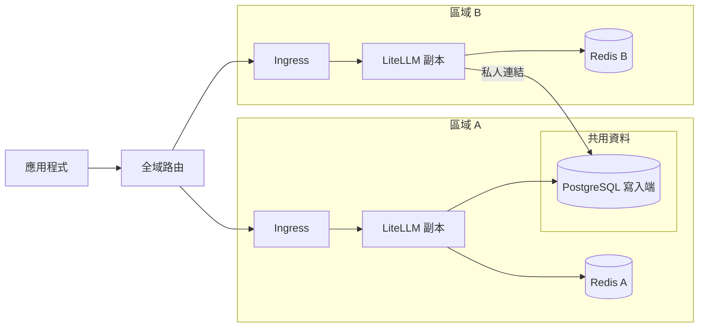

import Tabs from '@theme/Tabs';
import TabItem from '@theme/TabItem';

# 多區域部署 {#multi-region-deployment}

{/* keep-version-note */}

當使用者需要鄰近的閘道，或您的復原計畫涵蓋區域中斷時，請在多個區域執行 LiteLLM。區域閘道使用一個邏輯 PostgreSQL 資料庫，以及每個區域一個 Redis 執行個體。

若是處理單一區域內的副本與可用區故障，請從[高可用性](./deploy/ha/overview.md) 開始。使用[路由](./deploy/multi_region/routing.md) 為每個請求選擇區域。使用[備援切換](./deploy/multi_region/failover.md) 規劃區域與共用相依性故障。

## 架構 {#architecture}



PostgreSQL 保存共用的金鑰、團隊、使用者、設定與支出記錄。請使用高可用性的資料庫服務。所有區域閘道都依賴其可寫入的主要資料庫。

| 模式 | 一般請求路由 | 容量需求 |
| --- | --- | --- |
| 主動-主動 | 兩個區域透過延遲、位置或加權政策提供請求服務。 | 存活的區域需要有備用容量來接手它接管的流量。 |
| 主動-被動 | 區域 A 提供請求服務。區域 B 作為待命等待。 | 保持待命容量與提供者存取就緒，以符合所需的復原時間。 |

在主動-被動部署中，請定期測試待命區域，檢查是否有過期憑證、配額不足或缺少設定。

驗證快取、設定重新載入、讀取副本延遲與批次支出寫入，都可能延遲跨區域的更新。請參閱[驗證快取](./caching_redis.md#virtual-key-authentication-cache-redis) 與[資料庫讀取副本](./db_read_replica.md)。

## 跨區域授權 {#licensing-across-regions}

當所有區域共用一個資料庫時，單一 LiteLLM Enterprise 授權即可涵蓋多區域部署。每個執行個體接收並驗證相同的 `LITELLM_LICENSE`。LiteLLM 會依共用資料庫的授權限制計算使用者與團隊數量。

| 拓撲 | 資料庫 | Enterprise 授權 |
| --- | --- | --- |
| 共用資料庫多區域部署 | 一個邏輯資料庫 | 部署一個 |
| 每個區域獨立部署 | 每個部署一個 | 每個部署一個 |

這種共用資料庫設計可與開源 proxy 一起使用。[全域控制平面](./global_control_plane.md) 為獨立部署新增集中管理與報告。每個資料平面保留自己的金鑰、團隊、預算、資料庫、Redis 與主金鑰。控制平面服務需要 Enterprise 授權。

## 需求 {#requirements}

| 設定 | 需求 | 用途 |
| --- | --- | --- |
| `DATABASE_URL` | 相同的邏輯可寫入資料庫 | 共用金鑰、設定、支出記錄與授權計數。 |
| `LITELLM_MASTER_KEY` | 相同的密鑰 | 一致的管理驗證。 |
| `LITELLM_SALT_KEY` | 相同的穩定密鑰 | 解密儲存在共用資料庫中的憑證。請勿在 rollout 期間更換它。 |
| `LITELLM_LICENSE` | 相同的授權（使用 Enterprise 功能時） | 啟用共用部署的 Enterprise 功能。 |
| `DISABLE_SCHEMA_UPDATE` | 在服務中的執行個體上為 `true` | 由單一協調的 migration 工作更新共用結構描述。 |

請在各區域使用相同的版本與設定來源。請為每個區域設定網路端點與提供者存取。請將共用密鑰儲存在您的密鑰管理器中，並提供給每個區域部署。

請為每個區域的 Redis 設定其本機副本，包括 `router_settings` 與任何 Redis 支援的快取設定。請參閱[生產環境 Redis 設定](./prod.md#redis)。

:::important 區域限制

分開的 Redis 執行個體不會共用速率限制計數器。在兩個區域各有一個 Redis 支援的 100 RPM 額度，跨區域可能允許 200 RPM。共用 PostgreSQL 不會將這些計數器合併成全域速率限制。若需要全域配額，請設計並測試跨區域的強制執行。共用 Redis 部署會增加跨區域延遲與一個共用相依性。快取與清除間隔也會影響預算與支出記錄的更新速度。

:::

區域 Redis 也會為共用的背景工作建立分開的持有權鎖。請跨區域協調資料庫層級的清理、預算重設與匯出。請測試在備援切換期間由哪個區域持有每個工作。請參閱[背景工作持有權](./prod.md#run-background-jobs-on-a-dedicated-worker)。

## 設定 {#setup}

### 1. 佈建共用資料庫 {#1-provision-the-shared-database}

請佈建具備可用區備援、備份與經過測試之寫入端備援切換程序的 PostgreSQL。每次升級透過 [Helm migration 工作](./deploy/helm.md) 或共用部署管線執行一次結構描述 migrations。不要從每個區域各啟動一次獨立的 migration。

如果您的復原計畫需要，請在另一個區域新增資料庫副本。請在您的[資料庫復原程序](./deploy/multi_region/failover.md#recover-the-shared-database) 中定義如何將它提升並重新導向寫入。

### 2. 連接各區域的網路 {#2-connect-the-regions-networks}

請提供從每個區域到共用資料庫的私人網路路由。只允許必要的資料庫連線。請依您的雲端使用 [AWS VPC peering](https://docs.aws.amazon.com/vpc/latest/peering/what-is-vpc-peering.html)、[Google Cloud VPC](https://docs.cloud.google.com/vpc/docs/vpc) 或 [Azure VNet peering](https://learn.microsoft.com/en-us/azure/virtual-network/virtual-network-peering-overview)。請確認受管資料庫支援您的路由與 DNS 設定。

請使用 TLS 並驗證資料庫伺服器憑證。請在服務中的執行個體與 migration 工作中掛載必要的 CA 憑證束。請參閱[資料庫 TLS](./prod.md#verify-the-database-server-certificate-custom-ca-eg-aws-rds)。跨區域的資料庫呼叫會增加網路延遲。請從每個區域測量驗證、管理操作與連線復原。

### 3. 在每個區域部署 proxy 執行個體 {#3-deploy-proxy-instances-in-each-region}

請使用 [Helm](./deploy/helm.md) 或 [Terraform](./deploy/terraform.md) 部署區域負載平衡器與 LiteLLM 副本。請在次要發佈中停用 migration 工作。在 Helm 圖表中，設定 `migrationJob.enabled: false`。請在所有服務中的執行個體上保持 `DISABLE_SCHEMA_UPDATE=true`。

請透過您部署的密鑰管理器注入密鑰，並將 CA 掛載在 `/certs/db-ca.pem`。

<Tabs>
<TabItem value="primary" label="區域 A">

```bash
DATABASE_URL="postgresql://litellm:<password>@db-writer.internal:5432/litellm?sslmode=verify-full&sslrootcert=/certs/db-ca.pem"
LITELLM_MASTER_KEY="sk-<shared-master-key>"
LITELLM_SALT_KEY="<shared-stable-encryption-key>"
LITELLM_LICENSE="<shared-enterprise-license>"
DISABLE_SCHEMA_UPDATE="true"
REDIS_HOST="redis.region-a.internal"
REDIS_PORT="6379"
REDIS_PASSWORD="<region-a-redis-secret>"
```

</TabItem>
<TabItem value="secondary" label="區域 B">

```bash
# Same writable database and shared deployment secrets as Region A
DATABASE_URL="postgresql://litellm:<password>@db-writer.internal:5432/litellm?sslmode=verify-full&sslrootcert=/certs/db-ca.pem"
LITELLM_MASTER_KEY="sk-<shared-master-key>"
LITELLM_SALT_KEY="<shared-stable-encryption-key>"
LITELLM_LICENSE="<shared-enterprise-license>"
DISABLE_SCHEMA_UPDATE="true"
# Redis is regional
REDIS_HOST="redis.region-b.internal"
REDIS_PORT="6379"
REDIS_PASSWORD="<region-b-redis-secret>"
```

</TabItem>
</Tabs>

開源部署請省略 `LITELLM_LICENSE`。請將 Redis 設定套用到您的 proxy 設定，並在服務需要時為 Redis 啟用 TLS。

### 4. 選用：新增區域讀取副本 {#4-optional-add-regional-read-replicas}

如果您需要降低資料庫讀取延遲，請將 `DATABASE_URL_READ_REPLICA` 設為區域讀取端點。寫入仍會送至 `DATABASE_URL`。也請為讀取端設定 TLS。

```bash
DATABASE_URL_READ_REPLICA="postgresql://litellm:<password>@db-reader.region-b.internal:5432/litellm?sslmode=verify-full&sslrootcert=/certs/db-ca.pem"
```

讀取副本可能落後於寫入端。在依賴副本之前，請測試新建立的金鑰、撤銷與預算變更。[讀取副本指南](./db_read_replica.md) 說明查詢路由與讀取端故障時的行為。讀取副本不會在主要資料庫故障時自動變成寫入端。

### 5. 路由用戶端 {#5-route-clients-to-the-nearest-region}

給用戶端一個閘道主機名稱。使用 DNS 政策、全域 HTTP 負載平衡器或高可用性 proxy 來選擇區域端點。若要查看使用 AWS Route 53、Global Accelerator、Google Cloud 負載平衡、Azure Traffic Manager、Front Door 與 HAProxy 的範例，請參閱[路由](./deploy/multi_region/routing.md)。

請設定健康檢查，使其符合您計畫在故障期間提供的服務。只有程序存活並不能證明某個區域可以驗證並提供請求服務。在啟用自動流量變更之前，請先閱讀[備援切換](./deploy/multi_region/failover.md#choose-a-health-policy)。

### 6. 驗證 {#6-verify}

透過一個區域建立虛擬金鑰。透過另一個區域的端點將它用於模型請求。確認回應，然後在 Admin UI 中檢查支出記錄。請預留時間給已設定的快取、支出寫入與任何讀取副本延遲。[快速入門](./docker_quick_start.md#5-create-a-virtual-key) 涵蓋金鑰建立。

逐一在每個區域不可用時測試路由。另外分開測試共用資料庫遺失。它可能同時影響兩個區域。記錄錯誤率、串流完成情況、復原時間，以及存活區域需要的備用容量。

## 選用：專用管理執行個體 {#optional-dedicated-admin-instance}

您可以將管理存取保留在一個私人主機名稱上，同時由區域閘道提供模型請求服務。

<EnterpriseFeature>

`DISABLE_ADMIN_ENDPOINTS` 與 `DISABLE_LLM_API_ENDPOINTS` 是 Enterprise 功能。

</EnterpriseFeature>

請設定這些環境值：

<Tabs>
<TabItem value="admin" label="管理執行個體">

```bash
DISABLE_LLM_API_ENDPOINTS="true"
```

</TabItem>
<TabItem value="worker" label="區域服務執行個體">

```bash
DISABLE_ADMIN_UI="true"
DISABLE_ADMIN_ENDPOINTS="true"
```

</TabItem>
</Tabs>

`DISABLE_ADMIN_UI` 會停用 `/ui`。`DISABLE_ADMIN_ENDPOINTS` 會停用管理路由，而模型端點、健康檢查與指標仍可使用。`DISABLE_LLM_API_ENDPOINTS` 會停用模型服務路由，而管理功能仍可使用。組件化的 [Helm 部署](./deploy/helm.md) 也會分開 gateway、backend 與 UI 服務。

## 常見問題 {#faq}

**我需要多區域嗎？** 單一區域內的副本與備援資料服務可以涵蓋執行個體與可用區故障。新增區域是為了滿足特定的延遲或災難復原需求。請測試額外的相依性。

**如果主要區域的資料庫故障怎麼辦？** 兩個區域都可能失去正常的資料庫支援操作。僅靠閘道備援切換無法解決這個問題。請使用[共用資料庫復原程序](./deploy/multi_region/failover.md#recover-the-shared-database)。請事先決定在中斷期間是否允許受限服務。

**區域可以執行不同版本嗎？** 只有在經過測試的升級期間，且兩個版本都支援共用結構描述與設定時才可以。Migrations 只執行一次。升級後將所有區域回到相同的版本。請參閱 [Blue/Green](./deploy/ha/blue_green.md) 與 [Canary](./deploy/ha/canary.md)。
