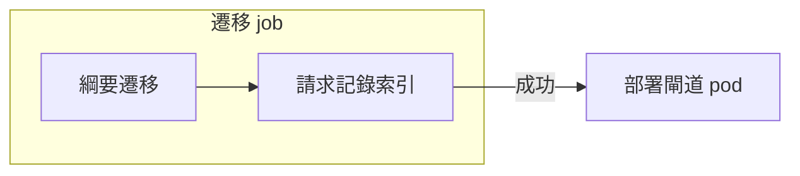

# 升級指南 {#upgrade-guide}

Helm chart 與官方 Terraform 模組為綱要變更與請求記錄索引建立提供了一個**獨立的遷移 job**。請在閘道 pod 上保持 `DISABLE_SCHEMA_UPDATE=true`，並讓該 job 完成後再部署新的閘道版本。



## 升級之前 {#before-you-upgrade}

請閱讀您將跨越版本的[發行說明](/release_notes)。檢查破壞性變更與資料庫變更、拍攝資料庫快照，並對還原的正式環境副本測試升級以測量其所需時間。回復映像不會還原資料庫變更。

### 從 v1.104.0 之前的版本升級 {#upgrading-from-a-version-before-v11040}

:::danger 舊 pod 可能會捨棄已升級的綱要

在遷移 job 或第一個新 pod 執行之前，請在**共用該資料庫的每個舊 LiteLLM 部署**上設定 `DISABLE_SCHEMA_UPDATE=true`。請在資料庫仍是舊綱要時完成部署該設定，讓重新啟動的 pod 無法以舊映像執行綱要設定。請將其他部署、重新啟動原則與自動映像回復納入這項檢查

舊版遷移解析器可以比對即時資料庫與舊映像的 `schema.prisma` 並執行該差異。它會捨棄舊映像不認識的表格與欄位，包括其資料，但會將它們已完成的遷移留在 `_prisma_migrations` 中。部署期間的舊 pod 重新啟動、映像回復，或同一資料庫上的另一個部署，都可能觸發這個情況

在 v1.84.0 之前，遷移後的健全性檢查即使在沒有待處理遷移時也會執行。在 v1.84.0 到 v1.103.x 中，它仍可能在遷移後或 `P3009` / `P3018` 復原期間執行。v1.104.0 將 v2 解析器設為預設，它不會執行這個綱要差異。以 `USE_V2_MIGRATION_RESOLVER=false` 或 `--use_legacy_migration_resolver` 明確選取舊版解析器，會在後續版本中保留這個風險

在新版本已更動資料庫之後，不要只回復映像。請停止部署，並將升級前的資料庫快照與相符的舊映像一起還原。請預期該快照之後的寫入會遺失或需要另外復原

:::

保持閘道 pod 的綱要更新停用，並另外執行目標版本的遷移 job。這可以防止舊解析器變更綱要；它不保證舊應用程式碼與每個新綱要都相容。請在正式環境之前，對還原的資料庫測試混合版本的期間

#### 當遷移歷史領先綱要時的復原 {#recovery-when-migration-history-is-ahead-of-the-schema}

如果舊 pod 已經執行了綱要設定，請停止該資料庫上的**所有 LiteLLM 執行個體與遷移 job**，並防止自動重新啟動。在復原之前先備份受損的資料庫。最安全的復原方式是還原升級前的快照，並在舊部署停用綱要更新的情況下重複升級

缺少如 `LiteLLM_DailyEndUserSpend` 的表格，可能在遷移期間造成帶有 PostgreSQL 錯誤 `42P01` 的 `P3018`，或即使啟動時回報 `No pending migrations to apply` 也會造成執行階段失敗。僅憑遷移總帳無法證明表格仍然存在。只刪除失敗的遷移項目，不會重建其建立遷移仍被記錄為完成的缺少表格

如果無法還原快照，請讓您的資料庫管理員先在受損資料庫的副本上測試綱要修復。確認即時綱要與確切舊映像的 `schema.prisma` 相符，然後將總帳與該舊映像隨附的遷移目錄比對。只移除該映像中不存在的遷移的總帳列，並讓目標映像重新套用它們。不要清除整個總帳，也不要將缺少表格的遷移標記為已套用。如果綱要只是部分重設或有其他變更，請勿使用這個程序

<details>
<summary>v1.80.0-stable.1 到 v1.105.0 的版本專屬範例</summary>

**只有**在 v1.80.0-stable.1 的舊版解析器於升級到 v1.105.0 期間，已將資料庫重設為該映像的綱要，且每個 LiteLLM 程序都已停止並已完成備份時，才使用這段 SQL。它會移除較新的遷移記錄，讓 v1.105.0 可以重播它們。三個明確的名稱是補登日期的遷移，僅靠時間戳記截點會漏掉它們。其他來源或目標版本需要各自的遷移比對

```sql
DELETE FROM "_prisma_migrations"
WHERE migration_name > '20251115120539_baseline_diff'
   OR migration_name IN (
     '20251113000000_add_project_table',
     '20251113000001_add_project_fields',
     '20251114180624_Add_org_usage_table'
   );
```

在啟用綱要更新的情況下執行 v1.105.0 遷移 job，並讓每個舊部署保持停止。要求成功結束，使用 `prisma migrate diff` 將修復後的綱要與目標映像的 `schema.prisma` 比對，並在閘道綱要更新停用的情況下恢復流量之前，驗證受影響的讀取與寫入

</details>

重播遷移會重建綱要，**而不是舊 pod 捨棄的資料**。請從備份復原該資料。永遠不要在啟用綱要更新的情況下，對修復後的資料庫執行舊映像

### 在升級之前先試跑遷移 {#dry-run-the-migrations-before-the-upgrade}

自 v1.109.0 起，proxy 會在啟動時套用待處理的遷移，並讓 PostgreSQL 回報資料庫無法接受的第一個遷移，回報方式與任何其他失敗的遷移相同（請參閱[遷移疑難排解](../troubleshoot/prisma_migrations.md#6-database-migration-cannot-proceed-on-rows-the-schema-change-cannot-take)）。若要在升級時段之前看到該結果，請從任何可連線到資料庫的機器，以**目標**映像執行試跑：

```bash
docker run \
-e DATABASE_URL=postgresql://<user>:<password>@<host>:5432/<dbname> \
docker.litellm.ai/berriai/litellm:X.Y.Z --check_migrations_against_existing_data
```

它會依序執行每個待處理遷移的真實 SQL，每個都在自己的交易中執行，並在下一個開始之前回復，因此 `_prisma_migrations` 與綱要會保持原樣，且沒有鎖會比其遷移存活更久，與真實升級一次提交一個遷移檔案的方式相同。依賴前一個遷移的遷移（例如在前一個遷移新增的欄位上建立的索引）會與它一起重播。結束代碼 0 會列出每個遷移及其花費的時間，這就是真實升級會持有該遷移鎖定的時間：

```
LiteLLM Proxy: 2 pending migration(s) applied one at a time in a dry run, each rolled back before the next so its locks are released, nothing changed:
  20991231000000_require_team_alias: 0.0 s
  20991231000001_team_alias_index: 0.0 s
```

結束代碼 2 會印出第一個失敗遷移的 PostgreSQL 本身錯誤。它之後的任何遷移都不會執行，而它之前的遷移會與其時間一起列出：

```
LiteLLM Proxy: Database migration cannot proceed. Migration 20991231000000_require_team_alias fails on this database after 0.0 s, nothing was applied.
column "team_alias" of relation "LiteLLM_TeamTable" contains null values
```

因為陳述式真的會執行，試跑會取得與升級相同的表格鎖定，持續時間與每個陳述式的執行時間相同，而在大型 `LiteLLM_SpendLogs` 上的 `CREATE INDEX` 會讓該表格的寫入停滯數分鐘。請在離峰時段或對還原的正式環境副本執行它。遷移以 `CONCURRENTLY` 建立的索引，會在交易內以一般方式建立，因為 PostgreSQL 在該處不允許並行形式。有表格但沒有 `_prisma_migrations` 歷史的資料庫不會被重播：試跑會詢問與啟動在建立基線之前相同的問題，即遷移資料夾是否為此建置隨附的那個（自訂的 `LITELLM_MIGRATION_DIR` 會被拒絕），以及即時綱要是否與此建置的 `schema.prisma` 相符，並在兩者都成立時回報 `nothing to dry-run`，或在其中之一不成立時回報拒絕（`prisma migrate diff`，或自訂資料夾）。proxy 在開始提供服務後於背景建立的請求記錄索引不屬於試跑的一部分；只有在 v1.108.0 上，同一個旗標改為執行唯讀的列計數，且 proxy 會因其發現而拒絕啟動。

## 使用 Helm 或 Terraform 升級 {#upgrade-with-helm-or-terraform}

| 部署 | 選取發行版本 | 在部署之前執行遷移 |
| --- | --- | --- |
| [Helm](./deploy/helm.md) | 固定 chart 修訂版與共用映像。遷移 Job 與應用程式使用相同的映像。 | 保持 `migrationJob.enabled: true`，並為您的部署控制器啟用 hook。等待 job 完成。 |
| [Terraform](./deploy/terraform.md) | 固定模組版本或來源修訂版。將 `image` 設為相容的映像標籤或摘要。 | 執行 `terraform init -upgrade`。在套用之前先檢視 `terraform plan`。這些模組會在更新服務之前，在 AWS 上執行 ECS 遷移任務，或在 GCP 上執行 Cloud Run 遷移 job。 |

<details>
<summary>Helm 與 Argo CD hook 設定</summary>

對於 `helm upgrade`，以下是 chart 在元件化與單體模式下的預設值：

```yaml title="values.yaml"
migrationJob:
  enabled: true
  hooks:
    helm:
      enabled: true
    argocd:
      enabled: false
```

對於 Argo CD，請啟用 `argocd` 並停用 `helm`。請參閱 [chart 值](https://github.com/BerriAI/litellm/blob/main/litellm/deploy/helm/litellm/values.yaml)。

</details>

檢查**遷移 job 記錄**，確認綱要與索引建立都已完成。在閘道部署之後，驗證 [`/health/readiness`](./health.md#probe-endpoints) 並透過閘道傳送一個測試請求。

## 資料庫遷移 {#database-migrations}

### 什麼會花時間 {#what-takes-time}

遷移 job 先執行綱要遷移，然後建立任何缺少的請求記錄索引。**兩個階段都計入 job 的執行時間。**已存在的有效索引會被跳過。

| 工作 | 什麼會影響持續時間 | 對資料庫的影響 |
| --- | --- | --- |
| 綱要變更，例如新表格或可為 null 的欄位 | 通常很短；鎖定等待仍可能延遲它們 | 短暫的鎖定可能延遲其他查詢 |
| 請求記錄索引 | `LiteLLM_SpendLogs` 大小、磁碟速度、記憶體與資料庫負載 | 並行索引建立允許讀取與寫入，但會消耗資料庫資源 |
| 帶有一般索引建立、表格重寫或資料回填的遷移 | 掃描或變更的列數；請檢查該發行的遷移 SQL | 可能阻擋寫入或其他查詢；請測試，並在需要時規劃維護時段 |

### 預期持續時間 {#expected-duration}

對正式環境大小的資料庫副本測量**完整遷移 job**的時間。僅綱要的升級可能很快，而在大型支出記錄表格上建立新索引會花更久。僅靠表格大小不足以預測升級時段。

對於 Helm，請設定 `migrationJob.activeDeadlineSeconds`（預設為 **1800 秒**）與部署控制器的逾時，以涵蓋完整的 job。使用 `helm upgrade` 時，也請相應設定 `--timeout`。對於 Terraform，請檢查 ECS 任務或 Cloud Run job 的逾時與部署等待上限；Helm 設定不適用於該處。

使用[支出記錄保留](./spend_logs_deletion.md)來限制未來索引建立必須掃描的資料。

<details>
<summary>檢查哪些綱要遷移已經套用</summary>

```sql
SELECT migration_name, finished_at
FROM "_prisma_migrations"
WHERE finished_at IS NOT NULL
  AND rolled_back_at IS NULL
ORDER BY finished_at;
```

將完整結果與您的**目標發行標籤**（而不是 `main`）的[遷移檔案](https://github.com/BerriAI/litellm/tree/main/litellm/proxy-extras/litellm_proxy_extras/migrations)比對。檢查待處理 SQL 中對大型表格的操作。請求記錄索引建立是一個獨立階段，因此僅憑遷移歷史無法確認 job 已完成。

</details>

## 滾動升級與支出記錄清理 {#rolling-upgrades-and-spend-log-cleanup}

[支出記錄清理](./spend_logs_deletion.md#when-the-job-runs)從 `LiteLLM_ScheduledJobRun` 表格執行，該表格由遷移 `20261105000000_scheduled_job_runs` 建立。舊版本的 pod 從程序內計時器排程同一個清理，使用 Redis 鎖，或在未設定 Redis 時完全不使用鎖，且兩者永遠看不到彼此。因此在滾動升級期間，兩個版本會同時執行清理，直到最後一個舊 pod 消失為止。每一方都在自己的陳述式逾時下以小批次刪除，且兩者使用相同的保留截點，因此成本是部署期間的重複工作與額外的刪除負載，而不是資料遺失。如果表格很大且部署很慢，請在升級之前取消保留設定，並在之後還原，或接受額外的負載

當舊 pod 使用 v2 解析器或設有 `DISABLE_SCHEMA_UPDATE=true` 時，這個額外的表格不會阻止它啟動。在舊版解析器上啟用綱要更新時，這並不安全，因為它可能捨棄新表格。請在目標遷移 job 執行之前遵循 [v1.104.0 之前的防護措施](#upgrading-from-a-version-before-v11040)，包括任何明確選取舊版解析器的後續映像。在整個部署期間保持閘道綱要更新停用

## 自訂部署 {#custom-deployments}

如果您的部署不提供遷移 job，請使用**目標 LiteLLM proxy 映像**，在設定了 `DATABASE_URL` 與所需資料庫憑證的情況下，在獨立的容器中執行這個命令：

```bash
DISABLE_SCHEMA_UPDATE=false litellm --skip_server_startup
```

這個 LiteLLM 命令會執行綱要遷移**與請求記錄索引建立**，等待兩者都完成，然後結束而不啟動閘道。在以 `DISABLE_SCHEMA_UPDATE=true` 部署閘道容器之前，請要求成功結束。資料列無法接受的遷移會在此命令內以 PostgreSQL 的錯誤失敗，且命令以非零代碼結束；請參閱[試跑](#dry-run-the-migrations-before-the-upgrade)以更早發現這個情況。

## 當遷移緩慢或卡住時 {#when-a-migration-is-slow-or-stuck}

先從**遷移 job 的記錄與狀態**開始。在變更逾時之前，先檢查 `pg_stat_activity` 中的資料庫鎖定等待與 `pg_stat_progress_create_index` 中的索引建立進度。

`LITELLM_PRISMA_MIGRATE_DEPLOY_TIMEOUT` 控制綱要遷移子程序（預設為 **600 秒**）。如果該階段需要更長時間，請在**遷移 job**上設定它；它不涵蓋請求記錄索引建立。整個 job 與部署的逾時必須為兩個階段與重試留出足夠的時間。

失敗的遷移與 PostgreSQL 版本專屬問題，請參閱[遷移疑難排解](../troubleshoot/prisma_migrations.md)。
