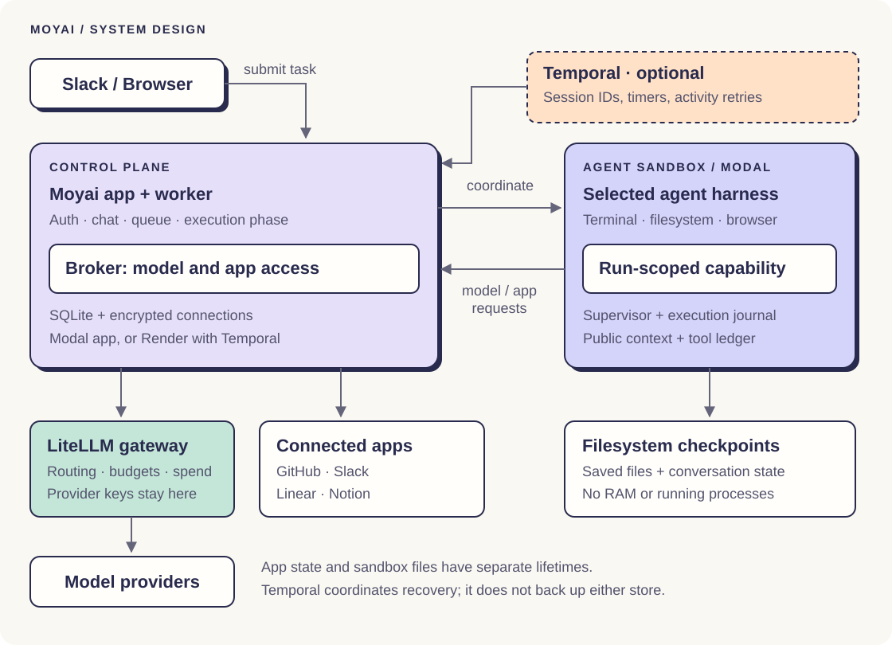
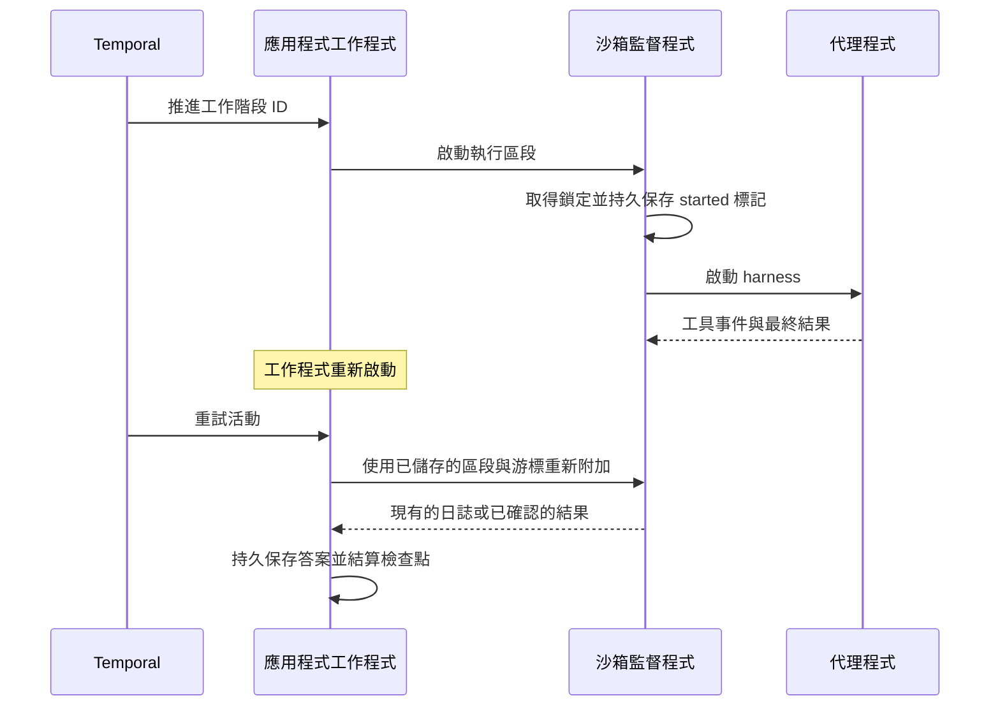

import {GuideNav} from '@site/src/components/Moyai';

<GuideNav active="architecture" />

Moyai 將對話的生命週期與執行其目前任務的機器分開。Web 應用程式負責身分、訊息、應用程式連接與執行記錄。沙箱負責執行代理程式。LiteLLM 負責模型存取與推論計費。

本指南說明 Modal 快速入門，以及 LiteLLM 團隊使用的 Render 加 Temporal 版面配置。實作連結指向 Moyai commit [`04ea562`](https://github.com/BerriAI/moyai/tree/04ea5627419c1cdcce1532667d95ba1956df8e30)。在操作其他修訂版本或沙箱提供者之前，請先查閱上游的[部署指南](https://github.com/BerriAI/moyai/blob/main/docs/deployment.md)。

關於在 EC2 上使用 Lambda MicroVM 的原生 Pydantic AI 與 Temporal 部署，請參閱 [AWS 部署與基礎架構](./aws.md#infrastructure)。

## 系統設計 {#system-design}

[開啟完整尺寸的圖表](./architecture.svg)。線條描述的是請求路徑，不是無限制的網路權限。此圖顯示的是 Modal 沙箱；Moyai 也有其他[沙箱提供者](https://github.com/BerriAI/moyai/blob/main/docs/deployment.md)。

| 元件 | 職責 | 持久狀態 |
|---|---|---|
| Web 應用程式與仲介程式 | 驗證使用者、接受訊息、強制執行連接政策、仲介模型與應用程式呼叫 | 聊天、訊息、連接記錄、請求計費 |
| 代理程式 harness | 以所選的原生 API 執行模型/工具迴圈 | Harness 專屬的歷史與公開工作上下文 |
| 沙箱 | 為代理程式提供終端機、檔案與瀏覽器 | 儲存在提供者快照中的檔案；即時程序保留在機器上 |
| LiteLLM 閘道 | 路由模型請求、保管提供者金鑰、強制執行金鑰預算、記錄推論成本 | 閘道支出記錄與模型設定 |
| Temporal（啟用時） | 排程下一個工作階段步驟、計時器與活動重試 | 工作階段 ID 與小型生命週期值，不包含提示詞、檔案或憑證 |

## 兩種部署版面配置 {#two-deployment-layouts}

### 預設：Modal 應用程式與沙箱 {#default-modal-app-and-sandboxes}

[設定指南](./setup.md) 使用 `deploy_modal.py` 在 Modal 上託管一個 Web 容器。它會為代理程式工作佈建獨立的沙箱。您不需要 Render 或 Temporal 即可完成該指南。

應用程式在本地磁碟上執行 SQLite，並將完整的資料庫快照與結果封存提交至 Modal Volume。它在確認 API 變更之前先為其建立檢查點，並約每兩秒為背景活動建立一次檢查點。嚴重故障可能會遺失最新的背景事件。

更換後，應用程式會還原其最後提交的快照，並將未完成的任務標記為中斷。它不會重播這些任務的外部寫入。傳送新訊息即可從最後儲存的工作區繼續。保持 `min_containers=1`、`max_containers=1`，並重建部署；此 SQLite 版面配置不支援多個寫入者或滾動式部署。重新部署會中斷進行中的任務。

來源：[Modal 部署](https://github.com/BerriAI/moyai/blob/04ea5627419c1cdcce1532667d95ba1956df8e30/deploy_modal.py) 與[狀態持久性](https://github.com/BerriAI/moyai/blob/04ea5627419c1cdcce1532667d95ba1956df8e30/docs/deployment.md#deploy-the-control-plane)。

### 可選：Render 應用程式、Temporal 編排、Modal 沙箱 {#optional-render-app-temporal-orchestration-modal-sandboxes}

Render 託管 Web 應用程式、仲介程式、SQLite 資料庫，以及一個共用的 Temporal 工作程式。Modal 託管獨立的代理程式機器。Temporal 為每個工作階段執行一個工作流程，並要求工作程式透過有界的活動推進它。

讓工作程式與 Web 應用程式位於同一個 Render 服務中，使兩者使用相同的資料庫與結果封存。一個工作程式可以協調多個工作階段；並不是每個代理程式都有一個工作程式容器。擴展控制平面之前，必須先有共用資料庫與構件儲存。

重新啟動的工作程式可以重新連接到存活的沙箱並讀取其執行日誌。Temporal 無法取代應用程式資料庫，也無法還原遺失的磁碟。請備份該磁碟，並保存加密與工作階段金鑰。

## 一個任務，從訊息到答案 {#one-task-from-message-to-answer}

1. **接受訊息。** 應用程式驗證 Web 請求或驗證 Slack 事件、找到工作階段，並提交訊息。啟用 Temporal 時，它會向工作階段工作流程發出信號。
2. **準備執行。** 工作程式載入記錄的階段、佈建或重用沙箱，並核發限定於該次執行的新權限憑證。所選的 harness 與模型決定閘道 API。
3. **執行工具與推論。** Harness 在沙箱中執行程式碼。模型與已連接應用程式的請求會通過仲介程式。應用程式會針對提出請求的使用者與訊息記錄活動與推論身分。
4. **儲存進度。** 在受支援的安全邊界上，執行階段會儲存對話狀態與檔案。它會保留待處理的工具記錄，使遺失的結果無法偽裝成成功。
5. **結算回應。** 應用程式在收集構件並拍攝最終快照之前，先持久保存最終答案。Web 聊天可以在儲存繼續進行時顯示答案。Slack 傳遞與排隊的後續訊息會等待結算。

回應會經過 `queued`、`provisioning`、`running`、`saving` 與 `idle`（顯示為 **Ready**）。排隊的後續訊息保留相同的工作階段 ID，並在前一個回應結算後開始。

## 狀態與檢查點 {#state-and-checkpoints}

| 狀態 | 位置 | 復原用途 |
|---|---|---|
| 對話與執行階段 | 應用程式 SQLite 及其部署專屬備份 | 找到工作階段、排隊的訊息、沙箱與日誌游標 |
| 工作區檔案 | 沙箱檔案系統加上提供者快照 | 在更換的機器上還原已儲存的檔案 |
| 公開工作上下文 | `/session/context.sqlite3`，包含在工作區快照中 | 還原摘要、最近的日誌項目與未解決的工具記錄 |
| 原生 harness 歷史 | Harness 專屬的已儲存狀態 | 僅在該介面卡的相容性、隱私與檢查點閘門允許時重用 |
| 執行日誌與結果 | 沙箱中獨立監督程式的區段目錄 | 在工作程式中斷連接後重新附加，並從已儲存的游標取用事件 |
| 工作流程進度 | Temporal 歷史 | 重試協調與排程等待；不包含工作區 |

### 僅在安全邊界建立檢查點 {#checkpoint-only-at-a-safe-boundary}

在文件所述的 Temporal/Hermes 流程中，Moyai 預設每十分鐘請求一次定期檢查點。Hermes 會在工具輪次之間到達下一個安全邊界後再儲存。執行中的工具可能會延遲該檢查點。

針對 Modal 的 24 小時沙箱限制，Moyai 會在 23 小時後請求續約。它要求已儲存的對話狀態、檔案系統快照、已結算的工具結果，並確認舊機器已停止，然後才在更換的機器上繼續該輪次。無法在硬性限制之前到達該邊界的工具仍可能被中斷。其他 harness 有各自的生命週期掛鉤；在假設相同的檢查點行為之前，請先查看 [harness 指南](https://github.com/BerriAI/moyai/blob/main/docs/harnesses.md)。

已完成的頂層 Temporal 工作階段會在訊息佇列排空後，讓其沙箱保持待命 `SANDBOX_IDLE_SECONDS=300`。該時間窗內的後續訊息會以新的權限憑證重用該機器。釋放之後，新的沙箱會還原已儲存的檢查點。待命的機器會消耗運算資源；已儲存的快照可能會產生儲存費用。

檔案系統快照保存的是檔案，不是 RAM 或執行中的程序。瀏覽器的連續性使用獨立的還原機制；請勿將檔案系統快照視為即時瀏覽器備份。

### 在不遺失工具狀態的情況下限制上下文 {#keep-context-bounded-without-losing-tool-status}

公開上下文儲存庫保存僅附加且經清理的日誌、由模型產生的摘要，以及原子性的覆蓋游標。摘要涵蓋已知的前綴；還原的上下文會將它與最近的索引項目結合。完整的收據可透過有界的讀取取得。

獨立的待處理工具分類帳會追蹤沒有已確認結果的呼叫。摘要不會清除這些記錄。若結果未知，還原的上下文會告訴代理程式，在重複該動作之前，先檢查原始記錄、工作區狀態與外部收據。

Harness 的還原方式不同。Codex 會以還原的公開上下文啟動一個新的暫時原生執行緒。Claude Agent SDK 與 OpenCode 只能透過介面卡的重用閘門重用已完成的原生狀態。Hermes 有自己的歷史流程。變更模型或請求者可能需要檢查點式的交接，以更新權限憑證與私有上下文範圍。

來源：[上下文儲存庫](https://github.com/BerriAI/moyai/blob/04ea5627419c1cdcce1532667d95ba1956df8e30/sandbox/context_store.py)、[上下文復原](https://github.com/BerriAI/moyai/blob/04ea5627419c1cdcce1532667d95ba1956df8e30/sandbox/context_recovery.py) 與[原生工作階段](https://github.com/BerriAI/moyai/blob/04ea5627419c1cdcce1532667d95ba1956df8e30/sandbox/native_session.py)。

## 工作程式復原與工具復原 {#worker-recovery-and-tool-recovery}

### 重新連接到存活的執行 {#reconnect-to-a-surviving-execution}

監督程式在執行期間持有獨佔鎖定，並在啟動 harness 之前寫入持久的 `started.json` 標記。它會以原子方式寫入結果。使用相同區段身分的重試會重新附加到該監督程式，而不是啟動第二個代理程式。

鎖定確立了目前是否有監督程式擁有該執行。標記記錄了先前可能已發生過啟動。若標記存在，但沒有即時擁有者或已確認的結果，Moyai 會報告中斷。重複啟動可能會重複一個已變更外部系統的工具。

來源：[監督程式啟動防護](https://github.com/BerriAI/moyai/blob/04ea5627419c1cdcce1532667d95ba1956df8e30/sandbox/durable_process.py)、[持久執行器](https://github.com/BerriAI/moyai/blob/04ea5627419c1cdcce1532667d95ba1956df8e30/app/durable_runner.py) 與 [Temporal 執行階段](https://github.com/BerriAI/moyai/blob/04ea5627419c1cdcce1532667d95ba1956df8e30/app/temporal_runtime.py)。

### 依證據處理失敗 {#handle-failures-according-to-the-evidence}

| 失敗 | Moyai 的回應 | 操作者或使用者動作 |
|---|---|---|
| Modal 快速入門 Web 容器被更換 | 還原應用程式快照並中斷未完成的工作 | 從最後儲存的工作區傳送明確的後續訊息 |
| Temporal 工作程式重新啟動；沙箱存活 | 重新附加到記錄的區段並讀取其日誌 | 在工作程式重新連接時檢查活動 |
| 沙箱在不確定工作期間消失 | 中斷；保留最後的安全檢查點 | 在要求繼續之前檢查檔案與外部收據 |
| Started 標記存在，但沒有即時擁有者或結果 | 停止，不再重新啟動該區段 | 調查寫入是否已完成 |
| 最終答案存在，但工作區儲存失敗 | 保留答案並附上警告，保留先前的快照，取消排隊的後續訊息 | 在繼續之前檢查已儲存的檔案與警告 |
| 已連接應用程式的寫入遺失其回應 | 保持結果不確定；遺失的結果不能證明失敗 | 在重試之前檢查目的地或發佈收據 |
| Slack 寄件匣傳送的結果不確定 | 不要自動重試該不確定的傳送 | 在請求另一次傳遞之前檢查討論串 |
| 執行前的暫時性啟動讀取失敗 | 重試讀取；當執行前檢查通過時，Temporal 可以使用有界的啟動復原時間窗 | 修正永久性的驗證/設定錯誤 |

**Temporal 活動至少執行一次。Moyai 不保證外部副作用恰好執行一次。** 停止會撤銷該次執行的權限憑證並請求清理；它無法撤銷外部服務已接受的寫入。重試模型請求也可能產生另一筆推論費用。

這些失敗邊界的可執行範例，請參閱上游的[持久性測試](https://github.com/BerriAI/moyai/blob/04ea5627419c1cdcce1532667d95ba1956df8e30/tests/test_durable.py) 與[上下文測試](https://github.com/BerriAI/moyai/blob/04ea5627419c1cdcce1532667d95ba1956df8e30/tests/test_context_store.py)。

## 憑證與存取邊界 {#credentials-and-access-boundaries}

提供者 API 金鑰保留在 LiteLLM。Moyai 應用程式持有閘道金鑰與加密的已連接應用程式憑證。沙箱會收到限定於該次執行、供仲介程式使用的權限憑證；仲介程式在轉送請求之前，會檢查該次執行與連接政策。

已啟用的已連接應用程式工具會在連接政策下執行，不需要管理員核准步驟。某些操作有額外的同意閘門，例如從已儲存的聊天編輯外部 PR。已暫停或唯讀的連接會阻擋新的寫入。這些共用連接保留其授權身分的權限。Moyai 的共用工作區是為受信任的團隊成員設計的，不是為隔離的租戶設計的。

預設的 Modal 沙箱使用容器隔離；可選的 VM 執行是獨立的設定。請勿假設沙箱有全面的出口許可清單。儲存庫程式碼與提示詞可能會透過您選擇的模型提供者離開您的雲端。在擴大存取範圍之前，請參閱[安全性與範圍](https://github.com/BerriAI/moyai/blob/main/docs/security-and-scope.md)。

## 成本計算 {#cost-accounting}

Moyai 以 LiteLLM 作為模型成本的事實來源。它會儲存閘道對每個受追蹤請求的最終費用，並依使用者、工作階段與模型加總相同的費用。它保留十進位精確度，而不是從 token 數量估算價格。

Moyai 會在推論之前保留請求身分，並將使用量歸屬到原始使用者、訊息、工作階段與模型。它會擷取非串流請求的最終回應成本與串流的最終使用量成本；初始串流標頭不是最終帳單。

若收據遺失，背景復原可以使用相同的閘道金鑰（加上額外權限）查詢 LiteLLM 的 `/spend/logs/v2`。這可以復原計算，而不需重新執行推論或變更中斷任務的執行狀態。未知的成本仍會保持可見。在評估安裝時，請將提供者推論費用與託管/儲存費用分開。

總計涵蓋有記錄成本的受追蹤 Moyai 請求。Moyai 之外的呼叫、回傳成本中缺少的閘道內部計費嘗試，以及未解決的收據，可能會與閘道金鑰的總計產生差異。核對支出時，請使用儀表板的覆蓋範圍與每請求金額。

請參閱[成本與收據復原](https://github.com/BerriAI/moyai/blob/main/docs/costs.md) 與[設定中的支出檢查](./setup.md#track-spend)。
