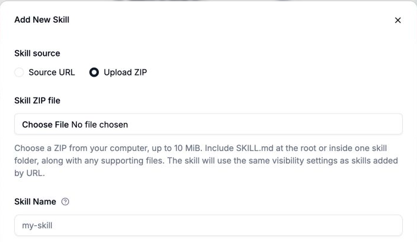
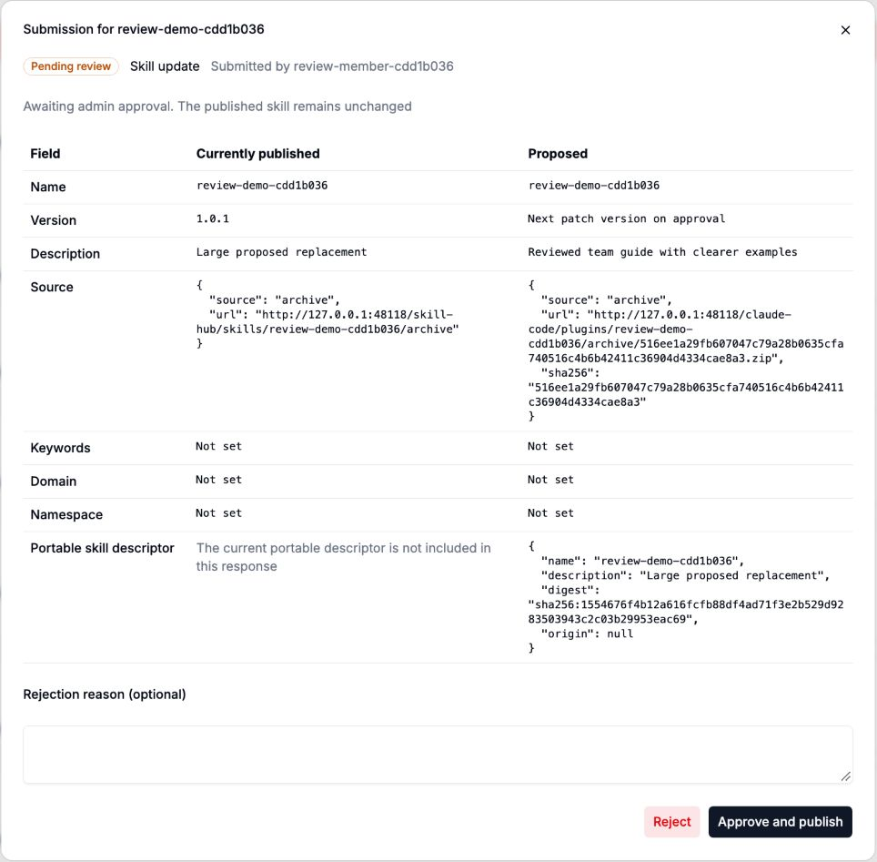
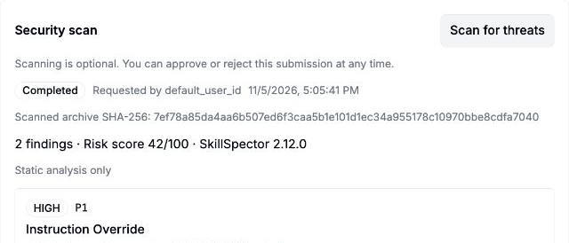
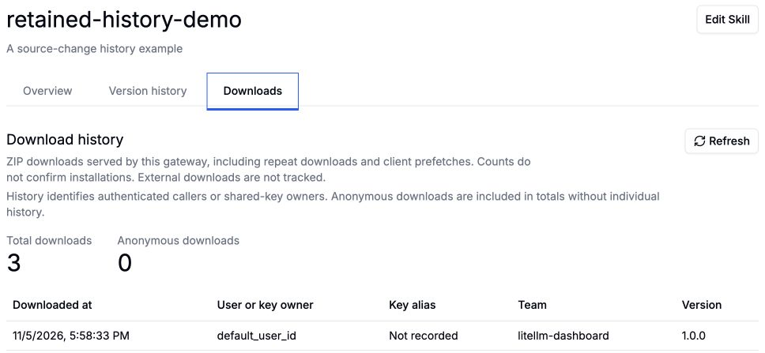
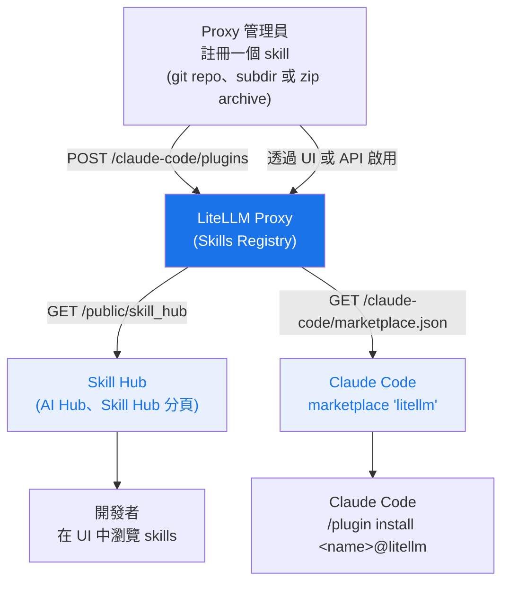

# 技能閘道 {#skills-gateway}

透過 **LiteLLM Skills Hub** 與您的團隊分享 skills。上傳 `SKILL.md` 及其 scripts 與參考檔案，然後將套件安裝到 Codex、Claude Code，或其他支援 [Agent Skills 格式](https://agentskills.io/specification) 的代理程式中。

| 功能 | 用途 |
|---------|-----------------|
| [ZIP 上傳](#upload-a-skill) | 在一個套件中分享 `SKILL.md` 及其支援檔案 |
| [管理員審查](#review-a-submission) | 在發布前審查成員的提交與可選的安全掃描結果 |
| [版本歷史](#publish-a-new-version) | 發布更新，並下載先前版本保留的 ZIP |
| [下載追蹤](#see-who-downloads-a-skill) | 查看總數，並以管理員身分查看誰下載了 skill 以及下載時間 |

對於 scripts 與整合，請使用 [可攜式 Agent Skills API](#portable-agent-skills-api)。您可以搭配 [Claude Code marketplace](#how-it-works) 使用相同的註冊表與存取授權。

## 在儀表板中使用 Skills Hub {#use-skills-hub-in-the-dashboard}

您的閘道管理員必須先套用 Skills Hub 資料庫 migrations，您才能開始。在儀表板中開啟 **Skills Hub**。您需要寫入存取權才能提交 skills 或更新。

### 上傳 skill {#upload-a-skill}

1. 將 `SKILL.md` 與您的 skill 需要的檔案一起壓縮成 ZIP。將 `SKILL.md` 放在封存根目錄，或放在單一頂層資料夾內。ZIP 大小限制為 10 MiB。
2. 選擇 **Register your skill**（舊版為 **Add Skill**），選擇 **Upload ZIP**，然後選取您的檔案。
3. 選擇 **Submit for approval**。Proxy 管理員選擇 **Register skill** 即可不經審查直接發布。



在 `SKILL.md` frontmatter 中設定名稱與描述；請參閱 [套件要求](#upload-or-import)。若要匯入公開的 GitHub 或 skills.sh skill，請選擇 **Import URL**。

在 **My submissions** 中查看管理員的決定。核准後，團隊成員就能存取您的變更。新 skills 在發布後即為公開；使用 [私人 skill 存取](#private-skills) 可將它們限制給選定的 keys 或 teams。

若要安裝已發布的 skill，請開啟它並選擇 **Install / Share**。複製適用於您的代理程式的指令，或從 skill 的詳細資料下載 ZIP。

### 審查提交 {#review-a-submission}

1. 以 proxy 管理員身分開啟 **Submissions**，並在待處理的提交上選擇 **Review**。
2. 比較 **Currently published** 與 **Proposed**。選擇 **Download submitted ZIP** 以檢查上傳的套件。
3. 如果您的管理員已 [設定掃描器](#optional-security-scans)，請選擇 **Scan for threats**。查看結果、風險分數，以及關於分析不完整的通知。
4. 選擇 **Approve and publish**，或選擇 **Reject** 並附上可選的原因。





*測試 skill 的掃描範例。*

掃描是可選的。由管理員決定核准或拒絕提交。在您核准更新之前，團隊成員會繼續使用已發布的版本。

### 發布新版本 {#publish-a-new-version}

1. 開啟已發布的 skill 並選擇 **Edit Skill**。
2. 選擇 **Upload ZIP** 以取代其檔案。在 `SKILL.md` 中保留相同的 skill 名稱。
3. 將 **Version override** 留空，以遞增 patch 版本，例如從 `1.0.0` 到 `1.0.1`。輸入更高的語意版本（例如 `1.1.0`）以覆寫它。
4. 以成員身分提交更新以供核准，或以管理員身分選擇 **Save changes**。

在 **Version history** 中，選擇先前版本旁的 **Download retained ZIP** 來下載它。您需要對該 skill 的目前存取權，以及保留的封存。以來源參照的項目包含中繼資料，不含外部檔案。

新 skills 從 `1.0.0` 開始。對於沒有歷史的現有 skill，發布一次更新即可開始記錄版本。API 範例請參閱 [版本與更新](#versions-and-updates)。

### 查看誰下載了 skill {#see-who-downloads-a-skill}

在目錄的 **Downloads** 中查看總數。以 proxy 管理員身分，開啟 skill 的 **Downloads** 分頁，查看已驗證的下載，包括時間、使用者或 key 擁有者、team，以及版本（若有）。



*測試 skill 的下載歷史範例。*

總數包括透過閘道的重複與匿名下載。匿名下載沒有個別歷史。共用 key 會標示其擁有者；您無法區分使用同一把 key 的人。下載並不代表已安裝或已執行 skill。管理員 API 請參閱 [下載次數與歷史](#download-counts-and-history)。

<details>
<summary>觀看 Skills Gateway 導覽</summary>

<iframe title="Skills Gateway 導覽" width="840" height="500" style={{maxWidth: "100%"}} src="https://www.loom.com/embed/cb74eb79df3e4c2b83a6efae54a589f9" frameBorder="0" allowFullScreen></iframe>

</details>

## 可攜式 Agent Skills API {#portable-agent-skills-api}

:::note 舊版管理 API

新的可攜式 skill 整合請使用 `/skill-hub`。已棄用的 `/claude-code/plugins` 管理端點仍可供相容性使用；Claude Code marketplace 的探索與安裝仍受支援。

:::

使用這些 API 前，請先套用 Skills Hub 資料庫 migrations。使用附加在可寫入使用者上的 key，您可以提交 skills 與更新以供 [管理員審查](#submissions-and-approval)。Proxy 管理員不經審查直接發布；唯讀使用者無法提交。

上傳的 ZIP 中，`SKILL.md` 位於根目錄或單一頂層資料夾內。支援檔案（例如 `scripts/`、`references/`、`assets/` 與 `agents/openai.yaml`）在可攜式下載中會保留其位元組與可執行 script 權限。

在 `SKILL.md` 的 YAML frontmatter 中宣告名稱與描述。名稱使用 1–64 個 ASCII 小寫字母、數字，以及名稱段落之間的單一連字號（`^[a-z0-9]+(?:-[a-z0-9]+)*$`）。描述必須包含 1–1024 個字元。

### 上傳或匯入 {#upload-or-import}

可攜式套件可以包含：

```text
pdf-summarizer/
  SKILL.md
  scripts/extract.sh
  agents/openai.yaml
```

例如，`SKILL.md` 可以包含：

```markdown
---
name: pdf-summarizer
description: Summarize PDFs with page citations.
---
Read the PDF and cite page numbers in the summary.
```

```bash
zip -r pdf-summarizer.zip pdf-summarizer
curl --fail-with-body https://your-proxy/skill-hub/skills/upload \
  -H "Authorization: Bearer $LITELLM_API_KEY" \
  -F "file=@pdf-summarizer.zip" \
  -F "version=1.0.0"
```

從 skills.sh 匯入公開 skill：

```bash
curl --fail-with-body https://your-proxy/skill-hub/skills/import \
  -H "Authorization: Bearer $LITELLM_API_KEY" \
  -H "Content-Type: application/json" \
  -d '{"url":"https://skills.sh/vercel-labs/agent-skills/vercel-react-best-practices"}'
```

從公開的 HTTPS `skills.sh/<owner>/<repository>/<skill>` 或 `github.com/<owner>/<repository>` URL 匯入。對於包含多個 skills 的 repository，使用 `skill` 或 repository 相對路徑 `path` 選取一個。使用 `ref` 指定 commit、tag 或 branch；預設為 `HEAD`。GitHub tree URL 可以提供 ref 與目錄。LiteLLM 會對選定的目錄建立快照，並拒絕其中的 symlinks。此端點拒絕私人 repositories、SSH URL、其他主機，以及任意的封存 URL。

上傳與 repository ZIP 必須在 10 MiB、1,000 個項目與 50 MiB 解壓縮資料之內，包括選定 skill 之外的檔案。每個選定的檔案可使用 10 MiB；`SKILL.md` 可使用 1 MiB。請為產生的相容性中繼資料預留空間：選定的 skill 最多可包含 999 個檔案，且儲存的套件必須符合解壓縮大小限制。過大的儲存套件會回傳 `422`。上傳與匯入若名稱已存在會回傳 `409`；請使用更新路由來取代它。

上傳、匯入與 ZIP 取代共用一個限制：**每位使用者每分鐘 10 次嘗試**，跨該使用者的所有 keys 計算。沒有使用者的管理員 keys 使用每把 key 的額度；無驗證的開發模式共用一個額度。額度耗盡的請求會回傳 `429`，並帶有 `Retry-After: 60`。

使用預設的 v3 速率限制器與共用 Redis 協調，以在多個 workers 或 replicas 之間強制執行此限制。如果預設限制器無法使用，或您啟用了舊版限制器，這些路由會回傳 `503`。

成員請求會回傳 `status: "pending_review"`、`action: "submitted"`、`submission_id` 與 `proposal`。管理員請求會回傳已發布的 skill。成員的提交在管理員核准前不會變更目錄。新的發布是公開的；管理員可以使用 `POST /skill-hub/skills/{name}/unpublish` 將它們設為私有，同時保留授權。公開 CLI 探索需要下方的選擇性加入設定。

### 瀏覽與下載 {#browse-and-download}

使用 LiteLLM key 列出公開 skills，以及授權給該 key 或其 team 的私人 skills：

```bash
curl --fail-with-body 'https://your-proxy/skill-hub/skills?query=pdf&offset=0&limit=20' \
  -H "Authorization: Bearer $LITELLM_API_KEY"

curl --fail-with-body https://your-proxy/skill-hub/skills/pdf-summarizer/content \
  -H "Authorization: Bearer $LITELLM_API_KEY"

curl --fail-with-body https://your-proxy/skill-hub/skills/pdf-summarizer/archive \
  -H "Authorization: Bearer $LITELLM_API_KEY" \
  -o pdf-summarizer.zip
```

清單回應包含 `skills`、`count` 與 `next_offset`。每個受管理的套件都提供 `download_url` 與 `content_url`。指向外部來源的項目可以出現在共用目錄中，而不帶有這些 URL。content 路由會回傳原始的 `SKILL.md`；archive 路由則包含其支援檔案，且 `SKILL.md` 位於 ZIP 根目錄。這些路由也會提供包含有效 Agent Skill 的現有受管理 Claude 上傳。外部 Git 或 URL 註冊會保留其原始來源。

| Endpoint | 驗證 | 用途 |
|----------|------|---------|
| `POST /skill-hub/skills/upload` | 可寫入的使用者 | 提交可攜式 ZIP；管理員不經審查直接發布 |
| `POST /skill-hub/skills/import` | 可寫入的使用者 | 提交公開的 GitHub 或 skills.sh 快照；管理員不經審查直接發布 |
| `GET /skill-hub/skills` | LiteLLM key | 以 `query`、`offset` 與 `limit`（1–100）搜尋可見的 skills |
| `GET /skill-hub/skills/{name}` | LiteLLM key | 讀取可見的 skill 中繼資料與下載 URL |
| `GET /skill-hub/skills/{name}/content` | LiteLLM key，或符合資格的公開存取 | 讀取原始的 `SKILL.md` |
| `GET /skill-hub/skills/{name}/archive` | LiteLLM key，或符合資格的公開存取 | 下載可攜式 ZIP |
| `PUT /skill-hub/skills/{name}` | 具有存取權的可寫入使用者 | 取代中繼資料；成員提交以供審查 |
| `PUT /skill-hub/skills/{name}/upload` | 具有存取權的可寫入使用者 | 取代 ZIP；成員提交以供審查 |
| `POST /skill-hub/skills/{name}/publish` | Proxy 管理員 | 將註冊表項目設為公開 |
| `POST /skill-hub/skills/{name}/unpublish` | Proxy 管理員 | 將它從公開探索中隱藏，同時保留授權 |
| `DELETE /skill-hub/skills/{name}` | Proxy 管理員 | 刪除 skill 與受管理的封存 |

中繼資料 `PUT` 接受 `description`、`version`、`domain`、`namespace`、`keywords` 與 `expected_updated_at`。省略的描述欄位會被清除；省略或為 null 的 `version` 會要求 patch 版本遞增。封存、來源與 Claude adapter 設定維持不變。

匿名 content 與 archive 請求需要公開的 skill、`litellm_settings.public_skills_index: true`，且 marketplace 驗證已停用。當公開索引關閉時，經驗證的下載仍可使用。私人 skills 使用現有的 [key 與 team 授權](#private-skills)。

### 版本與更新 {#versions-and-updates}

新 skills 預設為 `1.0.0`。發布更新會記錄歷史並遞增 patch 版本，除非您提供更高的 SemVer。對於缺少版本或版本無效的舊版 skills，請提供明確的版本。發布或取消發布只會變更可見性，不會建立版本。

若要取代檔案，請在 `SKILL.md` 中保留相同的名稱。使用 `jq` 讀取目前的時間戳，並將它作為 `expected_updated_at` 傳入，以防止過時的編輯：

```bash
UPDATED_AT=$(curl --fail-with-body https://your-proxy/skill-hub/skills/pdf-summarizer \
  -H "Authorization: Bearer $LITELLM_API_KEY" | jq -r '.updated_at')

curl --fail-with-body -X PUT https://your-proxy/skill-hub/skills/pdf-summarizer/upload \
  -H "Authorization: Bearer $LITELLM_API_KEY" \
  -F "file=@pdf-summarizer.zip" \
  -F "version=1.1.0" \
  -F "expected_updated_at=$UPDATED_AT"

curl --fail-with-body 'https://your-proxy/skill-hub/skills/pdf-summarizer/versions?limit=20&offset=0' \
  -H "Authorization: Bearer $LITELLM_API_KEY"
```

歷史會回傳 `versions` 與 `next_offset`。每個項目包含 `id`、`version`、`published_at`、`published_by`、`content_kind` 與 `download_url`。在 `GET /skill-hub/skills/{name}/versions/{version_id}` 與 `GET /skill-hub/skills/{name}/versions/{version_id}/archive` 中，使用該項目的 **`id`** 作為 `version_id`。SemVer 字串無法識別項目。`stored_archive` 項目包含可攜式 ZIP；`source_reference` 保留中繼資料，不含外部檔案。請使用對該 skill 具有目前存取權的 key。刪除 skill 也會刪除其歷史。

### 提交與核准 {#submissions-and-approval}

開啟 **Skills → Submissions** 查看您的提案。Proxy 管理員與管理員檢視者可以檢查所有使用者的提案；核准與拒絕需要 proxy 管理員。若要修改不可變的提案，請提交新的提案。在核准前，已發布的 skill 維持不變。

將 `SUBMISSION_ID` 設為成員上傳、匯入或更新所回傳的 `submission_id`。使用位於 `LITELLM_MASTER_KEY` 的 proxy 管理員 key，檢查並核准它：

```bash
curl --fail-with-body 'https://your-proxy/skill-hub/submissions?status=pending_review&limit=20&offset=0' \
  -H "Authorization: Bearer $LITELLM_MASTER_KEY"

curl --fail-with-body "https://your-proxy/skill-hub/submissions/$SUBMISSION_ID" \
  -H "Authorization: Bearer $LITELLM_MASTER_KEY"

curl --fail-with-body -X PUT "https://your-proxy/skill-hub/submissions/$SUBMISSION_ID/approve" \
  -H "Authorization: Bearer $LITELLM_MASTER_KEY"
```

清單會回傳 `submissions`、該頁的 `count` 與 `has_more`；使用 `offset` 分頁。在詳細回應中比較 `submission` 與 `current_skill`。提交者與管理員可以在 `GET /skill-hub/submissions/{submission_id}/archive` 下載帶有 `has_archive: true` 的提案。若要拒絕，請送出 `PUT /skill-hub/submissions/{submission_id}/reject`，並附上可選的 JSON 內文，例如 `{"reason":"Remove the embedded credentials"}`。審查回應包含 `action`、`submission` 與 `skill`（拒絕時為 `null`）。

過時的更新或衝突的核准會回傳 `409`；請重新載入已發布的 skill 並提交修訂的提案。每位成員最多可有 20 個待處理提案，以及 50 MiB 的待處理中繼資料與封存；超過任一上限會回傳 `429`。現有的 `/claude-code/plugins` 寫入路由仍僅限管理員。

### 可選的安全掃描 {#optional-security-scans}

將 [SkillSpector adapter](https://github.com/BerriAI/litellm/tree/main/litellm/proxy/discovery_endpoints/skill_scanner_adapter) 部署在獨立的服務上，並在閘道環境中設定其共用密鑰：

```yaml title="config.yaml"
general_settings:
  skill_scanner:
    endpoint: https://scanner.example.com/scan
    api_key_env: SKILL_SCANNER_API_KEY
    use_llm: false
    timeout_seconds: 180
```

使用閘道可連到的 HTTPS 端點，或本機開發用的 HTTP loopback。若要進行語意分析，請設定 `use_llm: true`，並在掃描器主機上設定提供者憑證。

在審查待處理提案之前，proxy 管理員可以在其審查對話框中選擇 **Scan for threats**，或呼叫：

```bash
curl --fail-with-body -X POST "https://your-proxy/skill-hub/submissions/$SUBMISSION_ID/scan" \
  -H "Authorization: Bearer $LITELLM_MASTER_KEY"

curl --fail-with-body "https://your-proxy/skill-hub/submissions/$SUBMISSION_ID/scan" \
  -H "Authorization: Bearer $LITELLM_MASTER_KEY"
```

兩個回應都包含 `configured` 與 `scan`。重複 GET，直到 `scan.status` 為 `completed` 或 `failed`。對於已完成的掃描，請查看結果、風險分數、掃描模式、限制與 `report.complete`。對於失敗，請讀取 `scan.error`。報告需要管理員存取權。使用 POST 重試失敗或中斷的掃描；每次嘗試都會取代先前的結果。缺少掃描器設定時，POST 會回傳 `503`；GET 會保留已儲存的報告。

管理員自行決定是否核准或拒絕，無論有沒有掃描。掃描器檢查的是儲存的 ZIP 位元組；遠端來源報告描述的是掃描當時的來源。在信任 skill 之前，請先查看結果。

### 下載次數與歷史 {#download-counts-and-history}

目錄讀者可以看到下載總數。`GET /skill-hub/skills` 包含呼叫者可見 skills 的 `download_count`。若要取得總數與已驗證的歷史，請使用 proxy 管理員 key：

```bash
curl --fail-with-body 'https://your-proxy/skill-hub/skills/pdf-summarizer/downloads?limit=25' \
  -H "Authorization: Bearer $LITELLM_MASTER_KEY"
```

回應包含 `total_downloads`、`anonymous_downloads`、`downloads` 與 `next_cursor`。將非 null 的 `next_cursor` 作為 `cursor` 傳入，以取得下一頁。事件包括 `downloaded_at`、`version`、`digest`，以及可用的使用者、key 別名與 team 識別碼。此端點僅限管理員。

次數從您部署追蹤時開始計算，包括透過閘道的重複可攜式、Claude 相容與保留版本 ZIP 請求。匿名請求會增加總數，但不產生個別事件。使用共用 key 時，您可以識別 key 的擁有者，但無法區分其使用者。LiteLLM 不會追蹤外部下載、已完成的安裝或執行。

## Claude Code marketplace {#how-it-works}



已啟用的 skills 是公開的；停用的 skills 是私有的，只會提供給獲授權的 key 或 team（請參閱 [私人 skills](#private-skills)）。新 skills 在發布時啟用。下方的 `/claude-code/plugins` 寫入路由需要 proxy 管理員；成員使用上方可攜式 API 的提交流程。

### Marketplace 設定 {#quick-start}

#### 1. 註冊技能 {#1-register-a-skill}

使用 [儀表板指南](#upload-a-skill) 或上方的可攜式 API 來上傳 ZIP，或從 GitHub 或 skills.sh 匯入。對於註冊外部來源供 Claude Code 取得的現有整合，請使用舊版 API 搭配管理員 key：

```bash
curl -X POST https://your-proxy/claude-code/plugins \
  -H "Authorization: Bearer $LITELLM_MASTER_KEY" \
  -H "Content-Type: application/json" \
  -d '{
    "name": "grill-me",
    "source": {
      "source": "git-subdir",
      "url": "https://github.com/mattpocock/skills",
      "path": "skills/productivity/grill-me"
    },
    "description": "Interview skill for relentless questioning",
    "domain": "Productivity",
    "namespace": "interviews"
  }'
```

`POST` 只會建立。註冊已存在的名稱會回傳 `409`；請改用 `PUT /claude-code/plugins/{name}` 變更現有的 skill。

#### 2. 發布或取消發布 {#2-publish-or-unpublish}

新註冊的 skill 已經啟用且公開。若要變更哪些 skills 是公開的，請使用 Admin UI：**AI Hub → Skill Hub → Select Skills to Make Public**。

或使用 API，透過 `/disable` 取消發布，透過 `/enable` 重新發布：

```bash
curl -X POST https://your-proxy/claude-code/plugins/grill-me/disable \
  -H "Authorization: Bearer $LITELLM_MASTER_KEY"
```

#### 3. 瀏覽 hub {#3-browse-the-hub}

公開 skills 會出現在 Admin UI 的 **AI Hub → Skill Hub** 下、位於 `/ui/model_hub` 的公開頁面上（在 **Skill Hub** 分頁中，無需登入），以及 API 的 `GET /public/skill_hub`。

#### 4. 在 Claude Code 中安裝 {#4-install-in-claude-code}

只需新增一次 proxy marketplace。該 marketplace 一律命名為 `litellm`：

```
/plugin marketplace add https://your-proxy/claude-code/marketplace.json
```

接著透過 `<name>@litellm` 安裝任何 skill：

```
/plugin install grill-me@litellm
```

相同指令也可在 shell 中作為 `claude plugin marketplace add <url>` 與 `claude plugin install grill-me@litellm` 使用。

若要改以設定方式推出 marketplace，請將其加入 `extraKnownMarketplaces`。`source` 值是一個 object；平面的 `"source": "url"` 項目會被 Claude Code 視為無效的 marketplace 項目而遭拒絕並忽略：

```json title="~/.claude/settings.json"
{
  "extraKnownMarketplaces": {
    "litellm": {
      "source": {
        "source": "url",
        "url": "https://your-proxy/claude-code/marketplace.json"
      }
    }
  }
}
```

## 私人 skills {#private-skills}

停用的 skill 會保留在 Skill Hub 與匿名 `marketplace.json` 之外，但您可以透過 `object_permission.skills` 將其授權給特定的 key 或 team。在 Admin UI 中，建立或編輯 key 或 team 時請使用 **Allowed Skills**。透過 API：

```bash
curl -X POST https://your-proxy/key/generate \
  -H "Authorization: Bearer $LITELLM_MASTER_KEY" \
  -H "Content-Type: application/json" \
  -d '{"object_permission": {"skills": ["internal-runbook"]}}'
```

當 key 與其 team 都列出 skills 時，該 key 會取得兩個清單的交集；否則會取得已設定的任一清單。開發者將 key 加入 marketplace URL，這樣他們被授權的 skills 就會顯示在公開 skills 旁邊：

```
/plugin marketplace add "https://your-proxy/claude-code/marketplace.json?key=sk-..."
```

`GET /claude-code/plugins` 與 `GET /claude-code/plugins/{name}` 套用相同規則：非管理員 key 會看到已啟用的 skills 以及授權給它的 skills，若某個停用的 skill 未授權給它，則會收到 `403`。Proxy 管理員可看到全部內容。

## 技能欄位 {#skill-fields}

| 欄位 | 說明 |
|-------|-------------|
| `name` | 唯一的 kebab-case 識別碼（`^[a-z0-9-]+$`），用於 `/plugin install <name>@litellm`。在建立時設定，之後固定不變 |
| `source` | Claude Code 取得 skill 的來源；請參閱 [來源格式](#source-formats) |
| `description` | 顯示在 hub 中的簡短描述 |
| `domain` | Skill Hub 中的頂層分組（例如 `Engineering`、`Productivity`） |
| `namespace` | 網域內的子分組（例如 `quality`、`meetings`） |
| `category` | 顯示在 marketplace 中的分類 |
| `keywords` | 用於搜尋與篩選的標籤 |
| `version` | Semver 字串；在建立時預設為 `1.0.0` |
| `installation_preference` | <SinceVersion v="1.107.0" /> 可選的 `available`、`auto_install` 或 `required`，會以 `installationPreference` 提供給 [Claude Desktop 自動安裝](./tutorials/claude_code_plugin_marketplace.md#auto-install-plugins-in-claude-desktop)。需要 `archive` 來源，且 `auto_install` 與 `required` 還需要其 `sha256`。Claude Desktop 將每個 plugin 的 `required` 視同 `auto_install`，因此使用者仍可移除它 |
| `author` | `{"name": "...", "email": "..."}` |
| `homepage` | 首頁 URL |

## 來源格式 {#source-formats}

| `source.source` | 必要欄位 | 範例 |
|-----------------|-----------------|---------|
| `github` | `repo` | `{"source": "github", "repo": "org/repo"}` |
| `url` | `url` | `{"source": "url", "url": "https://gitlab.com/org/repo.git"}` |
| `git-subdir` | `url`、`path` | `{"source": "git-subdir", "url": "https://github.com/org/repo.git", "path": "skills/my-skill"}` |
| `archive` | `url`（HTTPS），可選的 `sha256` | `{"source": "archive", "url": "https://bucket.s3.amazonaws.com/my-skill.zip", "sha256": "<64 hex chars>"}` |

`git-subdir` 路徑必須是以斜線分隔的相對段落，且僅能包含字母、數字、點、連字號與底線。`archive` URL 必須使用 HTTPS，而 `sha256` 若有提供，必須是 64 字元的十六進位摘要。Claude Code 會在開發者的機器上從這些來源下載，因此私人 repositories 和 archives 需要那裡的憑證。

## 舊版 API 參考 {#api-reference}

| Endpoint | 驗證 | 說明 |
|----------|------|-------------|
| `POST /claude-code/plugins` | Proxy 管理員 | 建立 skill（若名稱已存在則為 `409`） |
| `GET /claude-code/plugins` | 任何 key | 列出呼叫者可見的 skills。`?enabled_only=true` 只會回傳公開的 skills |
| `GET /claude-code/plugins/{name}` | 任何 key | 取得單一 skill（若其已停用且未授權給呼叫者，則為 `403`） |
| `PUT /claude-code/plugins/{name}` | Proxy 管理員 | 取代 skill。省略的描述欄位會重設為預設值，且 `installation_preference` 會被清除；省略 `version` 會要求 patch 版本遞增 |
| `POST /claude-code/plugins/{name}/enable` | Proxy 管理員 | 發布 skill |
| `POST /claude-code/plugins/{name}/disable` | Proxy 管理員 | 取消發布 skill |
| `DELETE /claude-code/plugins/{name}` | Proxy 管理員 | 刪除 skill |
| `GET /public/skill_hub` | 無 | 列出公開 skills |
| `GET /claude-code/marketplace.json` | 無，或 `?key=` | Claude Code marketplace manifest。`?key=` 會加入授權給該 key 的已停用 skills |

## Agent Skills 探索索引 {#agent-skills-discovery-index}

Hub 會貢獻透過 `/skill-hub/skills/upload` 或 `/skill-hub/skills/import` 建立的公開套件。現有受管理的 Claude 上傳在有效時可以使用中性下載，但不會自動出現在此索引中。

此索引也保留透過 [`/v1/skills`](./skills.md) 上傳到 proxy 自有儲存區、且使用 `custom_llm_provider=litellm_proxy` 的 skills。該提供者相容 API 及其儲存區與 Hub API 保持分開。合併後的索引最多包含 1,000 個 skills，代管儲存區的項目保留優先權。名稱衝突會取得唯一的安裝別名，而原始的 `SKILL.md` 維持不變。

索引預設為關閉。啟用後，代管 `/v1/skills` 儲存區中可安裝的 skills 會公開給任何可連到 proxy 的人，以及符合資格的公開 Hub 套件：

```yaml title="config.yaml"
litellm_settings:
  public_skills_index: true
```

索引可在 `GET /.well-known/agent-skills/index.json` 取得，並以 `/.well-known/skills/index.json` 作為別名。代管儲存區的封存保留 `GET /v1/skills/{skill_id}/archive`；Hub 項目使用 `GET /skill-hub/skills/{name}/archive`。當 `public_skills_index` 關閉時，兩條索引路由與代管儲存區封存路由都會回傳 `404`。

Hub 套件只有在公開，且未啟用 `general_settings.claude_code_marketplace_auth_required` 時，才會出現在匿名索引中。該驗證設定不會變更現有代管儲存區的發布行為。

### 在 Codex 與 Claude Code 中安裝 {#install-in-codex-and-claude-code}

從您的專案目錄中，使用 Node.js 22.20.0 或更新版本，以及固定版本的 [skills CLI 1.7.6](https://www.npmjs.com/package/skills/v/1.7.6)：

```bash
npx --yes skills@1.7.6 add https://your-proxy \
  --skill pdf-summarizer --agent codex claude-code --copy --yes
```

將 `pdf-summarizer` 換成您公開索引中的 skill 名稱。CLI 會為兩個選定的代理程式安裝套件。使用 `--list` 取代選取與安裝旗標，以檢查可用的 skills。

[固定版本 CLI 的 well-known 提供者](https://github.com/vercel-labs/skills/blob/7a5e920bead4b1039a6d6df5d7e1163b7b09423a/src/providers/wellknown.ts) 在取得索引或封存 URL 時，不會送出 LiteLLM 驗證標頭。因此，這個安裝流程需要對選定套件的匿名存取。對於私人 skills，請透過上方的中性 API 使用已授權的 key 下載封存。Claude marketplace 的 `?key=` 流程維持獨立。
